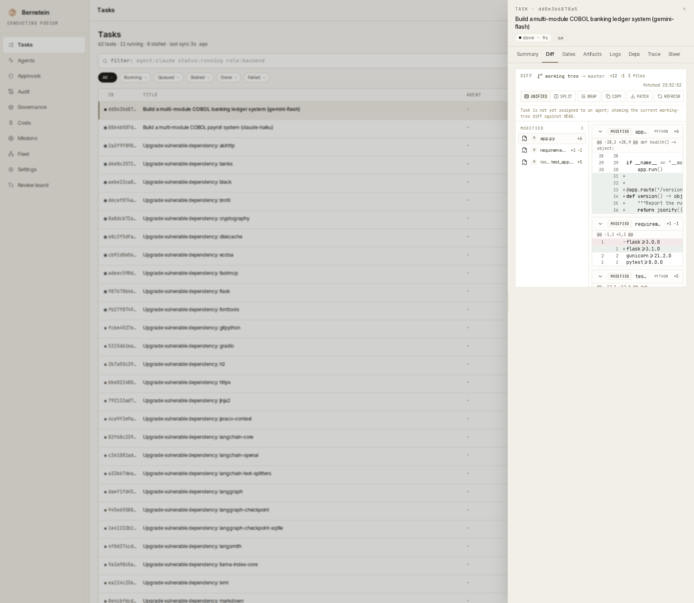
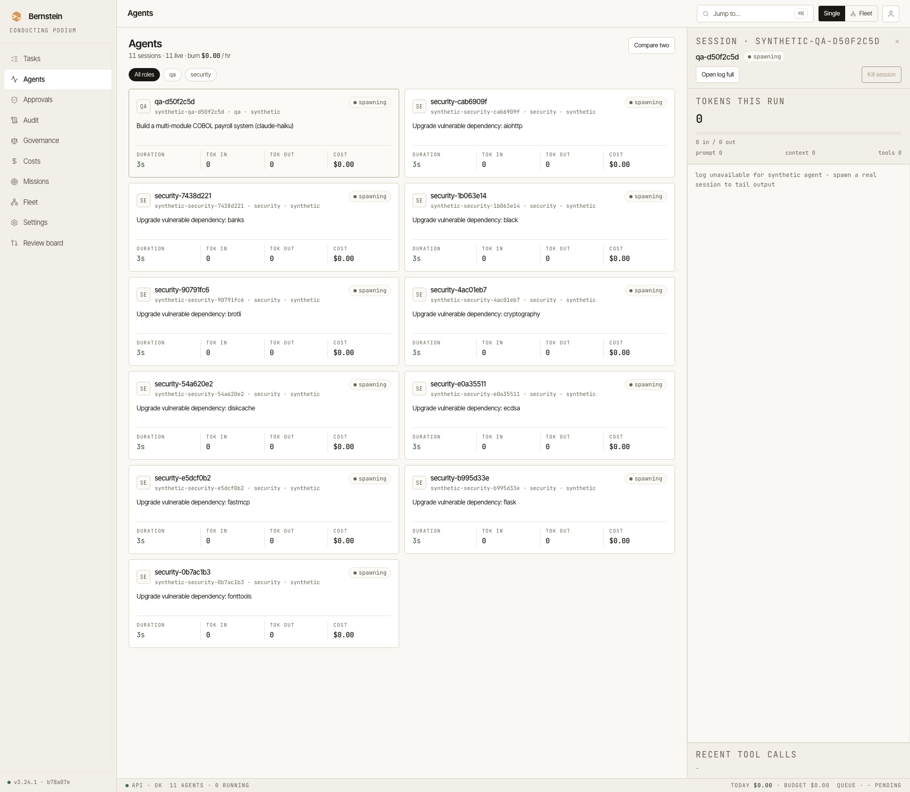
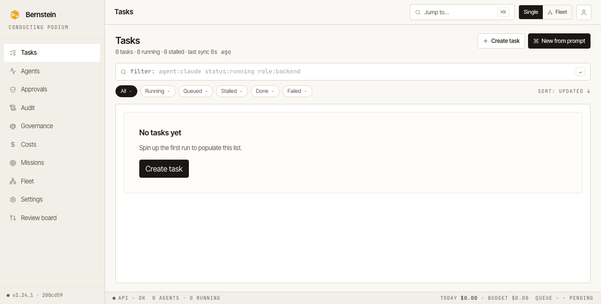
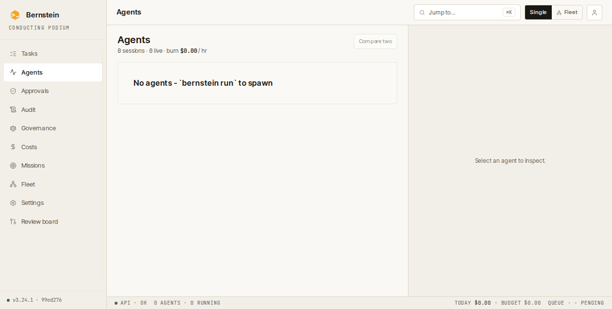
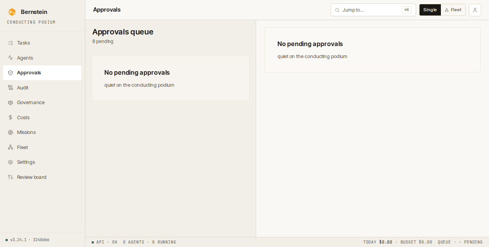
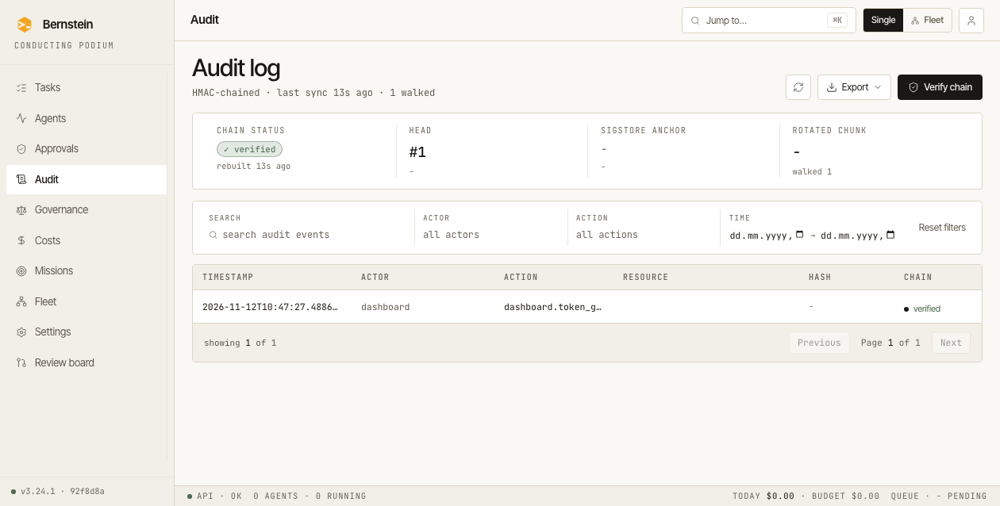
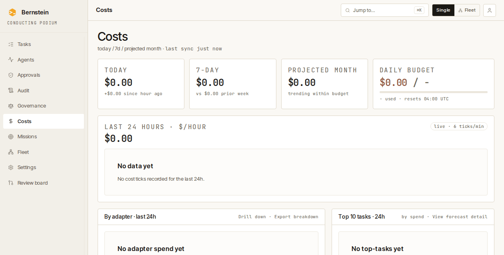
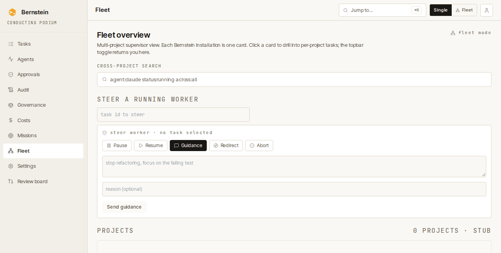
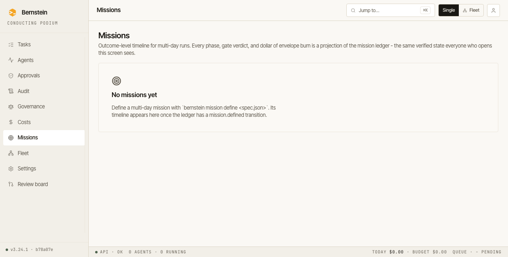
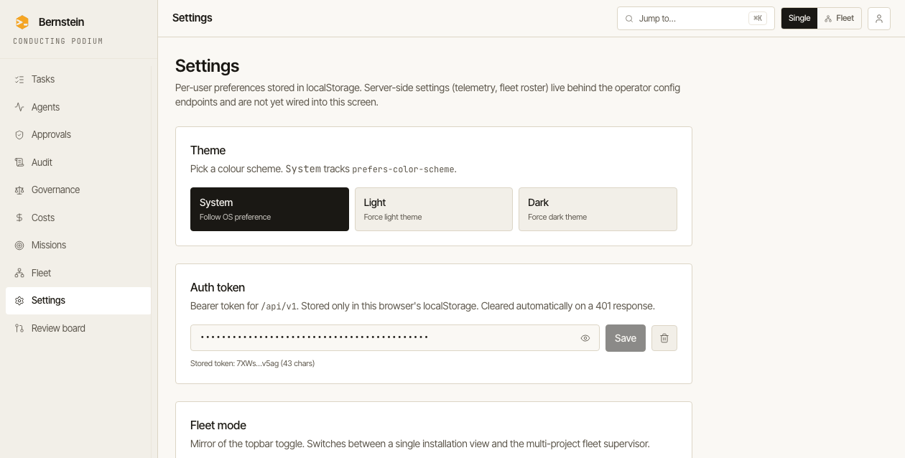

# Screens

Ten screen routes under `/ui`: nine dashboard screens plus the standalone Vocabulary developer reference. Routes: `web/src/App.tsx`. Screen components: `web/src/routes/`. Design tokens: `web/src/index.css`.

## Screenshots

## Tasks (`/ui/tasks`, default route)

- **Source:** `web/src/routes/Tasks.tsx`.
- **Layout:** 2-column grid `1fr 380px`. Left = filter chips + table. Right = selected-task drawer.
- **Data shown:** task ID, title + branch, agent, role pill, duration (color-coded if stalled), progress bar, cost.
- **Filter chips:** All · Running · Queued · Stalled · Done · Failed (with counts). Selecting **Done** sends `status=done` without a time-window parameter; it is not limited to the last 24 hours.
- **Operator search syntax:** mono input parses `agent:` / `status:` / `role:` token prefixes.
- **Drawer tabs:** Summary · Diff · Gates · Artifacts · Logs · Deps · Trace · Steer (Steer disabled with a reason on terminal tasks).
- **Artifacts:** task-scoped evidence posted by workers, including reports, tables, and preview links, with version history and a progress strip.
- Use "Create task" or "New from prompt" to enter a title, prompt and optional role. The form submits to `POST /api/v1/tasks` and opens the drawer for the created task.
- If the server's response cannot confirm creation, use **Check task** before submitting again.
- **Actions:** Cancel run · Re-run · Change model · Change role · Kill session.
- **Endpoints:** `GET /api/v1/tasks?status=&agent=&page=`, `POST /api/v1/tasks/{id}/{cancel,retry,prioritize,kill}`, `POST /api/v1/tasks/batch-ops`. SSE: `task_update`, `task_progress` over `/api/v1/events`.
- **Replaces TUI widget:** `task_list.py` + `task_detail_overlay.py` + `dependency_graph.py`.

## Agents (`/ui/agents`)

- **Source:** `web/src/routes/Agents.tsx`.
- **Layout:** 2-column grid `1fr 420px`. Left = 2-up card grid. Right = selected-agent drawer.
- **Card content:** mono 2-letter avatar, name, session id + role, status pill, current task, 4-metric strip (duration, tokens in, tokens out, cost).
- **Drawer:** stacked token meter (prompt / context / tools), live log with INFO / PLAN / PASS / WARN / WAIT / LIVE coloring, historical-vs-live separator rule.
- **Actions:** kill session, compare two agents (overlay with shared time axis).
- **Endpoints:** `GET /api/v1/agents`, `GET /api/v1/agents/comparison`, `POST /api/v1/agents/{session_id}/kill`. Live tail: `GET /api/v1/agents/{session_id}/stream` (SSE, ANSI-coloured).
- **Replaces TUI widget:** `agent_log.py` + `tokens.py` + `agent_duration.py` + `worker_badges.py`.

## Approvals (`/ui/approvals`)

- **Source:** `web/src/routes/Approvals.tsx`.
- **Layout:** 2-column grid `440px 1fr`. Left = queue. Right = selected approval (Why card · Diff · Action bar).
- The queue shows the tool, role, submitting session and wait time. Select a request to inspect its arguments and any supplied reasons.
- **Diff card:** sticky filename + +/− counts, mono 11.5 px, `+` lines green wash, `−` lines red wash, `max-height: 240px` with internal scroll.
- Use "Approve once" or "Deny" for the selected request. With its queue row focused, `A` approves and `D` denies. Up and Down move focus and selection in the queue. The server checks expiry. If the server reports the request has expired or changed, review the refreshed queue before deciding.
- The screen polls `GET /api/v1/approvals/queue` and sends the selected request's nonce with the `allow` or `reject` decision to `POST /api/v1/approvals/{approval_id}/resolve`.
- **Replaces TUI widget:** `approval_panel.py`.

## Governance (`/ui/governance`)

- **Source:** `web/src/routes/Governance.tsx`.
- Choose or drop a run receipt and select **Verify receipt**. The browser sends the original file to `POST /api/v1/governance/verify-receipt`.
- The screen shows the server's verdict and any errors. A successful check uses the key embedded in the receipt and displays the `integrity-only` tier.

## Audit (`/ui/audit`)

- **Source:** `web/src/routes/Audit.tsx`.
- **Layout:** single column, full-width.
- **Chain status banner:** 4-col card grid - chain status (verified), head (#ID + truncated hash), Sigstore anchor (rekor entry), rotated (age + chunk).
- **Filters bar:** search · actor · action · time, separated by hairline dividers, mono uppercase labels above each value, "Reset" ghost button on right.
- **Table:** Timestamp (ISO mono, color-coded operator vs system) · Actor · Action · Resource · Hash (mono truncated `…`) · Chain status icon (verified / rebuilt).
- **Verify chain modal:** triggered by primary "Verify chain". Shows last verified head, walked range, sigstore transparency anchor pointer, "Re-verify from chunk #" button.
- **Endpoints:** `GET /api/v1/audit?event_type=&search=&from=&to=&page=&page_size=` → `{items,total,page,page_size}`. Export: `POST /api/v1/audit/export?format=csv|jsonl`.
- **Replaces TUI widget:** none - audit chain inspection had no TUI surface.

## Costs (`/ui/costs`)

- **Source:** `web/src/routes/Costs.tsx`.
- **Layout:** single column, fluid grid.
- **Top KPI row:** 4 cards (`1fr 1fr 1fr 1.4fr`) - today · 7 d · projected month · daily-budget gauge with 5 px progress bar.
- **24 h sparkline:** recharts `<BarChart>`, 8 px bars / 2 px gap, last bar full accent. Dashed gridlines at 25 / 50 / 75 %. Mono x-axis labels (`−24h / −18h / −12h / −6h / now`).
- **By-adapter table:** Adapter (mono) · Calls · Tokens · Cost · Share (progress + %) · Δ 7 d (mono colored: green if reduced, warning if > +20 %).
- **Top 10 tasks:** index column (mono `01`–`10`) · title + agent meta · cost (mono bold right).
- **Endpoints:** `GET /api/v1/costs/current`, `/costs/history`, `/costs/by-tag`, `/costs/forecast`, `/costs/top-tasks?limit=10`. The Top Tasks request returns up to 10 highest-cost tasks with usage in the trailing 24 hours: the route sets `limit=10`, while the handler's default `hours=24` defines the report window. Live ticks: `GET /api/v1/events/cost`.
- **Replaces TUI widget:** `cost_sparkline.py`.

## Missions (`/ui/missions`)

- **Source:** `web/src/routes/Missions.tsx`.
- **What it shows:** the outcome-level timeline over a multi-day run - phase lanes with per-phase state, gate receipt, and envelope burn.
- **Provenance:** gate-task IDs link to their evidence bundles. Phase receipt hashes are displayed as text identifiers, not links. The `mission_status_hash` is also an identifier, shown so two operators can confirm they are looking at the same state; it is not an evidence link.
- **Unverified state:** when work-ledger chain verification fails (`ledger_verified === false`) the screen switches to an explicit unverified banner instead of best-effort rendering.
- **Endpoints:** `GET /api/v1/missions/*` (`src/bernstein/core/routes/missions.py`) - a deterministic projection folded from the mission's work-ledger chain; the server holds no mission-side state.
- **Replaces TUI widget:** none - mission timelines had no TUI surface.

## Fleet (`/ui/fleet`)

- **Source:** `web/src/routes/Fleet.tsx`.
- **What it shows:** a multi-project supervisor view with one card per installation, showing health, agent count, today's cost and pending approvals.
- **Actions:** open a project card to view its tasks, search across projects to see the match count, or enter a task ID to steer a running worker.
- **Empty state:** when the backend reports a stub with no projects, the screen shows "No fleet aggregator attached" and an **Open Tasks** action.

## Settings (`/ui/settings`)

- **Source:** `web/src/routes/Settings.tsx`.
- **Preferences:** choose System, Light or Dark theme, and toggle the browser's fleet-mode preference. Reload after changing fleet mode for the topbar control to reflect the new value.
- **Auth token:** save, show/hide or clear the bearer token used for `/api/v1` requests. The token is stored only in this browser's localStorage.
- **Scope:** these are per-user browser preferences; server-side telemetry settings and the fleet roster are not yet wired into this screen.

## Vocabulary (`/ui/vocabulary`)

- **Source:** `web/src/routes/Vocabulary.tsx`.
- **Standalone reference:** a developer reference rendered outside the dashboard shell, rather than an operational dashboard screen.
- **What it shows:** runtime CSS token names, resolved values and previews; Tailwind type-scale samples; and shared empty, error and loading states, status dots and pills.
