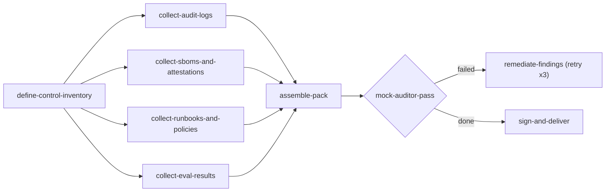

<div align="center">

<picture>
  <source media="(prefers-color-scheme: dark)" srcset="https://raw.githubusercontent.com/sipyourdrink-ltd/bernstein/main/docs/assets/readme-banner-dark.webp">
  
</picture>

<br>

> *"To achieve great things, two things are needed: a plan and not quite enough time."* - [attributed to](https://quoteinvestigator.com/2020/08/19/plan-time/) Leonard Bernstein

### طبقة الحوكمة مفتوحة المصدر لوكلاء الذكاء الاصطناعي
<!-- l10n: en="an open-source governance layer for AI agents" hash="sha256:f988e1e29b9e" -->

[](https://github.com/sipyourdrink-ltd/bernstein/actions/workflows/ci.yml)
[](https://pypi.org/project/bernstein/)
[](https://python.org)
[](https://github.com/sipyourdrink-ltd/bernstein/blob/main/LICENSE)
[](https://scorecard.dev/viewer/?uri=github.com/sipyourdrink-ltd/bernstein)


[website](https://bernstein.run) &middot; [docs](https://docs.bernstein.run/) &middot; [deepwiki](https://deepwiki.com/sipyourdrink-ltd/bernstein) &middot; [install](https://docs.bernstein.run/en/latest/getting-started/install/) &middot; [first run](https://github.com/sipyourdrink-ltd/bernstein/blob/main/docs/getting-started/first-run.md) &middot; [plugins](https://github.com/sipyourdrink-ltd/bernstein-addons) &middot; [org-kit](https://github.com/sipyourdrink-ltd/bernstein-addons/tree/main/plugins/org-kit) &middot; [glossary](https://github.com/sipyourdrink-ltd/bernstein/blob/main/docs/reference/GLOSSARY.md) &middot; [limitations](https://github.com/sipyourdrink-ltd/bernstein/blob/main/docs/reference/KNOWN_LIMITATIONS.md) &middot; [name policy](https://github.com/sipyourdrink-ltd/bernstein/blob/main/TRADEMARKS.md)

[简体中文](https://github.com/sipyourdrink-ltd/bernstein/blob/main/docs/i18n/README.zh-Hans.md) &middot; [繁體中文](https://github.com/sipyourdrink-ltd/bernstein/blob/main/docs/i18n/README.zh-TW.md) &middot; [日本語](https://github.com/sipyourdrink-ltd/bernstein/blob/main/docs/i18n/README.ja.md) &middot; [한국어](https://github.com/sipyourdrink-ltd/bernstein/blob/main/docs/i18n/README.ko.md) &middot; [हिन्दी](https://github.com/sipyourdrink-ltd/bernstein/blob/main/docs/i18n/README.hi.md) &middot; [বাংলা](https://github.com/sipyourdrink-ltd/bernstein/blob/main/docs/i18n/README.bn.md) &middot; [Русский](https://github.com/sipyourdrink-ltd/bernstein/blob/main/docs/i18n/README.ru.md) &middot; [Español](https://github.com/sipyourdrink-ltd/bernstein/blob/main/docs/i18n/README.es.md) &middot; [Português](https://github.com/sipyourdrink-ltd/bernstein/blob/main/docs/i18n/README.pt.md) &middot; [Deutsch](https://github.com/sipyourdrink-ltd/bernstein/blob/main/docs/i18n/README.de.md) &middot; [Français](https://github.com/sipyourdrink-ltd/bernstein/blob/main/docs/i18n/README.fr.md) &middot; [Italiano](https://github.com/sipyourdrink-ltd/bernstein/blob/main/docs/i18n/README.it.md) &middot; [Nederlands](https://github.com/sipyourdrink-ltd/bernstein/blob/main/docs/i18n/README.nl.md) &middot; [Polski](https://github.com/sipyourdrink-ltd/bernstein/blob/main/docs/i18n/README.pl.md) &middot; [Svenska](https://github.com/sipyourdrink-ltd/bernstein/blob/main/docs/i18n/README.sv.md) &middot; [Suomi](https://github.com/sipyourdrink-ltd/bernstein/blob/main/docs/i18n/README.fi.md) &middot; [Українська](https://github.com/sipyourdrink-ltd/bernstein/blob/main/docs/i18n/README.uk.md) &middot; [Türkçe](https://github.com/sipyourdrink-ltd/bernstein/blob/main/docs/i18n/README.tr.md) &middot; [العربية](https://github.com/sipyourdrink-ltd/bernstein/blob/main/docs/i18n/README.ar.md) &middot; [עברית](https://github.com/sipyourdrink-ltd/bernstein/blob/main/docs/i18n/README.he.md) &middot; [Bahasa Indonesia](https://github.com/sipyourdrink-ltd/bernstein/blob/main/docs/i18n/README.id.md) &middot; [Tiếng Việt](https://github.com/sipyourdrink-ltd/bernstein/blob/main/docs/i18n/README.vi.md) &middot; [ไทย](https://github.com/sipyourdrink-ltd/bernstein/blob/main/docs/i18n/README.th.md)

</div>

---

> **الحالة: تجريبي (beta).** تتم صيانته بواسطة شخص واحد، وهو قيد التطوير النشط. رقم الإصدار يحسب عدد الإصدارات وليس النضج — قد تغيّر الإصدارات الفرعية الواجهات. قم بتثبيت الإصدار لأي شيء تعتمد عليه؛ يتم إصلاح التراجعات سريعاً، [أبلغ عنها](https://github.com/sipyourdrink-ltd/bernstein/issues).

Bernstein هو طبقة الحوكمة مفتوحة المصدر لوكلاء الذكاء الاصطناعي. يعمل بمبدأ policy as code: أنت تكتب السياسة - من يمكنه فعل ماذا، وما الذي يحتاج موافقة، وما الذي يجب تسجيله - ويفرضها Bernstein وينتج السجل القابل للتحقق. مجدوِل حتمي - لا نموذج في حلقة التنسيق - يشغّل الوكلاء بالتوازي، ويفحص ما ينتجونه عبر بوابات، ويسجّل كل خطوة، بحيث يمكن التحقق من التشغيل لاحقًا، دون اتصال، من المخرجات وحدها. وكلاء البرمجة عبر سطر الأوامر يعملون فورًا (Claude Code, Codex, Gemini CLI)، والطبقة نفسها تحكم أي حمل وكيلي: يمكن أن يكون الناتج diff أو تقرير بحث أو مجموعة بيانات أو حزمة أدلة تدقيق. ملف تعريف تثبيت air-gap مضمّن. Apache-2.0.

### لمحة سريعة
<!-- l10n: en="at a glance" hash="sha256:3c95f239d9cf" -->

خمس خصائص تميّزه؛ وما بعدها تفاصيل.

- **لا وجود لنماذج LLM في حلقة التنسيق.** الجدولة مبنية بلغة Python الخالصة، مما يجعل التشغيل قابلاً لإعادة الإنتاج من البداية إلى النهاية. أعد تشغيل خطة الأمس وستحصل على نفس مخطط المهام تماماً.
- **أدلة مفاتيح الأجهزة.** تستخدم أدوات التحقق دون اتصال لحيازة PIV وموافقة FIDO2 بروتوكول الإيصالات نفسه، مع ثقة مثبتة ووقت صريح. لا ترفع حيازة الرمز مستويات ثقة TRACE. [أدلة مفاتيح الأجهزة](https://github.com/sipyourdrink-ltd/bernstein/blob/main/docs/operations/hardware-key-evidence.md).
- **قابل للتحقق بعد التنفيذ.** يسجل سجل إعادة التشغيل (replay journal) كل عملية تشغيل، ويسجل عمود النسب الفقري (lineage spine) الدائم كل خطوة ذات نسب؛ ويضيف سجل التدقيق الاختياري المتسلسل بـ HMAC (`BERNSTEIN_AUDIT=1`) إيصالات يمكنك التحقق منها بدون اتصال بالإنترنت. يظهر عدم الحتمية كعدم تطابق في التجزئة (hash mismatch) عند الخطوة المحددة تماماً، وليس كعدم استقرار عشوائي عند إعادة التشغيل. المعاملات غير البرمجية تعامل بالمثل: يمكن للمهمة تحديد عقد نواتج (تقرير، مجموعة بيانات، سجل إجراءات، نتيجة عمليات) وتكتمل بإيصال نسب موقّع بدلاً من commit في git.
- **معزول بالتصميم.** تحصل كل مهمة برمجية على git worktree خاص بها خلف بوابات الدمج؛ وتحصل مهام وضع النواتج على دليل عمل تحت `.sdd/workspaces/`. لا يتشارك الوكلاء أي مساحة عمل قابلة للتعديل افتراضياً؛ الحالة المشتركة الوحيدة هي قائمة المهام المتراكمة (backlog) التي يتم حجزها ذرياً. فرض قيود أشد على نظام الملفات اختياري عبر [خلفيات بيئة الحماية (sandbox)](https://github.com/sipyourdrink-ltd/bernstein/blob/main/docs/architecture/sandbox.md). عند تعطيل worktrees تعمل كل مهمة في مساحة العمل المشتركة.
- **شامل ومحلي.** 55 اسمًا قابلاً للاختيار لمحوّلات وكلاء CLI، بما فيها غلاف `--prompt` العام. الحالة قائمة على الملفات، بدون وسيط SaaS، وبدون مستوى بيانات من طرف ثالث.

القائمة الكاملة متوفرة في [صفحة الإمكانيات](https://github.com/sipyourdrink-ltd/bernstein/blob/main/docs/reference/capabilities.md)؛ و[مصفوفة الميزات](https://github.com/sipyourdrink-ltd/bernstein/blob/main/docs/reference/FEATURE_MATRIX.md) هي الفهرس الشامل.

يدعم خادم المهام بوابة يتحكم فيها المشغّل وتحتفظ بحالتها لتولي المهام الجديدة؛ راجع [الدليل](https://github.com/sipyourdrink-ltd/bernstein/blob/main/docs/operations/claim-admission.md).

تدعم سياسة المهايئات حسب الدور قائمة سماح افتراضية اختيارية للأدوار غير المدرجة؛ راجع [الدليل](https://github.com/sipyourdrink-ltd/bernstein/blob/main/docs/operations/role-adapter-policy.md).

### كيف يبدو التشغيل
<!-- l10n: en="what a run looks like" hash="sha256:8279488abf5a" -->

ملف YAML واحد يعلن التشغيل كاملًا: المراحل والأدوار والاعتماديات والشروط التي يعمل بموجبها كل عقدة أصلًا. المجدوِل ينفّذه كـ Python خالص - لا شيء في الملف موجّه نصي، ولا يقرر أي نموذج ما يحدث تاليًا. هذا المخطط ينتج حزمة أدلة تدقيق؛ الملف الكامل في [`.bernstein/workflows/audit-evidence-pack.yaml`](https://github.com/sipyourdrink-ltd/bernstein/blob/main/.bernstein/workflows/audit-evidence-pack.yaml).

```yaml
name: audit-evidence-pack
version: "1.0.0"

phases:
  - name: scope
    allowed_roles: [manager, architect]
  - name: collect
  - name: validate
    allowed_roles: [qa, security]
  - name: deliver
    allowed_roles: [security, manager]

nodes:
  define-control-inventory:
    phase: scope
    role: architect

  collect-audit-logs:
    phase: collect
    role: security
    depends_on: [define-control-inventory]

  # three more evidence streams collect in parallel:
  # collect-sboms-and-attestations, collect-runbooks-and-policies,
  # collect-eval-results

  assemble-pack:
    phase: validate
    role: docs
    depends_on:
      - collect-audit-logs
      - collect-sboms-and-attestations
      - collect-runbooks-and-policies
      - collect-eval-results

  mock-auditor-pass:
    phase: validate
    role: qa
    depends_on: [assemble-pack]

  remediate-findings:
    phase: collect
    role: docs
    depends_on:
      - source: mock-auditor-pass
        condition: "status == 'failed'"
    retry:
      max_attempts: 3
      until: "status == 'done'"

  sign-and-deliver:
    phase: deliver
    role: security
    depends_on:
      - source: mock-auditor-pass
        condition: "status == 'done'"
```



كل عقدة يأخذها وكيل تسمح المرحلة بدوره؛ وتبقى أسوار الأدوار وبوابات الموافقة قائمة مهما فعل الوكيل داخل المهمة. عقدة الكود تكتمل خلف بوابات الدمج في git worktree خاص بها. العقد أعلاه تكتمل بشكل مختلف: [عقد المخرجات](https://github.com/sipyourdrink-ltd/bernstein/blob/main/docs/operations/artifacts.md) يسمّي الناتج (تقرير، مجموعة بيانات، فحص، سجل إجراءات)، وتُغلق العقدة بإيصال lineage موقّع بدل commit. المجدوِل نفسه، السجل نفسه، التحقق دون اتصال نفسه - سواء حمل المخطط كودًا أو بحثًا أو تغيير عمليات أو مزيجًا من الثلاثة. مخططات جاهزة للبرمجيات والبحث والوثائق والمؤسسات ومسارات المساهمين في [`.bernstein/scenarios/`](https://github.com/sipyourdrink-ltd/bernstein/tree/main/.bernstein/scenarios).

تحافظ المحاولات المتكررة على `dispatch_tier`؛ ويمكن اختيار المستوى صراحةً عند إعادة فتح المهمة. راجع [عقد مستويات التنفيذ](https://github.com/sipyourdrink-ltd/bernstein/blob/main/docs/operations/task-tier-classification.md#retry-and-reopen).

### التثبيت في 30 ثانية
<!-- l10n: en="install in 30 seconds" hash="sha256:b24c255f61fb" -->

```bash
uv tool install bernstein    # or: pipx install bernstein
bernstein demo               # zero-key local run (4 mock tasks); prints project path & run_id
# Inside the printed demo directory, sign and verify your own receipt offline:
openssl genpkey -algorithm ED25519 -out demo.key && openssl pkey -in demo.key -pubout -out demo.pub
bernstein verify run <run_id> --signing-key-path demo.key
bernstein verify receipt .sdd/runs/<run_id>/run-receipt.json --public-key demo.pub
```

شغّل المهمة من فرع عمل. يدمج Bernstein التغييرات التي اجتازت الفحوص في الفرع الحالي، ويوقف التشغيل الذي يسمح بالدمج إذا كنت على الفرع الافتراضي. راجع التغييرات في فرع العمل قبل فتح طلب سحب.

تمت تغطية pipx وpip وbrew وdnf وnpm وDocker في [دليل التثبيت](https://docs.bernstein.run/en/latest/getting-started/install/)؛ وحزمة التثبيت المعزولة لها [دليل air-gap](https://docs.bernstein.run/en/latest/installation/air-gap/) الخاص بها.

[GHCR](https://ghcr.io/sipyourdrink-ltd/bernstein) &middot; [GitHub Codespaces](https://codespaces.new/sipyourdrink-ltd/bernstein?quickstart=1)


التسجيل أعلاه هو لتشغيل حقيقي ويأتي مع إثباته الخاص. التسجيل وإيصال التشغيل الموقع المشتق من سجل ذلك التشغيل والمفتاح العام الذي يثبته موجودة في [`docs/assets/demo-run/`](https://github.com/sipyourdrink-ltd/bernstein/tree/main/docs/assets/demo-run). تحقق من التشغيل الذي شاهدته للتو دون اتصال بالإنترنت:

```bash
bernstein verify receipt docs/assets/demo-run/run-receipt.json \
    --public-key docs/assets/demo-run/run-receipt.pub.pem
```

يمكن إعادة التحقق من الإيصال المحفوظ في أي وقت باستخدام الأمر أعلاه؛ وتفشل النسخة المعدّلة في الاختبار نفسه. `scripts/record_demo.sh` إنشاء التسجيل والإيصال والمفتاح من تشغيل حقيقي جديد؛ لا يوجد شيء اصطناعي داخل الطرفية.

يمكن متابعة التشغيل الجاري من أي من واجهتي المشغل. تقرأ كلتاهما نفس واجهة برمجة تطبيقات المهام، لذا لا تعد أي منهما انعكاساً متأخراً للأخرى. في `bernstein live`، يتم التمرير في العمودين الأيسر والأيمن بشكل مستقل كلوحات كاملة، مما يحافظ على إمكانية الوصول إلى العناصر في الطرفيات القصيرة.

|  |  |
|:---:|:---:|
| `BERNSTEIN_SERVER_URL="<task-server-url>"` `bernstein live` — لوحة معلومات الطرفية (عُقد العمال البعيدة) | `<task-server-url>/ui/` — لوحة متصفح خادم المهام الجاري عند تثبيت ملفات الواجهة. `bernstein gui serve` يبدأ خادماً مستقلاً في مساحة العمل الحالية. |

إذا كان الخادم يتطلب المصادقة، فاضبط `BERNSTEIN_AUTH_TOKEN` للطرفية وأدخل رمزاً مخولاً في شاشة تسجيل الدخول بالمتصفح. [GUI authentication](https://github.com/sipyourdrink-ltd/bernstein/blob/main/docs/gui/index.md#quickstart).

### إثبات عملية تشغيل
<!-- l10n: en="prove a run" hash="sha256:a880d9a9bef1" -->

الحتمية هنا شيء يمكنك التحقق منه بنفسك، وليست أمراً تسلم به دون دليل. قم بالتشغيل مرة واحدة مع تمكين التدقيق، ثم تحقق مما تم تسجيله:

```bash
BERNSTEIN_AUDIT=1 bernstein -g "fix the failing test in tests/test_foo.py"
bernstein replay list                 # run ids recorded on disk
bernstein replay latest --verify      # recompute the journal head, name the first divergent step
bernstein lineage verify <run_id>     # recompute the always-on lineage spine
bernstein audit verify                # HMAC chain + Merkle seal (written because audit was enabled)
bernstein audit diagnose <run_id> --signal gate --sign-key KEY
                                      # name the exact step a failure entered the run, as a signed receipt
bernstein verify run <run_id> --signing-key-path key.pem   # sign one portable run receipt
bernstein verify receipt .sdd/runs/<run_id>/run-receipt.json  # verify it offline: file only
```

يتم كتابة السجل في كل تشغيل؛ عمود النسب الفقري يعمل دائماً ويكتسب إدخالاً لكل خطوة ذات نسب، لذا يمكن أن ينتهي التشغيل القصير بعمود فقري صالح وفارغ. يمتلك `bernstein audit verify` سلسلة للتحقق منها فقط عند بدء التشغيل بـ `BERNSTEIN_AUDIT=1` أو إعداد مسبق للامتثال أو `bernstein run --audit`. ينتمي الخيار `--audit` إلى `bernstein run`؛ في صيغة `bernstein -g` أعلاه، قم بتعيين متغير البيئة.

يربط إيصال التشغيل رأس السجل، ورأس عمود النسب الفقري عندما يكتب التشغيل إدخالات، واختيارياً نطاق سلسلة التدقيق، تحت كيان واحد موقع بـ Ed25519 مع تضمين المفتاح العام. يمكن للمراجع الذي يمتلك هذا الملف والمفتاح العام للمشغل التأكد من عدم تعديل الإجراءات والسلاسل المضمنة: لا حاجة لمفتاح HMAC، ولا حاجة لمجلد `.sdd/` نشط، ورمز الخروج `2` يحدد أول خطوة متباينة عند التلاعب. يحدد ذلك الإيصال حالة السجل المضمنة؛ وإثبات أن تلك الحالة هي السجل المكتمل بالكامل يتطلب بالإضافة إلى ذلك ختماً مستقلاً للرأس/العدد. مع الملف بمفرده ودون تحديد `--public-key`، يكون الفحص للنزاهة الداخلية فقط. التفاصيل في [إعادة التشغيل الحتمي](https://github.com/sipyourdrink-ltd/bernstein/blob/main/docs/operations/deterministic-replay.md#signed-run-receipt-one-file-offline-verification).

في واجهة الويب، افتح **Governance** واستخدم **Verify a receipt** للتحقق من إيصال التشغيل عبر الخادم. يعرض المتصفح نتيجة التحقق من السلامة فقط ومصدر المفتاح. راجع [Governance operator guide](https://github.com/sipyourdrink-ltd/bernstein/blob/main/docs/operations/governance.md#verifying-a-dropped-receipt).

تنطبق نفس إمكانية التحقق على أرقام التقييم. يقوم `bernstein bench run <suite> --reliability k` (يكتب أيضاً `bernstein eval --reliability k`) بتشغيل كل مهمة `k` من المرات بتنسيق ثابت، ثم يبلغ عن حد أدنى `pass^k` (يجب أن تنجح جميع محاولات `k`) إلى جانب الحد الأقصى `pass@1`. يتم ختم هذه النتيجة في إيصال موقّع يعيد `bernstein bench reliability-verify` حسابه دون اتصال، وبالتالي فإن أي حد أدنى مفتعل يفشل في التحقق. التفاصيل: [الحد الأدنى للموثوقية pass^k](https://github.com/sipyourdrink-ltd/bernstein/blob/main/docs/eval/reliability.md).

استخدم `bernstein govern audit --format json` أو `--format sarif` للحصول على نتائج فحص قابلة للقراءة آليًا، و`--strict --quiet` لتحديد اجتياز الفحص في CI. راجع [govern audit](https://github.com/sipyourdrink-ltd/bernstein/blob/main/docs/operations/governance.md#govern-audit-machine-readable-output-and-ci-gates). تتضمن حزمة أدلة `cosai` فئات تهديدات MCP من النسخة المثبتة من الورقة المؤرخة في 2026-01-08، وتوضح الفجوات المتبقية في التغطية.

`bernstein delegation verify RUN` يقارن سلسلة الإيصالات بالقيمة النهائية لرأس السلسلة وعدد خطوات التفويض المختومين في بيان التشغيل باستخدام HMAC بمفتاح التدقيق، فيكشف حذف ذيل السلسلة والاستبدال والإضافة بعد الإغلاق، بما في ذلك إعادة كتابة الإعلان دون امتلاك المفتاح. إزالة الإعلان تترك التشغيل غير مكتمل (رمز الخروج `3`)، ولا يُعدّ صالحًا أبدًا. لا يكشف هذا إعادة تشغيل لقطة أصلية أقدم، ولا يحمي من كاتب يمتلك مفتاح التدقيق. راجع [سير عمل التحقق من التفويض](https://github.com/sipyourdrink-ltd/bernstein/blob/main/docs/operations/delegation-verify.md).

يقيس `self-conformance-bench-v1` خمسة اختبارات لكشف العبث بحزمة نتائج القياس، باستخدام عينات ضابطة موقّعة وإعادة تشغيل دون اتصال؛ راجع [الدليل](https://github.com/sipyourdrink-ltd/bernstein/blob/main/docs/operations/bench-envelope-conformance.md).

### كيف يعمل
<!-- l10n: en="how it works" hash="sha256:b734c935f998" -->

يمر كل هدف عبر أربع مراحل:

1. **التفكيك (Decompose)**. يقوم المدير بتقسيم هدفك إلى مهام ذات أدوار وملفات مخصصة وإشارات اكتمال. استدعاء واحد لـ LLM، وبعد ذلك بلغة Python الخالصة فقط.
2. **التشغيل (Spawn)**. يبدأ الوكلاء في [git worktrees](https://git-scm.com/docs/git-worktree) معزولة، واحد لكل مهمة برمجية؛ بينما تحصل مهام وضع النواتج على دليل عمل عادي. يظل الفرع الرئيسي نظيفاً.
3. **التحقق (Verify)**. يتحقق المدقق (janitor) من إشارات ملموسة: نجاح الاختبارات، وجود الملفات، نظافة التنسيق (lint)، وصحة الأنواع.
4. **الدمج (Merge)**. يتم دمج العمل المتحقق منه في main. تتم إعادة محاولة المهام الفاشلة أو توجيهها إلى نموذج مختلف.

لماذا تم بناء المجدول بلغة Python الخالصة، وما المقايضات المترتبة على ذلك: [لماذا الحتمية](https://github.com/sipyourdrink-ltd/bernstein/blob/main/docs/architecture/WHY_DETERMINISTIC.md).

يُرجع فحص `can_spawn()` في متتبّع التكاليف القيمة `False` عندما يبلغ الإنفاق التراكمي بعد التصحيح عتبة الإيقاف المحددة للميزانية أو يتجاوزها، حتى لو لم يُبلَّغ عن أي رموز جديدة. بعد إعادة التشغيل، لا تكفي أعداد الرموز المحفوظة وحدها لاستعادة التكلفة التراكمية الدقيقة التي سبق الإبلاغ عنها لمجموعة محددة من الوكيل والمهمة والنموذج.

### أوامر الاستخدام اليومي
<!-- l10n: en="everyday commands" hash="sha256:db85124a3e75" -->

```bash
cd your-project
bernstein init                    # creates .sdd/ workspace, bernstein.yaml + templates/
bernstein -g "Add rate limiting"  # agents spawn, work in parallel, verify, exit
bernstein live                    # watch progress in the TUI dashboard
bernstein run plan.yaml           # multi-stage plan: skip LLM planning, execute directly
bernstein stop                    # graceful shutdown with drain
```

إذا انتهت مهمة في تشغيل SSH منفصل برمز خروج غير صفري، تفشل المهمة ويفشل التشغيل. يسجّل إيصال المهمة رمز الخروج وتظل المهام اللاحقة قيد الانتظار.

واجهة المشغل الكاملة (أتمتة طلبات السحب PR، الجداول الزمنية، جسور المحادثة، برنامج الإصلاح التلقائي autofix) مفصلة في [أوامر المشغل](https://github.com/sipyourdrink-ltd/bernstein/blob/main/docs/operations/commands.md).

يقوم `bernstein workflow` بتشغيل مخططات DAG تعريفية بصيغة YAML من عقد الوكيل / الأمر / الحلقة - مع دعم الاستئناف للتشغيلات المتوقفة:

```bash
bernstein workflow run idea-to-pr -g "Add JWT auth"   # prints run_id
bernstein workflow resume <run_id> -g "Add JWT auth" # picks up at the first non-completed node
```

يتم تسجيل نقطة تحقق لحالة التشغيل في `.sdd/runs/<run_id>/` عند كل عقدة. يتحقق الاستئناف من تجزئة البيان عند بدء التشغيل، لذا يتم رفض أي تغيير في المواصفة بدلاً من تنفيذ بيان مختلف بصمت. يمكن لعقد التنظيف تعيين `always_run: true` للتنفيذ بعد فشل أمر أو فشل إرسال دون تحويل تشغيل مُجهَض إلى نجاح (يتم تتبّع بوابة اكتمال الوكيل في [#6639](https://github.com/sipyourdrink-ltd/bernstein/issues/6639)). انظر [بيانات سير العمل](https://github.com/sipyourdrink-ltd/bernstein/blob/main/docs/operations/workflows.md). مرّر قيمة `-g` نفسها مجددًا عند الاستئناف لاستبدال `{goal}` في مطالبات العقد غير المكتملة.

`bernstein compliance controls` تعرض مجموعات الاختبار لكل ضابط وآخر قياس مكتمل إن وُجد. [تغطية الاختبارات](https://github.com/sipyourdrink-ltd/bernstein/blob/main/docs/compliance/regulator-mapped-packs.md#cli-inspection)

بوابات سلامة المستودع: يفشل `bernstein readme-l10n verify` أي طلب سحب تباعدت ملفات README المترجمة فيه عن الأصل الإنجليزي (مع تسمية القسم القديم)، بينما يعيد `bernstein readme-l10n sync` ربطها بعد التعديل الإنجليزي. انظر [readme-l10n](https://github.com/sipyourdrink-ltd/bernstein/blob/main/docs/playbooks/readme-l10n.md).

### الوكلاء المدعومون
<!-- l10n: en="supported agents" hash="sha256:d674cd57d15a" -->

Claude Code وCodex CLI وGemini CLI وGitHub Copilot CLI وCursor وAider وGoose وMuse Code وOpenAI Agents SDK وAmp وCody وContinue وDevin Terminal وJunie وKilo وKiro وAWS Q Developer وOllama وOpenCode وOpenHands وOpen Interpreter وgptme وPlandex وAIChat وLetta Code وQwen وغيرهم. يحتوي [فهرس المحولات](https://github.com/sipyourdrink-ltd/bernstein/blob/main/docs/adapters/index.md) على أوامر تثبيت لـ 30 منهم. تسرد `bernstein integrations list` جميع عمليات التكامل الـ 57 المتصلة من `src/bernstein/adapters/registry.py`، المصدر الوحيد للحقيقة. 55 منها عبارة عن محولات وكلاء قابلة للاختيار؛ والسطران الآخران هما نموذج الاختبار `mock` وملف تعريف نقطة النهاية `self-hosted-endpoints`. أي أداة أخرى تدعم خيار `--prompt` تعمل من خلال الغلاف العام. `bernstein adapters list` → `Selectable CLI agent adapter names: 55` (`generic`; `agy` = `antigravity`).

امزج بين الوكلاء في نفس التشغيل: نماذج محلية منخفضة التكلفة للأكواد النمطية، ونماذج سحابية أقوى للأمور المعمارية. يعرض `bernstein integrations list --installed` ما هو متاح على جهازك.

### ما وراء الصفحة الرئيسية
<!-- l10n: en="beyond the front page" hash="sha256:63d7eefff374" -->

كل التفاصيل المعمقة متوفرة على [موقع التوثيق](https://docs.bernstein.run/):

| الصفحة | ما تغطيه |
|---|---|
| [capabilities](https://github.com/sipyourdrink-ltd/bernstein/blob/main/docs/reference/capabilities.md) | قائمة الإمكانيات الكاملة: وضع خادم MCP، بطاقات الوكلاء الموقعة، خلفيات الحماية، مصارف النواتج، التوافق التنظيمي |
| [Agent Manifest export](https://github.com/sipyourdrink-ltd/bernstein/blob/main/docs/operations/agent-manifest.md) | `bernstein manifest export-agent` · `composition-only` · `agent-manifest==0.12.0` |
| [`bernstein_create_task`](https://github.com/sipyourdrink-ltd/bernstein/blob/main/docs/operations/bare-tasks.md) | `POST /api/v1/tasks` → `bernstein_claim` → `bernstein_complete` |
| [who this is for](https://github.com/sipyourdrink-ltd/bernstein/blob/main/docs/use-cases.md) | أين تكمن القيمة ومتى يكون Bernstein أداة غير مناسبة |
| [workflows](https://github.com/sipyourdrink-ltd/bernstein/blob/main/docs/operations/workflow-manifests.md) | مخططات DAG تعريفية بصيغة YAML من عقد الوكيل / الأمر / الحلقة |
| [web UI](https://github.com/sipyourdrink-ltd/bernstein/blob/main/docs/gui/index.md) | لوحة تحكم في المتصفح تعتمد على نفس API المستخدم في TUI (إنشاء المهام ومراجعتها) |
| [صحة العُقد العاملة](https://github.com/sipyourdrink-ltd/bernstein/blob/main/docs/operations/cluster-mode.md#worker-health-telemetry) (`bernstein worker`) | تتوقف العقدة عن طلب مهام جديدة إذا تجاوز استخدام الذاكرة أو زمن استجابة الشبكة الحد المسموح أو انخفضت مساحة القرص عن الحد الأدنى. |
| [datasources](https://github.com/sipyourdrink-ltd/bernstein/blob/main/docs/operations/datasources.md) | إيصالات استعلام للقراءة فقط، ومشغل استعلام يربط كل نتيجة بلقطة المخطط المقابلة |
| [agent catalogs](https://github.com/sipyourdrink-ltd/bernstein/blob/main/docs/operations/agent-catalogs.md) | توجيه الأدوار إلى تعريفات وكلاء خارج القوالب المضمنة — دليل YAML/SKILL.md عام أو هيكل إضافات Claude Code |
| [security](https://github.com/sipyourdrink-ltd/bernstein/blob/main/docs/operations/security.md) | بطاقة التقييم الأمني، واختبار العشوائية (fuzzing)، والتحصين |
| [architecture](https://github.com/sipyourdrink-ltd/bernstein/blob/main/docs/architecture/ARCHITECTURE.md) | كيف يعمل النظام من الداخل |

### لماذا هذا الاسم؟
<!-- l10n: en="why the name?" hash="sha256:e9839a1c718d" -->

سمي Bernstein تيمناً بـ Leonard Bernstein، قائد الأوركسترا والملحن الأمريكي. ينسّق مُنسِّق المشروع فريقاً من وكلاء الذكاء الاصطناعي بنفس الطريقة التي قاد بها برنشتاين أوركسترا نيويورك الفيلهارمونية: كل عازف يدخل في وقته المحدد، النوتة الموسيقية حتمية، وقائد الأوركسترا مسؤول عن النتيجة. تصف استعارة قائد الأوركسترا قدرة Bernstein على تنسيق مهام الوكلاء التي تنتج شيفرة أو تقارير بحثية أو مجموعات بيانات.

بدأ Bernstein كطبقة حتمية لمنع الدمج غير الحتمي والحالات غير الموثقة عند تشغيل وكلاء البرمجة بالتوازي. Apache-2.0. الإصدارات والوثائق: [bernstein.run](https://bernstein.run).

### المساهمة، الدعم، الترخيص
<!-- l10n: en="contributing, support, license" hash="sha256:cb937af4a6cc" -->

نرحب بطلبات السحب (PRs)؛ يحتوي [CONTRIBUTING.md](https://github.com/sipyourdrink-ltd/bernstein/blob/main/CONTRIBUTING.md) على إرشادات الإعداد ونمط الكود. يتم تقديم بلاغات الأمان عبر [SECURITY.md](https://github.com/sipyourdrink-ltd/bernstein/blob/main/SECURITY.md). التواصل: [forte@bernstein.run](mailto:forte@bernstein.run).

البيانات الوصفية للاقتباس موجودة في [CITATION.cff](https://github.com/sipyourdrink-ltd/bernstein/blob/main/CITATION.cff). الترخيص: [Apache-2.0](https://github.com/sipyourdrink-ltd/bernstein/blob/main/LICENSE)؛ واسم المشروع محمي بشكل منفصل في [TRADEMARKS.md](https://github.com/sipyourdrink-ltd/bernstein/blob/main/TRADEMARKS.md).

---

[Alex Chernysh](https://alexchernysh.com) &middot; [GitHub](https://github.com/chernistry) &middot; [X](https://x.com/alex_chernysh) &middot; [bernstein.run](https://bernstein.run) &middot; [task notifications](https://github.com/sipyourdrink-ltd/bernstein/blob/main/docs/operations/notifications.md#role-task-subscriptions-sse)

<!-- mcp-name: io.github.sipyourdrink-ltd/bernstein -->
