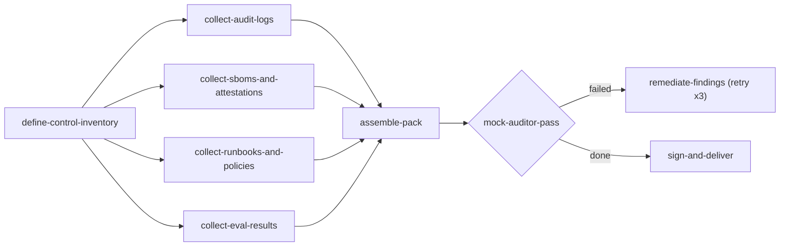

<div align="center">

<picture>
  <source media="(prefers-color-scheme: dark)" srcset="https://raw.githubusercontent.com/sipyourdrink-ltd/bernstein/main/docs/assets/readme-banner-dark.webp">
  
</picture>

<br>

> *"To achieve great things, two things are needed: a plan and not quite enough time."* - [attributed to](https://quoteinvestigator.com/2020/08/19/plan-time/) Leonard Bernstein

### die Open-Source-Governance-Schicht für KI-Agenten
<!-- l10n: en="an open-source governance layer for AI agents" hash="sha256:f988e1e29b9e" -->

[](https://github.com/sipyourdrink-ltd/bernstein/actions/workflows/ci.yml)
[](https://pypi.org/project/bernstein/)
[](https://python.org)
[](https://github.com/sipyourdrink-ltd/bernstein/blob/main/LICENSE)
[](https://scorecard.dev/viewer/?uri=github.com/sipyourdrink-ltd/bernstein)


[website](https://bernstein.run) &middot; [docs](https://docs.bernstein.run/) &middot; [deepwiki](https://deepwiki.com/sipyourdrink-ltd/bernstein) &middot; [install](https://docs.bernstein.run/en/latest/getting-started/install/) &middot; [first run](https://github.com/sipyourdrink-ltd/bernstein/blob/main/docs/getting-started/first-run.md) &middot; [plugins](https://github.com/sipyourdrink-ltd/bernstein-addons) &middot; [org-kit](https://github.com/sipyourdrink-ltd/bernstein-addons/tree/main/plugins/org-kit) &middot; [glossary](https://github.com/sipyourdrink-ltd/bernstein/blob/main/docs/reference/GLOSSARY.md) &middot; [limitations](https://github.com/sipyourdrink-ltd/bernstein/blob/main/docs/reference/KNOWN_LIMITATIONS.md) &middot; [name policy](https://github.com/sipyourdrink-ltd/bernstein/blob/main/TRADEMARKS.md)

[简体中文](https://github.com/sipyourdrink-ltd/bernstein/blob/main/docs/i18n/README.zh-Hans.md) &middot; [繁體中文](https://github.com/sipyourdrink-ltd/bernstein/blob/main/docs/i18n/README.zh-TW.md) &middot; [日本語](https://github.com/sipyourdrink-ltd/bernstein/blob/main/docs/i18n/README.ja.md) &middot; [한국어](https://github.com/sipyourdrink-ltd/bernstein/blob/main/docs/i18n/README.ko.md) &middot; [हिन्दी](https://github.com/sipyourdrink-ltd/bernstein/blob/main/docs/i18n/README.hi.md) &middot; [বাংলা](https://github.com/sipyourdrink-ltd/bernstein/blob/main/docs/i18n/README.bn.md) &middot; [Русский](https://github.com/sipyourdrink-ltd/bernstein/blob/main/docs/i18n/README.ru.md) &middot; [Español](https://github.com/sipyourdrink-ltd/bernstein/blob/main/docs/i18n/README.es.md) &middot; [Português](https://github.com/sipyourdrink-ltd/bernstein/blob/main/docs/i18n/README.pt.md) &middot; [Deutsch](https://github.com/sipyourdrink-ltd/bernstein/blob/main/docs/i18n/README.de.md) &middot; [Français](https://github.com/sipyourdrink-ltd/bernstein/blob/main/docs/i18n/README.fr.md) &middot; [Italiano](https://github.com/sipyourdrink-ltd/bernstein/blob/main/docs/i18n/README.it.md) &middot; [Nederlands](https://github.com/sipyourdrink-ltd/bernstein/blob/main/docs/i18n/README.nl.md) &middot; [Polski](https://github.com/sipyourdrink-ltd/bernstein/blob/main/docs/i18n/README.pl.md) &middot; [Svenska](https://github.com/sipyourdrink-ltd/bernstein/blob/main/docs/i18n/README.sv.md) &middot; [Suomi](https://github.com/sipyourdrink-ltd/bernstein/blob/main/docs/i18n/README.fi.md) &middot; [Українська](https://github.com/sipyourdrink-ltd/bernstein/blob/main/docs/i18n/README.uk.md) &middot; [Türkçe](https://github.com/sipyourdrink-ltd/bernstein/blob/main/docs/i18n/README.tr.md) &middot; [العربية](https://github.com/sipyourdrink-ltd/bernstein/blob/main/docs/i18n/README.ar.md) &middot; [עברית](https://github.com/sipyourdrink-ltd/bernstein/blob/main/docs/i18n/README.he.md) &middot; [Bahasa Indonesia](https://github.com/sipyourdrink-ltd/bernstein/blob/main/docs/i18n/README.id.md) &middot; [Tiếng Việt](https://github.com/sipyourdrink-ltd/bernstein/blob/main/docs/i18n/README.vi.md) &middot; [ไทย](https://github.com/sipyourdrink-ltd/bernstein/blob/main/docs/i18n/README.th.md)

</div>

---

> **Status: Beta.** Von einer Einzelperson gepflegt, in aktiver Entwicklung. Die Versionsnummer zählt Releases, nicht Reife – Minor-Versionen können Schnittstellen ändern. Versionen für produktive Abhängigkeiten fixieren; Regressionen werden zügig behoben, [Fehler bitte melden](https://github.com/sipyourdrink-ltd/bernstein/issues).

Bernstein ist die Open-Source-Governance-Schicht für KI-Agenten. Es läuft auf policy as code: Du schreibst die Policy - wer was tun darf, was eine Freigabe braucht, was protokolliert werden muss -, und Bernstein setzt sie durch und erzeugt den verifizierbaren Nachweis. Ein deterministischer Scheduler - kein Modell in der Koordinationsschleife - führt Agenten parallel aus, prüft ihre Ergebnisse an Gates und protokolliert jeden Schritt, sodass sich ein Lauf im Nachhinein verifizieren lässt: offline, allein aus den Artefakten. CLI-Coding-Agenten laufen ab Werk (Claude Code, Codex, Gemini CLI), und dieselbe Schicht governt jede Agenten-Workload: das Ergebnis kann ein Diff sein, ein Forschungsbericht, ein Datensatz oder ein Audit-Evidence-Pack. Air-Gap-Installationsprofil inklusive. Apache-2.0.

### auf einen Blick
<!-- l10n: en="at a glance" hash="sha256:3c95f239d9cf" -->

Fünf Dinge zeichnen es aus; alles Weitere sind Details.

- **Kein LLM in der Koordinationsschleife.** Das Scheduling ist reines Python, wodurch ein Durchlauf durchgängig reproduzierbar ist. Gestern geplanten Ablauf erneut abspielen und exakt denselben Task-Graphen erhalten.
- **Nachweise für Hardwareschlüssel.** Offline-Prüfer für PIV-Verwahrung und FIDO2-Freigaben nutzen dasselbe Belegprotokoll mit festgelegten Vertrauensankern und expliziter Zeit. Token-Verwahrung erhöht keine TRACE-Vertrauensstufen. [Nachweise für Hardwareschlüssel](https://github.com/sipyourdrink-ltd/bernstein/blob/main/docs/operations/hardware-key-evidence.md).
- **Nachträglich überprüfbar.** Das Replay-Journal zeichnet jeden Lauf auf, und das durchgehend aktive Lineage-Rückgrat registriert jeden schrittweisen Herkunftsnachweis; das optionale HMAC-verkettete Audit-Log (`BERNSTEIN_AUDIT=1`) ergänzt Belege (Receipts), die offline verifiziert werden können. Nichtdeterminismus zeigt sich als Hash-Abweichung am exakten Einzelschritt statt als sporadischer Testfehler. Nicht-Code-Ergebnisse erhalten dieselbe Behandlung: Ein Task kann einen Artefakt-Vertrag (Report, Datensatz, Aktionsprotokoll, Ops-Ergebnis) definieren und schließt mit einem signierten Lineage-Receipt statt einem Git-Commit ab.
- **Von Grund auf isoliert.** Jeder Programmier-Task erhält ein eigenes Git-Worktree hinter Merge-Gates; Artefakt-Modus-Tasks erhalten ein Arbeitsverzeichnis unter `.sdd/workspaces/`. Agenten teilen standardmäßig keinen veränderlichen Workspace; der einzige gemeinsame Zustand ist das Task-Backlog, das atomar beansprucht wird. Strengere Dateisystembeschränkungen sind optional über [Sandbox-Backends](https://github.com/sipyourdrink-ltd/bernstein/blob/main/docs/architecture/sandbox.md) verfügbar. Werden Worktrees deaktiviert, läuft jeder Task im geteilten Checkout.
- **Umfassend und lokal.** 55 auswählbare CLI-Agenten-Adapternamen, einschließlich des generischen `--prompt`-Wrappers. dateibasierter Zustand, kein SaaS-Umweg, keine externe Datenebene.

Die vollständige Liste befindet sich auf der [Funktionsübersicht](https://github.com/sipyourdrink-ltd/bernstein/blob/main/docs/reference/capabilities.md); die [Feature-Matrix](https://github.com/sipyourdrink-ltd/bernstein/blob/main/docs/reference/FEATURE_MATRIX.md) bietet den vollständigen Index.

Der Taskserver unterstützt eine dauerhafte, vom Betreiber gesteuerte Sperre für neue Aufgabenübernahmen; siehe [Anleitung](https://github.com/sipyourdrink-ltd/bernstein/blob/main/docs/operations/claim-admission.md).

Die Adapterrichtlinie für Rollen unterstützt eine optionale Standardliste erlaubter Adapter für nicht einzeln aufgeführte Rollen; siehe [Anleitung](https://github.com/sipyourdrink-ltd/bernstein/blob/main/docs/operations/role-adapter-policy.md).

### wie ein Lauf aussieht
<!-- l10n: en="what a run looks like" hash="sha256:8279488abf5a" -->

Eine einzige YAML-Datei deklariert den Lauf: Phasen, Rollen, Abhängigkeiten und die Bedingungen, unter denen ein Knoten überhaupt läuft. Der Scheduler führt sie als reines Python aus - nichts in der Datei ist ein Prompt, und kein Modell entscheidet, was als Nächstes passiert. Dieser Graph erzeugt ein Audit-Evidence-Pack; die vollständige Datei liegt unter [`.bernstein/workflows/audit-evidence-pack.yaml`](https://github.com/sipyourdrink-ltd/bernstein/blob/main/.bernstein/workflows/audit-evidence-pack.yaml).

```yaml
name: audit-evidence-pack
version: "1.0.0"

phases:
  - name: scope
    allowed_roles: [manager, architect]
  - name: collect
  - name: validate
    allowed_roles: [qa, security]
  - name: deliver
    allowed_roles: [security, manager]

nodes:
  define-control-inventory:
    phase: scope
    role: architect

  collect-audit-logs:
    phase: collect
    role: security
    depends_on: [define-control-inventory]

  # three more evidence streams collect in parallel:
  # collect-sboms-and-attestations, collect-runbooks-and-policies,
  # collect-eval-results

  assemble-pack:
    phase: validate
    role: docs
    depends_on:
      - collect-audit-logs
      - collect-sboms-and-attestations
      - collect-runbooks-and-policies
      - collect-eval-results

  mock-auditor-pass:
    phase: validate
    role: qa
    depends_on: [assemble-pack]

  remediate-findings:
    phase: collect
    role: docs
    depends_on:
      - source: mock-auditor-pass
        condition: "status == 'failed'"
    retry:
      max_attempts: 3
      until: "status == 'done'"

  sign-and-deliver:
    phase: deliver
    role: security
    depends_on:
      - source: mock-auditor-pass
        condition: "status == 'done'"
```



Jeden Knoten übernimmt ein Agent, dessen Rolle die Phase zulässt; Rollenzäune und Freigabe-Gates halten, egal was der Agent innerhalb der Aufgabe tut. Ein Code-Knoten endet hinter Merge-Gates im eigenen git worktree. Die Knoten oben enden anders: ein [Artefaktvertrag](https://github.com/sipyourdrink-ltd/bernstein/blob/main/docs/operations/artifacts.md) benennt das Ergebnis (Bericht, Datensatz, Scan, Aktionslog), und der Knoten schließt mit einer signierten Lineage-Quittung statt eines Commits. Derselbe Scheduler, dasselbe Journal, dieselbe Offline-Verifikation - ob der Graph Code, Forschung, eine Ops-Änderung oder eine Mischung aus allen dreien liefert. Fertige Graphen für Software, Forschung, Doku, Enterprise und Contributor-Workflows liegen in [`.bernstein/scenarios/`](https://github.com/sipyourdrink-ltd/bernstein/tree/main/.bernstein/scenarios).

Wiederholungsversuche behalten `dispatch_tier` bei; beim erneuten Öffnen einer Aufgabe kann die Stufe ausdrücklich gewählt werden. Siehe [Vertrag für Dispatch-Stufen](https://github.com/sipyourdrink-ltd/bernstein/blob/main/docs/operations/task-tier-classification.md#retry-and-reopen).

### in 30 Sekunden installieren
<!-- l10n: en="install in 30 seconds" hash="sha256:b24c255f61fb" -->

```bash
uv tool install bernstein    # or: pipx install bernstein
bernstein demo               # zero-key local run (4 mock tasks); prints project path & run_id
# Inside the printed demo directory, sign and verify your own receipt offline:
openssl genpkey -algorithm ED25519 -out demo.key && openssl pkey -in demo.key -pubout -out demo.pub
bernstein verify run <run_id> --signing-key-path demo.key
bernstein verify receipt .sdd/runs/<run_id>/run-receipt.json --public-key demo.pub
```

Starte den Lauf auf einem Arbeitsbranch. Bernstein führt geprüfte Änderungen in den ausgecheckten Branch zurück. Auf dem Standardbranch stoppt Bernstein Läufe, die Änderungen zusammenführen würden. Prüfe die Änderungen auf dem Arbeitsbranch, bevor du einen Pull Request öffnest.

pipx, pip, brew, dnf, npm und Docker werden in der [Installationsanleitung](https://docs.bernstein.run/en/latest/getting-started/install/) behandelt; das Air-Gap-Wheelhouse verfügt über einen eigenen [Air-Gap-Leitfaden](https://docs.bernstein.run/en/latest/installation/air-gap/).

[GHCR](https://ghcr.io/sipyourdrink-ltd/bernstein) &middot; [GitHub Codespaces](https://codespaces.new/sipyourdrink-ltd/bernstein?quickstart=1)


Die obige Aufnahme zeigt einen realen Durchlauf und bringt ihren eigenen Nachweis mit. Die Aufzeichnung, der aus dem Journal dieses Laufs abgeleitete signierte Run-Receipt und der zugehörige öffentliche Schlüssel liegen in [`docs/assets/demo-run/`](https://github.com/sipyourdrink-ltd/bernstein/tree/main/docs/assets/demo-run). Verifizieren Sie den soeben gesehenen Durchlauf offline:

```bash
bernstein verify receipt docs/assets/demo-run/run-receipt.json \
    --public-key docs/assets/demo-run/run-receipt.pub.pem
```

Der committete Receipt lässt sich jederzeit mit dem obigen Befehl erneut prüfen; eine manipulierte Kopie besteht dieselbe Prüfung nicht. `scripts/record_demo.sh` regeneriert Aufnahme, Receipt und Schlüssel aus einem frischen realen Durchlauf; im Terminal wird nichts synthetisiert.

Ein laufender Durchlauf kann über beide Bedienoberflächen beobachtet werden. Beide lesen dieselbe Task-API, sodass keine Oberfläche ein verzögertes Abbild der anderen ist. In `bernstein live` scrollen linke und rechte Spalte unabhängig als vollständige Bereiche, sodass Steuerelemente auch in kleineren Terminals erreichbar bleiben.

|  |  |
|:---:|:---:|
| `BERNSTEIN_SERVER_URL="<task-server-url>"` `bernstein live` — das Terminal-Dashboard (entfernte Worker-Knoten) | `<task-server-url>/ui/` — Browser-Dashboard des laufenden Task-Servers, sofern die GUI-Dateien installiert sind. `bernstein gui serve` startet einen eigenständigen Server im aktuellen Arbeitsverzeichnis. |

Bei einem Server mit Authentifizierung setze `BERNSTEIN_AUTH_TOKEN` für das Terminal und gib einen autorisierten Token auf der Anmeldeseite im Browser ein. [GUI authentication](https://github.com/sipyourdrink-ltd/bernstein/blob/main/docs/gui/index.md#quickstart).

### einen Durchlauf nachweisen
<!-- l10n: en="prove a run" hash="sha256:d4095258a0e7" -->

Determinismus ist hier etwas, das Sie überprüfen, statt darauf zu vertrauen. Einmal mit aktiviertem Audit ausführen und die Aufzeichnungen verifizieren:

```bash
BERNSTEIN_AUDIT=1 bernstein -g "fix the failing test in tests/test_foo.py"
bernstein replay list                 # run ids recorded on disk
bernstein replay latest --verify      # recompute the journal head, name the first divergent step
bernstein lineage verify <run_id>     # recompute the always-on lineage spine
bernstein audit verify                # HMAC chain + Merkle seal (written because audit was enabled)
bernstein audit diagnose <run_id> --signal gate --sign-key KEY
                                      # name the exact step a failure entered the run, as a signed receipt
bernstein verify run <run_id> --signing-key-path key.pem   # sign one portable run receipt
bernstein verify receipt .sdd/runs/<run_id>/run-receipt.json  # verify it offline: file only
```

Das Journal wird bei jedem Lauf geschrieben; das Lineage-Rückgrat ist immer aktiv und erhält für jeden Schritt einen Eintrag, sodass ein kurzer Lauf mit einem gültigen, leeren Rückgrat enden kann. `bernstein audit verify` hat nur dann eine Kette zu prüfen, wenn der Lauf mit `BERNSTEIN_AUDIT=1`, einem Compliance-Preset oder `bernstein run --audit` gestartet wurde. Das Flag `--audit` gehört zu `bernstein run`; bei der obigen `bernstein -g`-Form setzen Sie die Umgebungsvariable.

Ein Run-Receipt bindet den Journal-Head, den Lineage-Head (sofern Einträge geschrieben wurden) und optional einen Audit-Kettenbereich unter einem einzigen Ed25519-signierten Subjekt mit eingebettetem öffentlichem Schlüssel. Ein Prüfer mit dieser Datei und dem öffentlichen Schlüssel des Betreibers kann bestätigen, dass Aktionen und Ketten unverändert sind: kein HMAC-Schlüssel, kein aktives `.sdd/`, und Exit-Code `2` mit Nennung des ersten abweichenden Schritts bei Manipulation. Dieser Receipt identifiziert den eingebetteten Journal-Zustand; um zu belegen, dass dieser Zustand dem vollständigen Journal entspricht, ist zusätzlich ein unabhängiges Head/Count-Siegel erforderlich. Mit der Datei allein ohne `--public-key`-Bindung dient die Prüfung nur der Integrität – sie belegt interne Konsistenz, nicht den Aussteller. Details unter [deterministisches Replay](https://github.com/sipyourdrink-ltd/bernstein/blob/main/docs/operations/deterministic-replay.md#signed-run-receipt-one-file-offline-verification).

Öffne in der Weboberfläche **Governance** und verwende **Verify a receipt**, um einen Run-Receipt auf dem Server zu prüfen. Der Browser zeigt das Ergebnis der reinen Integritätsprüfung und die Herkunft des Schlüssels. Siehe [Governance operator guide](https://github.com/sipyourdrink-ltd/bernstein/blob/main/docs/operations/governance.md#verifying-a-dropped-receipt).

Dieselbe Prüfbarkeit gilt für Evaluierungsmetriken. `bernstein bench run <suite> --reliability k` (auch `bernstein eval --reliability k`) führt jede Aufgabe `k`-mal unter fester Koordination aus und berichtet die Untergrenze `pass^k` (alle `k` Versuche müssen bestehen) neben der Obergrenze `pass@1`. Dieses Ergebnis wird in einem signierten Beleg versiegelt, den `bernstein bench reliability-verify` offline nachrechnet, sodass fingierte Werte die Verifikation nicht bestehen. Details: [pass^k Zuverlässigkeits-Untergrenze](https://github.com/sipyourdrink-ltd/bernstein/blob/main/docs/eval/reliability.md).

Verwenden Sie `bernstein govern audit --format json` oder `--format sarif` für maschinenlesbare Prüfergebnisse und `--strict --quiet` als Freigabekriterium in der CI. Siehe [govern audit](https://github.com/sipyourdrink-ltd/bernstein/blob/main/docs/operations/governance.md#govern-audit-machine-readable-output-and-ci-gates). Das `cosai`-Evidenzpaket enthält die MCP-Bedrohungsklassen aus der festgelegten Fassung des Papiers vom 2026-01-08 und benennt die verbleibenden Abdeckungslücken.

`bernstein delegation verify RUN` vergleicht die Belegkette mit dem endgültigen Kettenkopf und der Anzahl der Delegationsschritte, die im Laufmanifest per HMAC mit dem Auditschlüssel versiegelt sind. Dadurch werden das Löschen des Kettenendes, Ersetzungen und Erweiterungen nach Abschluss erkannt, einschließlich eines Umschreibens der Deklaration ohne Schlüssel. Wird die Deklaration entfernt, bleibt der Lauf unvollständig (Exitcode `3`) und gilt niemals als gültig. Dies erkennt weder das Wiedereinspielen eines älteren authentischen Snapshots noch schützt es vor einem Schreiber, der den Auditschlüssel besitzt. Siehe [Ablauf der Delegationsprüfung](https://github.com/sipyourdrink-ltd/bernstein/blob/main/docs/operations/delegation-verify.md).

### wie es funktioniert
<!-- l10n: en="how it works" hash="sha256:b734c935f998" -->

Jedes Ziel durchläuft vier Phasen:

1. **Zerlegen (Decompose)**. Der Manager teilt Ihr Ziel in Aufgaben mit Rollen, zugewiesenen Dateien und Abschlusskriterien auf. Ein LLM-Aufruf, danach reines Python.
2. **Starten (Spawn)**. Agenten starten in isolierten [Git-Worktrees](https://git-scm.com/docs/git-worktree), einer pro Coding-Task; Artefakt-Tasks erhalten ein reguläres Arbeitsverzeichnis. Der Hauptbranch bleibt sauber.
3. **Verifizieren (Verify)**. Der Janitor prüft handfeste Kriterien: Tests erfolgreich, Dateien vorhanden, Linting fehlerfrei, Typen korrekt.
4. **Zusammenführen (Merge)**. Verifizierte Änderungen gelangen in den Main-Branch. Fehlgeschlagene Tasks werden wiederholt oder an ein anderes Modell übergeben.

Warum der Scheduler in reinem Python geschrieben ist und welche Vor- und Nachteile das bringt: [Warum deterministisch](https://github.com/sipyourdrink-ltd/bernstein/blob/main/docs/architecture/WHY_DETERMINISTIC.md).

Die Prüfung `can_spawn()` der Kostenerfassung gibt `False` zurück, wenn die korrigierten Gesamtausgaben die konfigurierte Budget-Stoppgrenze erreichen oder überschreiten, auch wenn keine neuen Tokens gemeldet wurden. Nach einem Neustart lässt sich der zuvor gemeldete genaue Gesamtbetrag für eine bestimmte Kombination aus Agent, Aufgabe und Modell allein aus den gespeicherten Tokenzählern nicht rekonstruieren.

### alltägliche Befehle
<!-- l10n: en="everyday commands" hash="sha256:b1ed81e59b08" -->

```bash
cd your-project
bernstein init                    # creates .sdd/ workspace, bernstein.yaml + templates/
bernstein -g "Add rate limiting"  # agents spawn, work in parallel, verify, exit
bernstein live                    # watch progress in the TUI dashboard
bernstein run plan.yaml           # multi-stage plan: skip LLM planning, execute directly
bernstein stop                    # graceful shutdown with drain
```

Endet eine Aufgabe in einem abgekoppelten SSH-Lauf mit einem Exitcode ungleich null, schlagen die Aufgabe und der Lauf fehl. Der Aufgabenbeleg hält den Exitcode fest. Spätere Aufgaben bleiben ausstehend.

Die vollständige Bedienoberfläche (PR-Automatisierung, Zeitpläne, Chat-Bridges, Autofix-Daemon) ist unter [Operator-Befehle](https://github.com/sipyourdrink-ltd/bernstein/blob/main/docs/operations/commands.md) beschrieben.

Eine Befehlsschleife wird am letzten Prüfpunkt mit der ursprünglichen Iterationsgrenze fortgesetzt. Wurde ein Befehl oder eine Bedingungsprüfung möglicherweise ausgeführt, ohne dass das Ergebnis gespeichert wurde, wird die Wiederaufnahme angehalten. Fehlt ein Prüfpunkt und könnte die Schleife bereits begonnen haben, wird die Wiederaufnahme ebenfalls angehalten. Prüfen Sie die Auswirkungen, bevor Sie einen neuen Lauf starten.

`bernstein workflow` führt deklarative YAML-DAGs aus, die aus Agenten-, Befehls- und Schleifenknoten bestehen - mit Unterstützung für die Wiederaufnahme unterbrochener Läufe:

```bash
bernstein workflow run idea-to-pr -g "Add JWT auth"   # prints run_id
bernstein workflow resume <run_id> -g "Add JWT auth" # picks up at the first non-completed node
```

Der Laufzustand wird bei jedem Knoten als Checkpoint unter `runs/<run_id>/` gesichert. Die Wiederaufnahme validiert den Manifest-Digest beim Start des Laufs, sodass eine geänderte Spezifikation abgelehnt wird, anstatt stillschweigend ein anderes Manifest auszuführen. Bereinigungsknoten können `always_run: true` setzen, um nach einem Befehls- oder Dispatch-Fehler ausgeführt zu werden, ohne einen abgebrochenen Lauf in einen Erfolg umzuwandeln (das Gating für den Agentenabschluss wird in [#6639](https://github.com/sipyourdrink-ltd/bernstein/issues/6639) nachverfolgt). Siehe [Workflow-Manifeste](https://github.com/sipyourdrink-ltd/bernstein/blob/main/docs/operations/workflows.md). Gib beim Fortsetzen denselben `-g`-Wert erneut an, damit `{goal}` in den Prompts der noch nicht abgeschlossenen Knoten ersetzt wird.

`bernstein compliance controls` zeigt pro Kontrolle die Testsuiten und die letzte vollständige Messung an, sofern eine vorliegt. [Benchmark-Abdeckung](https://github.com/sipyourdrink-ltd/bernstein/blob/main/docs/compliance/regulator-mapped-packs.md#cli-inspection)

Repository-Hygieneprüfungen: `bernstein readme-l10n verify` lässt PRs fehlschlagen, deren übersetzte READMEs von der englischen Quelle abweichen (mit Nennung des veralteten Abschnitts), `bernstein readme-l10n sync` aktualisiert die Bindungen nach englischen Änderungen. Siehe [readme-l10n](https://github.com/sipyourdrink-ltd/bernstein/blob/main/docs/playbooks/readme-l10n.md).

### unterstützte Agenten
<!-- l10n: en="supported agents" hash="sha256:d674cd57d15a" -->

Claude Code, Codex CLI, Gemini CLI, GitHub Copilot CLI, Cursor, Aider, Goose, Muse Code, OpenAI Agents SDK, Amp, Cody, Continue, Devin Terminal, Junie, Kilo, Kiro, AWS Q Developer, Ollama, OpenCode, OpenHands, Open Interpreter, gptme, Plandex, AIChat, Letta Code, Qwen und mehr. Der [Adapter-Index](https://github.com/sipyourdrink-ltd/bernstein/blob/main/docs/adapters/index.md) enthält Installationsbefehle für 30 davon. `bernstein integrations list` führt alle 57 angebundenen Integrationen aus `src/bernstein/adapters/registry.py` auf, der zentralen Quelle der Wahrheit. 55 davon sind wählbare Agentenadapter; die beiden anderen Zeilen sind der Test-Stub `mock` und das Endpunkt-Profil `self-hosted-endpoints`. Jedes andere Werkzeug mit `--prompt`-Flag funktioniert über den generischen Wrapper. `bernstein adapters list` → `Selectable CLI agent adapter names: 55` (`generic`; `agy` = `antigravity`).

Kombinieren Sie Agenten im selben Lauf: Günstige lokale Modelle für Boilerplate-Code, leistungsfähigere Cloud-Modelle für Architekturfragen. `bernstein integrations list --installed` zeigt verfügbare Installationen auf Ihrem System.

### hinter den Kulissen
<!-- l10n: en="beyond the front page" hash="sha256:63d7eefff374" -->

Alle weiterführenden Details finden sich auf der [Dokumentations-Website](https://docs.bernstein.run/):

| Seite | Themenbereich |
|---|---|
| [capabilities](https://github.com/sipyourdrink-ltd/bernstein/blob/main/docs/reference/capabilities.md) | vollständige Funktionsliste: MCP-Server-Modus, signierte Agent-Cards, Sandbox-Backends, Artefakt-Sinks, regulatorische Abbildungen |
| [Agent Manifest export](https://github.com/sipyourdrink-ltd/bernstein/blob/main/docs/operations/agent-manifest.md) | `bernstein manifest export-agent` · `composition-only` · `agent-manifest==0.12.0` |
| [`bernstein_create_task`](https://github.com/sipyourdrink-ltd/bernstein/blob/main/docs/operations/bare-tasks.md) | `POST /api/v1/tasks` → `bernstein_claim` → `bernstein_complete` |
| [who this is for](https://github.com/sipyourdrink-ltd/bernstein/blob/main/docs/use-cases.md) | wo der konkrete Nutzen liegt und wann Bernstein das falsche Werkzeug ist |
| [workflows](https://github.com/sipyourdrink-ltd/bernstein/blob/main/docs/operations/workflow-manifests.md) | deklarative YAML-DAGs aus Agenten-, Befehls- und Schleifenknoten |
| [web UI](https://github.com/sipyourdrink-ltd/bernstein/blob/main/docs/gui/index.md) | Browser-Dashboard auf Basis derselben API wie das TUI (Aufgaben erstellen und prüfen) |
| [Zustand der Cluster-Worker](https://github.com/sipyourdrink-ltd/bernstein/blob/main/docs/operations/cluster-mode.md#worker-health-telemetry) (`bernstein worker`) | Worker übernehmen keine neuen Aufgaben, solange freier Speicherplatz, Speicherauslastung oder Netzlatenz außerhalb der Grenzwerte liegen. |
| [datasources](https://github.com/sipyourdrink-ltd/bernstein/blob/main/docs/operations/datasources.md) | Nur-Lese-Abfragebelege plus ein Abfragetreiber, der Ergebnisse an den jeweiligen Schema-Snapshot bindet |
| [agent catalogs](https://github.com/sipyourdrink-ltd/bernstein/blob/main/docs/operations/agent-catalogs.md) | Rollen auf externe Agentendefinitionen verweisen lassen – generische YAML/SKILL.md-Verzeichnisse oder Claude Code Plugin-Layouts |
| [security](https://github.com/sipyourdrink-ltd/bernstein/blob/main/docs/operations/security.md) | Scorecard, Fuzzing, Härtung |
| [architecture](https://github.com/sipyourdrink-ltd/bernstein/blob/main/docs/architecture/ARCHITECTURE.md) | technische Funktionsweise im Detail |

### warum dieser Name?
<!-- l10n: en="why the name?" hash="sha256:e9839a1c718d" -->

Bernstein ist nach Leonard Bernstein benannt, dem US-amerikanischen Dirigenten und Komponisten. Der Orchestrator des Projekts steuert ein Ensemble von KI-Agenten so, wie Bernstein die New Yorker Philharmoniker dirigierte: Jeder Musiker auf den Punkt, die Partitur deterministisch, der Dirigent für das Gesamtergebnis verantwortlich. Die Dirigentenmetapher beschreibt Bernsteins Fähigkeit zur Orchestrierung von Agentenaufgaben, die Code, Forschungsberichte oder Datensätze erzeugen.

Bernstein entstand als deterministisches Harness, um nicht-deterministische Merges und ungeprüfte Zustände bei parallelen Coding-Agenten zu verhindern. Apache-2.0. Releases und Dokumentation: [bernstein.run](https://bernstein.run).

### mitwirken, support, lizenz
<!-- l10n: en="contributing, support, license" hash="sha256:cb937af4a6cc" -->

Pull Requests sind willkommen; [CONTRIBUTING.md](https://github.com/sipyourdrink-ltd/bernstein/blob/main/CONTRIBUTING.md) beschreibt Setup und Codestil. Sicherheitsberichte bitte über [SECURITY.md](https://github.com/sipyourdrink-ltd/bernstein/blob/main/SECURITY.md) einreichen. Kontakt: [forte@bernstein.run](mailto:forte@bernstein.run).

Zitiermetadaten finden sich in [CITATION.cff](https://github.com/sipyourdrink-ltd/bernstein/blob/main/CITATION.cff). Lizenz: [Apache-2.0](https://github.com/sipyourdrink-ltd/bernstein/blob/main/LICENSE); der Projektname ist separat in [TRADEMARKS.md](https://github.com/sipyourdrink-ltd/bernstein/blob/main/TRADEMARKS.md) geschützt.

---

[Alex Chernysh](https://alexchernysh.com) &middot; [GitHub](https://github.com/chernistry) &middot; [X](https://x.com/alex_chernysh) &middot; [bernstein.run](https://bernstein.run) &middot; [task notifications](https://github.com/sipyourdrink-ltd/bernstein/blob/main/docs/operations/notifications.md#role-task-subscriptions-sse)

<!-- mcp-name: io.github.sipyourdrink-ltd/bernstein -->
