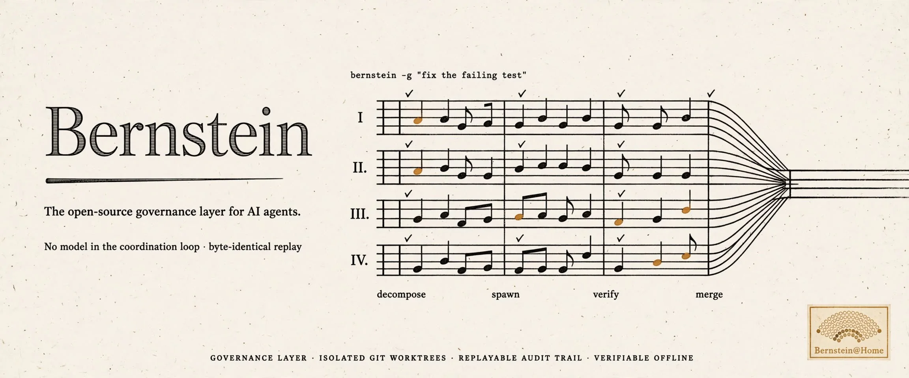
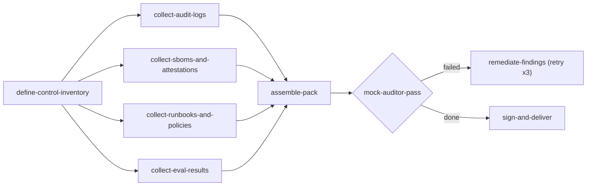
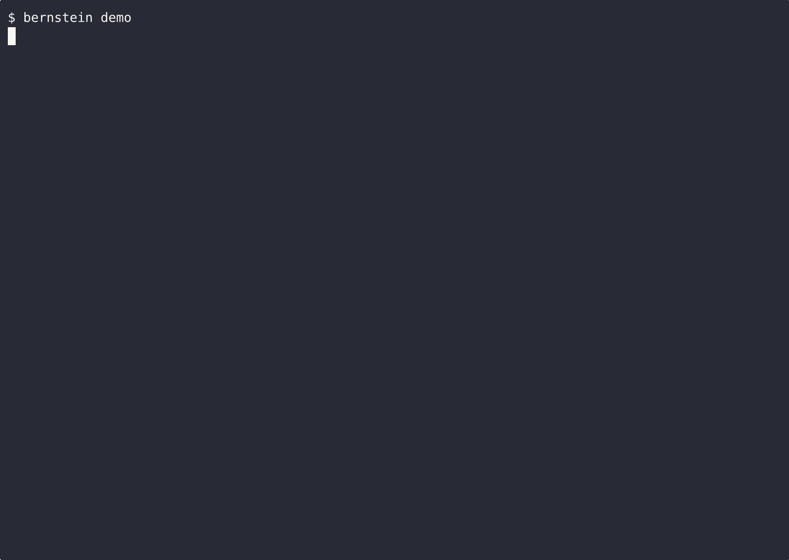
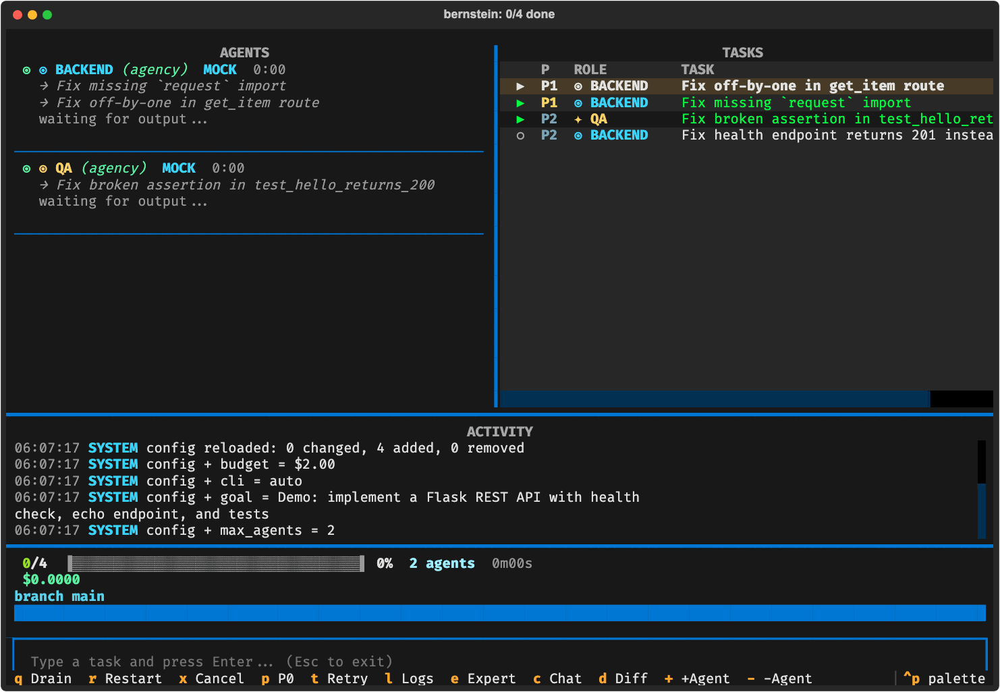
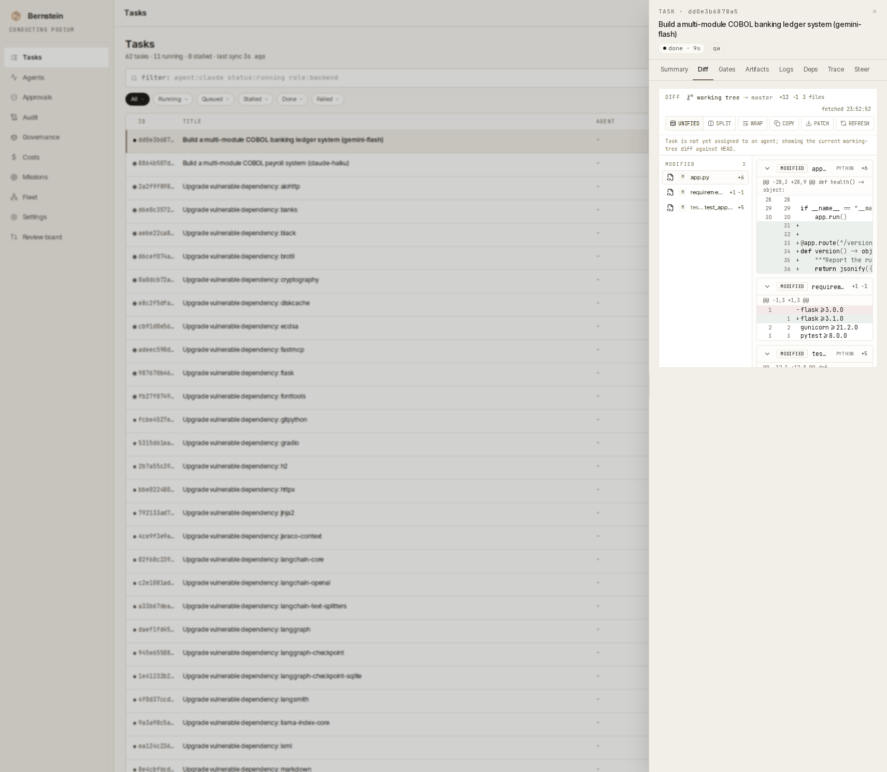

<div align="center">



<br>

> *"To achieve great things, two things are needed: a plan and not quite enough time."* - [attributed to](https://quoteinvestigator.com/2020/08/19/plan-time/) Leonard Bernstein

### avoimen lähdekoodin governance-kerros AI-agenteille
<!-- l10n: en="the open-source governance layer for AI agents" hash="sha256:60d1439d3749" -->

[](https://github.com/sipyourdrink-ltd/bernstein/actions/workflows/ci.yml)
[](https://pypi.org/project/bernstein/)
[](https://python.org)
[](https://github.com/sipyourdrink-ltd/bernstein/blob/main/LICENSE)
[](https://scorecard.dev/viewer/?uri=github.com/sipyourdrink-ltd/bernstein)


[website](https://bernstein.run) &middot; [docs](https://docs.bernstein.run/) &middot; [deepwiki](https://deepwiki.com/sipyourdrink-ltd/bernstein) &middot; [install](https://docs.bernstein.run/en/latest/getting-started/install/) &middot; [first run](https://github.com/sipyourdrink-ltd/bernstein/blob/main/docs/getting-started/first-run.md) &middot; [glossary](https://github.com/sipyourdrink-ltd/bernstein/blob/main/docs/reference/GLOSSARY.md) &middot; [limitations](https://github.com/sipyourdrink-ltd/bernstein/blob/main/docs/reference/KNOWN_LIMITATIONS.md) &middot; [name policy](https://github.com/sipyourdrink-ltd/bernstein/blob/main/TRADEMARKS.md)

[简体中文](https://github.com/sipyourdrink-ltd/bernstein/blob/main/docs/i18n/README.zh-Hans.md) &middot; [繁體中文](https://github.com/sipyourdrink-ltd/bernstein/blob/main/docs/i18n/README.zh-TW.md) &middot; [日本語](https://github.com/sipyourdrink-ltd/bernstein/blob/main/docs/i18n/README.ja.md) &middot; [한국어](https://github.com/sipyourdrink-ltd/bernstein/blob/main/docs/i18n/README.ko.md) &middot; [हिन्दी](https://github.com/sipyourdrink-ltd/bernstein/blob/main/docs/i18n/README.hi.md) &middot; [বাংলা](https://github.com/sipyourdrink-ltd/bernstein/blob/main/docs/i18n/README.bn.md) &middot; [Русский](https://github.com/sipyourdrink-ltd/bernstein/blob/main/docs/i18n/README.ru.md) &middot; [Español](https://github.com/sipyourdrink-ltd/bernstein/blob/main/docs/i18n/README.es.md) &middot; [Português](https://github.com/sipyourdrink-ltd/bernstein/blob/main/docs/i18n/README.pt.md) &middot; [Deutsch](https://github.com/sipyourdrink-ltd/bernstein/blob/main/docs/i18n/README.de.md) &middot; [Français](https://github.com/sipyourdrink-ltd/bernstein/blob/main/docs/i18n/README.fr.md) &middot; [Italiano](https://github.com/sipyourdrink-ltd/bernstein/blob/main/docs/i18n/README.it.md) &middot; [Nederlands](https://github.com/sipyourdrink-ltd/bernstein/blob/main/docs/i18n/README.nl.md) &middot; [Polski](https://github.com/sipyourdrink-ltd/bernstein/blob/main/docs/i18n/README.pl.md) &middot; [Svenska](https://github.com/sipyourdrink-ltd/bernstein/blob/main/docs/i18n/README.sv.md) &middot; [Suomi](https://github.com/sipyourdrink-ltd/bernstein/blob/main/docs/i18n/README.fi.md) &middot; [Українська](https://github.com/sipyourdrink-ltd/bernstein/blob/main/docs/i18n/README.uk.md) &middot; [Türkçe](https://github.com/sipyourdrink-ltd/bernstein/blob/main/docs/i18n/README.tr.md) &middot; [العربية](https://github.com/sipyourdrink-ltd/bernstein/blob/main/docs/i18n/README.ar.md) &middot; [עברית](https://github.com/sipyourdrink-ltd/bernstein/blob/main/docs/i18n/README.he.md) &middot; [Bahasa Indonesia](https://github.com/sipyourdrink-ltd/bernstein/blob/main/docs/i18n/README.id.md) &middot; [Tiếng Việt](https://github.com/sipyourdrink-ltd/bernstein/blob/main/docs/i18n/README.vi.md) &middot; [ไทย](https://github.com/sipyourdrink-ltd/bernstein/blob/main/docs/i18n/README.th.md)

</div>

---

> **Tila: beta.** Yhden henkilön ylläpitämä, aktiivisessa kehityksessä. Versionumero laskee julkaisuja, ei kypsyyttä — pienet versiopäivitykset (minor) voivat muuttaa rajapintoja. Lukitse versio kriittisissä riippuvuuksissa; regressiot korjataan nopeasti, [ilmoita niistä](https://github.com/sipyourdrink-ltd/bernstein/issues).

Bernstein on avoimen lähdekoodin governance-kerros AI-agenteille. Se toimii policy as code -periaatteella: sinä kirjoitat käytännön - kuka saa tehdä mitä, mikä vaatii hyväksynnän, mikä on kirjattava - ja Bernstein toteuttaa sen ja tuottaa todennettavan tallenteen. Deterministinen skeduloija - ei mallia koordinaatiosilmukassa - ajaa agentteja rinnakkain, portittaa niiden tuotokset ja kirjaa jokaisen askeleen, joten ajon voi verifioida jälkikäteen, offline, pelkistä artefakteista. CLI-koodiagentit toimivat suoraan (Claude Code, Codex, Gemini CLI ja 50+ muuta), ja sama kerros governoi mitä tahansa agenttikuormaa: tulos voi olla diff, tutkimusraportti, datasetti tai auditointievidenssipaketti. Air-gap-asennusprofiili mukana. Apache-2.0.

### lyhyesti
<!-- l10n: en="at a glance" hash="sha256:24180098a385" -->

Viisi asiaa erottaa sen muista; loput ovat yksityiskohtia.

- **Ei kielimallia koordinointisilmukassa.** Aikataulutus on puhdasta Pythonia, joten suoritus on täysin toistettavissa alusta loppuun. Toista eilinen suunnitelma ja saat saman tehtävägraafin.
- **Laitteistoavainten todisteet.** PIV-säilytyksen ja FIDO2-hyväksynnän offline-tarkistimet jakavat kuittiprotokollan, kiinnitetyt luottamusankkurit ja nimenomaisen ajan. Tokenin säilytys ei nosta TRACE-luottamustasoja. [Laitteistoavainten todisteet](https://github.com/sipyourdrink-ltd/bernstein/blob/main/docs/operations/hardware-key-evidence.md).
- **Tarkistettavissa jälkikäteen.** Toistoloki (replay journal) tallentaa jokaisen ajon, ja aina aktiivinen alkuperärunko (lineage spine) kirjaa jokaisen jäljitettävän vaiheen; valinnainen HMAC-ketjutettu audit-loki (`BERNSTEIN_AUDIT=1`) lisää kuitteja (receipts), jotka voidaan vahvistaa offline-tilassa. Epädeterministisyys näkyy tarkkana tiiviste-erona kyseisessä vaiheessa eikä satunnaisena epävakautena uudelleenajossa. Muut kuin koodituotokset käsitellään samalla tavalla: tehtävä voi määritellä artefaktisopimuksen (raportti, tietoaineisto, toimintaloki, operaatiotulos) ja se valmistuu allekirjoitetulla alkuperäkuitilla git-commitin sijaan.
- **Eristetty rakenteellisesti.** Jokainen koodaustehtävä saa oman git worktreen merge-porttien taakse; artefaktitilan tehtävät saavat työhakemiston polkuun `.sdd/workspaces/`. Agentit eivät oletusarvoisesti jaa muokattavaa työtilaa; ainoa jaettu tila on tehtäväjono, joka varataan atomisesti. Tiukemmat tiedostojärjestelmärajoitukset ovat valinnaisia [sandbox-taustajärjestelmien](https://github.com/sipyourdrink-ltd/bernstein/blob/main/docs/architecture/sandbox.md) kautta. Jos poistat worktreen käytöstä, jokainen tehtävä suoritetaan jaetussa työtilassa.
- **Kattava ja paikallinen.** Yli 53 CLI-agenttisovitinta sekä yleinen `--prompt`-kääre, tiedostopohjainen tila, ei SaaS-riippuvuuksia, ei ulkopuolista datatasoa.

Täydellinen luettelo löytyy [kyvykkyyssivulta](https://github.com/sipyourdrink-ltd/bernstein/blob/main/docs/reference/capabilities.md); [ominaisuusmatriisi](https://github.com/sipyourdrink-ltd/bernstein/blob/main/docs/reference/FEATURE_MATRIX.md) toimii kattavana hakemistona.

### miltä ajo näyttää
<!-- l10n: en="what a run looks like" hash="sha256:980d54d982be" -->

Yksi YAML-tiedosto deklaroi ajon: vaiheet, roolit, riippuvuudet ja ehdot, joilla solmu ylipäätään ajetaan. Skeduloija suorittaa sen puhtaana Pythonina - mikään tiedostossa ei ole prompti, eikä mikään malli päätä mitä seuraavaksi tapahtuu. Tämä graafi tuottaa auditointievidenssipaketin; koko tiedosto on [`.bernstein/workflows/audit-evidence-pack.yaml`](https://github.com/sipyourdrink-ltd/bernstein/blob/main/.bernstein/workflows/audit-evidence-pack.yaml).

```yaml
name: audit-evidence-pack
version: "1.0.0"

phases:
  - name: scope
    allowed_roles: [manager, architect]
  - name: collect
  - name: validate
    allowed_roles: [qa, security]
  - name: deliver
    allowed_roles: [security, manager]

nodes:
  define-control-inventory:
    phase: scope
    role: architect

  collect-audit-logs:
    phase: collect
    role: security
    depends_on: [define-control-inventory]

  # three more evidence streams collect in parallel:
  # collect-sboms-and-attestations, collect-runbooks-and-policies,
  # collect-eval-results

  assemble-pack:
    phase: validate
    role: docs
    depends_on:
      - collect-audit-logs
      - collect-sboms-and-attestations
      - collect-runbooks-and-policies
      - collect-eval-results

  mock-auditor-pass:
    phase: validate
    role: qa
    depends_on: [assemble-pack]

  remediate-findings:
    phase: collect
    role: docs
    depends_on:
      - source: mock-auditor-pass
        condition: "status == 'failed'"
    retry:
      max_attempts: 3
      until: "status == 'done'"

  sign-and-deliver:
    phase: deliver
    role: security
    depends_on:
      - source: mock-auditor-pass
        condition: "status == 'done'"
```



Jokaisen solmun ottaa agentti, jonka roolin vaihe sallii; rooliaidat ja hyväksyntäportit pitävät riippumatta siitä, mitä agentti tekee tehtävän sisällä. Koodisolmu päättyy merge-porttien taakse omassa git worktreessään. Yllä olevat solmut päättyvät toisin: [artefaktisopimus](https://github.com/sipyourdrink-ltd/bernstein/blob/main/docs/operations/artifacts.md) nimeää tuloksen (raportti, datasetti, skannaus, toimiloki), ja solmu sulkeutuu allekirjoitetulla lineage-kuitilla commitin sijaan. Sama skeduloija, sama journal, sama offline-verifiointi - kantoi graafi sitten koodia, tutkimusta, ops-muutosta tai näiden sekoitusta. Valmiit graafit ohjelmistoille, tutkimukselle, dokumentaatiolle, enterprise-käyttöön ja kontribuutiovirroille ovat [`.bernstein/scenarios/`](https://github.com/sipyourdrink-ltd/bernstein/tree/main/.bernstein/scenarios).

### asennus 30 sekunnissa
<!-- l10n: en="install in 30 seconds" hash="sha256:b40c617d0eda" -->

```bash
uv tool install bernstein    # or: pipx install bernstein
bernstein init
bernstein doctor             # checks a CLI agent is installed and authenticated
bernstein -g "fix the failing test in tests/test_foo.py"
```

`bernstein doctor --json` näyttää myös auditointisopimuksen `findings`-havainnot, jotka ovat samoilla asennushavainnoilla samat kuin komennon `bernstein govern audit --only INS --json` tulokset. Tavallisen doctor-raportin esitystapa ei muutu. Pysyvät tarkistustunnisteet löytyvät [doctorin käyttöoppaasta](https://github.com/sipyourdrink-ltd/bernstein/blob/main/docs/operations/doctor.md).

pipx, pip, brew, dnf, npm ja Docker käsitellään [asennusoppaassa](https://docs.bernstein.run/en/latest/getting-started/install/); eristetyllä paketilla on oma [air-gap-oppaansa](https://docs.bernstein.run/en/latest/installation/air-gap/).

`bernstein worktrees sweep` näyttää esikatselun valmistuneiden tehtävien jättämistä työpuista ja sandbox-istunnoista sekä niiden iän ja levytilan käytön. Vain työpuita voi poistaa, ja siihen tarvitaan `--apply`-valitsin ja erillinen poistohyväksyntä. Sandboxit sisällytetään vain raporttiin (poistaminen: #6571); `doctor` varoittaa pitkään jäljelle jääneistä resursseista. Katso [siivousohje](https://github.com/sipyourdrink-ltd/bernstein/blob/main/docs/operations/worktrees.md#task-terminal-lane-sweep).

Taidon alustuksen epäonnistuessa se siirretään [karanteeniin](https://github.com/sipyourdrink-ltd/bernstein/blob/main/docs/operations/declaration-quarantine.md), ja syy sekä auditointitapahtuma tallennetaan pysyvästi. `bernstein status` näyttää määrän; `doctor` ja `govern audit` raportoivat käytöstä poistetut määrittelyt. Korjaa syy ja poista sitten merkintä nimenomaisesti komennolla `bernstein quarantine re-enable DECLARATION_ID`.

[GHCR](https://ghcr.io/sipyourdrink-ltd/bernstein) &middot; [GitHub Codespaces](https://codespaces.new/sipyourdrink-ltd/bernstein?quickstart=1)



Yllä oleva tallenne on todellinen suoritus ja sisältää oman todisteensa. Tallenne, ajon lokista johdettu allekirjoitettu kuitti ja sen kiinnittävä julkinen avain sijaitsevat hakemistossa [`docs/assets/demo-run/`](https://github.com/sipyourdrink-ltd/bernstein/tree/main/docs/assets/demo-run). Vahvista juuri katsomasi ajo offline-tilassa:

```bash
bernstein verify receipt docs/assets/demo-run/run-receipt.json \
    --public-key docs/assets/demo-run/run-receipt.pub.pem
```

Tallennetun kuitin voi tarkistaa milloin tahansa uudelleen yllä olevalla komennolla; muokattu kopio ei läpäise samaa tarkistusta. `scripts/record_demo.sh` luo tallenteen, kuitin ja avaimen uudelleen tuoreesta todellisesta ajosta; mikään terminaalissa ei ole simuloitua.

Käynnissä olevaa ajoa voidaan seurata kummasta tahansa käyttöliittymästä. Molemmat lukevat samaa tehtävärajapintaa, joten kumpikaan ei ole toisen viivästynyt heijastus. `bernstein live` -näkymässä vasen ja oikea sarake vierittyvät itsenäisesti kokonaisina paneeleina, jolloin ohjaimet pysyvät saavutettavissa myös matalissa terminaaleissa.

|  |  |
|:---:|:---:|
| `bernstein live` — terminaalinäkymä (etätyöntekijäsolmut) | `bernstein gui serve` — selainnäkymä |

### ajon todistaminen
<!-- l10n: en="prove a run" hash="sha256:2bf0bf2378da" -->

Deterministiikka on täällä ominaisuus, jonka voit tarkistaa, ei asia jota pitäisi uskoa sokeasti. Aja kerran auditointi päällä ja vahvista tallennetut tiedot:

```bash
BERNSTEIN_AUDIT=1 bernstein -g "fix the failing test in tests/test_foo.py"
bernstein replay list                 # run ids recorded on disk
bernstein replay latest --verify      # recompute the journal head, name the first divergent step
bernstein lineage verify <run_id>     # recompute the always-on lineage spine
bernstein audit verify                # HMAC chain + Merkle seal (written because audit was enabled)
bernstein audit diagnose <run_id> --signal gate --sign-key KEY
                                      # name the exact step a failure entered the run, as a signed receipt
bernstein verify run <run_id> --signing-key-path key.pem   # sign one portable run receipt
bernstein verify receipt .sdd/runs/<run_id>/run-receipt.json  # verify it offline: file only
```

Loki kirjoitetaan jokaisella ajolla; alkuperärunko on aina aktiivinen ja saa merkinnän jokaisesta jäljitettävästä vaiheesta, joten lyhyt ajo voi päättyä kelvolliseen, tyhjään runkoon. `bernstein audit verify` tarkistaa ketjun vain silloin, kun ajo käynnistettiin parametrilla `BERNSTEIN_AUDIT=1`, vaatimustenmukaisuusprofiililla tai komennolla `bernstein run --audit`. Valitsin `--audit` kuuluu komentoon `bernstein run`; yllä olevassa `bernstein -g` -muodossa aseta ympäristömuuttuja.

Ajokuitti sitoo lokin kärjen, alkuperärungon kärjen (jos merkintöjä tallennettiin) ja valinnaisesti audit-ketjun aikavälin yhden Ed25519-allekirjoitetun kohteen alle sisäänrakennetulla julkisella avaimella. Tarkastaja, jolla on tämä tiedosto ja ylläpitäjän julkinen avain, voi varmistaa, että tallennettuja toimintoja ja ketjuja ei ole muutettu: ei HMAC-avainta, ei aktiivista `.sdd/`-hakemistoa, ja poistumiskoodi `2` nimeää ensimmäisen poikkeavan vaiheen peukaloinnin yhteydessä. Tämä kuitti yksilöi sisältämänsä lokitilan; sen todistaminen, että tämä tila on täydellinen valmis loki, vaatii lisäksi riippumattoman kärki/lukumääräsinetin. Pelkällä tiedostolla ilman `--public-key`-avainta tarkistus vahvistaa vain sisäisen eheyden. Yksityiskohdat osiossa [deterministinen toisto](https://github.com/sipyourdrink-ltd/bernstein/blob/main/docs/operations/deterministic-replay.md#signed-run-receipt-one-file-offline-verification).

Avaa verkkokäyttöliittymässä **Governance** ja tarkista ajokuitti palvelimella valitsemalla **Verify a receipt**. Selain näyttää pelkän eheystarkistuksen tuloksen ja avaimen lähteen. Katso [Governance operator guide](https://github.com/sipyourdrink-ltd/bernstein/blob/main/docs/operations/governance.md#verifying-a-dropped-receipt).

Sama todennettavuus koskee arviointituloksia. `bernstein bench run <suite> --reliability k` (myös muodossa `bernstein eval --reliability k`) ajaa jokaisen tehtävän `k` kertaa kiinteällä koordinoinnilla ja raportoi alarajan `pass^k` (kaikkien `k` yrityksen on onnistuttava) ylärajan `pass@1` rinnalla. Tulos sinetöidään allekirjoitettuun kuittiin, jonka `bernstein bench reliability-verify` laskee uudelleen offline-tilassa, jolloin väärennetty alaraja hylätään tarkistuksessa. Lisätietoja: [pass^k-luotettavuuden alaraja](https://github.com/sipyourdrink-ltd/bernstein/blob/main/docs/eval/reliability.md).

Käytä `bernstein govern audit --format json`- tai `--format sarif`-valintaa koneluettaviin tarkistustuloksiin ja `--strict --quiet`-valintaa CI:n hyväksymisehtona. Katso [govern audit](https://github.com/sipyourdrink-ltd/bernstein/blob/main/docs/operations/governance.md#govern-audit-machine-readable-output-and-ci-gates).

`bernstein delegation verify RUN` vertaa kuittiketjua lopulliseen ketjun päähän ja hyppyjen määrään, jotka on sinetöity ajon manifestiin auditointiavaimella lasketulla HMAC-tunnisteella. Se havaitsee ketjun loppuosan poistamisen, korvaamisen ja ketjun kasvattamisen sulkemisen jälkeen sekä ilmoituksen uudelleenkirjoittamisen ilman avainta. Ilmoituksen poistaminen jättää ajon keskeneräiseksi (paluukoodi `3`), eikä ajoa koskaan pidetä kelvollisena. Tämä ei havaitse vanhemman aidon tilannekuvan uudelleenkäyttöä eikä suojaa kirjoittajalta, jolla on auditointiavain. Katso [delegoinnin tarkistuksen työnkulku](https://github.com/sipyourdrink-ltd/bernstein/blob/main/docs/operations/delegation-verify.md).

### miten se toimii
<!-- l10n: en="how it works" hash="sha256:f818df2e6cbb" -->

Jokainen tavoite etenee neljän vaiheen läpi:

1. **Paloittelu (Decompose)**. Manageri jakaa tavoitteesi tehtäviin rooleineen, kohdetiedostoineen ja valmistumiskriteereineen. Yksi kielimallikutsu, sen jälkeen puhdasta Pythonia.
2. **Käynnistys (Spawn)**. Agentit käynnistyvät eristetyissä [git worktreeissä](https://git-scm.com/docs/git-worktree), yksi koodaustehtävää kohden; artefaktitilan tehtävät saavat tavallisen työkansion. Päähaara pysyy puhtaana.
3. **Vahvistus (Verify)**. Tarkastaja (janitor) varmistaa konkreettiset signaalit: testit menevät läpi, tiedostot ovat olemassa, lint on puhdas, tyypit täsmäävät.
4. **Yhdistäminen (Merge)**. Vahvistettu työ yhdistetään main-haaraan. Epäonnistuneet tehtävät yritetään uudelleen tai reititetään toiselle mallille.

Miksi aikatauluttaja on toteutettu puhtaalla Pythonilla ja mitä kompromisseja siihen liittyy: [miksi deterministinen](https://github.com/sipyourdrink-ltd/bernstein/blob/main/docs/architecture/WHY_DETERMINISTIC.md).

### arkipäiväiset komennot
<!-- l10n: en="everyday commands" hash="sha256:7d149b09b9bc" -->

```bash
cd your-project
bernstein init                    # creates .sdd/ workspace, bernstein.yaml + templates/
bernstein -g "Add rate limiting"  # agents spawn, work in parallel, verify, exit
bernstein live                    # watch progress in the TUI dashboard
bernstein run plan.yaml           # multi-stage plan: skip LLM planning, execute directly
bernstein stop                    # graceful shutdown with drain
```

Koko operaattoripinta (PR-automaatio, aikataulut, chat-sillat, autofix-taustaprosessi) löytyy sivulta [operaattorin komennot](https://github.com/sipyourdrink-ltd/bernstein/blob/main/docs/operations/commands.md).

`bernstein workflow` ajaa deklaratiivisia YAML DAG -rakenteita, jotka koostuvat agentti-, komento- ja silmukkasolmuista - tukien keskeytyneiden ajojen jatkamista:

```bash
bernstein workflow run idea-to-pr -g "Add JWT auth"   # prints run_id
bernstein workflow resume <run_id>                    # picks up at the first non-completed node
```

Ajon tila tallennetaan tarkistuspisteenä hakemistoon `.sdd/runs/<run_id>/` jokaisessa solmussa. Jatkaminen vahvistaa manifestin tiivisteen ajon alussa, joten spesifikaatiomuutos hylätään sen sijaan, että eri manifesti suoritettaisiin hiljaisesti. Katso [workflow-manifestit](https://github.com/sipyourdrink-ltd/bernstein/blob/main/docs/operations/workflows.md).

Koodihygieniaportit: `bernstein readme-l10n verify` hylkää PR:n, jonka käännetyt README-tiedostot poikkeavat englanninkielisestä lähteestä (nimetten vanhentuneen osion), ja `bernstein readme-l10n sync` päivittää sidokset englanninkielisten muokkausten jälkeen. Katso [readme-l10n](https://github.com/sipyourdrink-ltd/bernstein/blob/main/docs/playbooks/readme-l10n.md).

### tuetut agentit
<!-- l10n: en="supported agents" hash="sha256:6a62582765f7" -->

Claude Code, Codex CLI, Gemini CLI, GitHub Copilot CLI, Cursor, Aider, Goose, Muse Code, OpenAI Agents SDK, Amp, Cody, Continue, Devin Terminal, Junie, Kilo, Kiro, AWS Q Developer, Ollama, OpenCode, OpenHands, Open Interpreter, gptme, Plandex, AIChat, Letta Code, Qwen ja muita. [Sovitinindeksi](https://github.com/sipyourdrink-ltd/bernstein/blob/main/docs/adapters/index.md) sisältää asennuskomennot 30 agentille. `bernstein integrations list` luettelee kaikki 56 kytkettyä integraatiota tiedostosta `src/bernstein/adapters/registry.py`, joka on ainoa totuuden lähde. 54 niistä on valittavia agenttisovittimia; kaksi muuta riviä ovat testivastine `mock` ja päätepisteprofiili `self-hosted-endpoints`. Kaikki muut työkalut, joissa on `--prompt`-valitsin, toimivat yleisen kääreen kautta.

Yhdistele agentteja samassa ajossa: edullisia paikallisia malleja rutiinikoodiin, raskaampia pilvimalleja arkkitehtuuriin. `bernstein integrations list --installed` näyttää koneellasi käytettävissä olevat työkalut.

### vapaaehtoinen laskentateho
<!-- l10n: en="volunteer compute" hash="sha256:3795224c8f81" -->

Projekti voi merkitä tiketit vapaaehtoisille avoimiksi, ja kuka tahansa voi ajaa yhden niistä omalla koneellaan ilman tiliä ja ilman koordinaattoria. Sen, mitä tehtävä saa tehdä, projekti ilmoittaa `volunteer.json`-manifestissa - hiekkalaatikon taustaosa, sallittujen verkko-osoitteiden lista, seinäkelloajan ja muistin katot - ja lahjoittajan omat rajat voivat vain kaventaa tätä, eivät koskaan laajentaa. Valmiin tehtävän tuottama kuitti sitoo tuloksen siihen eristyspäätökseen, jonka alla se ajettiin, joten ylläpitäjä voi kuukausienkin päästä tarkistaa, mihin työllä todella oli lupa koskea.

```bash
bernstein volunteer verify .
bernstein volunteer browse --budget 60
```

[Lahjoittajan opas](https://github.com/sipyourdrink-ltd/bernstein/blob/main/docs/volunteer/donor-guide.md) käsittelee workerin ajamisen ja asettamasi budjetin, [projektin opas](https://github.com/sipyourdrink-ltd/bernstein/blob/main/docs/volunteer/project-guide.md) manifestin ilmoittamisen, ja [uhkamalli](https://github.com/sipyourdrink-ltd/bernstein/blob/main/docs/volunteer/threat-model.md) kertoo, miltä kukin raja suojaa ja miltä ei. Yhden komennon ajuria ei ole vielä julkaistu: tänään toimivat alikomennot ovat `verify`, `browse`, `budget`, `verify-bundle` ja `hub`. `autopilot` on rekisteröity, mutta se kieltäytyy käynnistymästä, kunnes `TaskSource` on toteutettu.

### etusivun lisäksi
<!-- l10n: en="beyond the front page" hash="sha256:1236c84b4c20" -->

Kaikki syvällisempi materiaali löytyy [dokumentaatiosivustolta](https://docs.bernstein.run/):

| sivu | aihealue |
|---|---|
| [capabilities](https://github.com/sipyourdrink-ltd/bernstein/blob/main/docs/reference/capabilities.md) | koko ominaisuuslista: MCP-palvelintila, allekirjoitetut agenttikortit, hiekkalaatikkotaustat, artefaktinielut, sääntelykartoitukset |
| [`bernstein_create_task`](https://github.com/sipyourdrink-ltd/bernstein/blob/main/docs/operations/bare-tasks.md) | `POST /api/v1/tasks` → `bernstein_claim` → `bernstein_complete` |
| [who this is for](https://github.com/sipyourdrink-ltd/bernstein/blob/main/docs/use-cases.md) | missä arvo syntyy ja milloin Bernstein ei ole oikea työkalu |
| [workflows](https://github.com/sipyourdrink-ltd/bernstein/blob/main/docs/operations/workflow-manifests.md) | deklaratiiviset YAML DAG -rakenteet agentti- / komento- / silmukkasolmuista |
| [web UI](https://github.com/sipyourdrink-ltd/bernstein/blob/main/docs/gui/index.md) | selainpohjainen hallintapaneeli samalla rajapinnalla kuin TUI |
| [cloud execution](https://github.com/sipyourdrink-ltd/bernstein/blob/main/docs/cloudflare/cloudflare-overview.md) | kokeellinen: aja agentteja Cloudflare Workersissa R2-työtilatasauksella omalla tililläsi. Isännöity `api.bernstein.run` -palvelu ei ole vielä saatavilla |
| [datasources](https://github.com/sipyourdrink-ltd/bernstein/blob/main/docs/operations/datasources.md) | vain luku -kyselykuitit sekä kyselyajuri, joka sitoo jokaisen tuloksen vastaavaan skeematilannevedokseen |
| [agent catalogs](https://github.com/sipyourdrink-ltd/bernstein/blob/main/docs/operations/agent-catalogs.md) | osoita roolit sisäänrakennettujen mallien ulkopuolisiin agenttimäärityksiin — yleiseen YAML/SKILL.md-hakemistoon tai Claude Coden lisäosarakenteeseen |
| [security](https://github.com/sipyourdrink-ltd/bernstein/blob/main/docs/operations/security.md) | tulostaulu, sumea testaus (fuzzing), koventaminen |
| [architecture](https://github.com/sipyourdrink-ltd/bernstein/blob/main/docs/architecture/ARCHITECTURE.md) | miten järjestelmä toimii konepellin alla |

### miksi tämä nimi?
<!-- l10n: en="why the name?" hash="sha256:2444448b9e03" -->

Bernstein on nimetty yhdysvaltalaisen kapellimestarin ja säveltäjän Leonard Bernsteinin mukaan. Projekti orkestroi CLI-koodausagenttien ryhmää samaan tapaan kuin Bernstein johti New Yorkin filharmonikkoja: jokainen soittaja ajallaan, partituuri deterministinen, kapellimestari vastuussa lopputuloksesta.

kirjoitin bernsteinin, koska maksoin 400 dollaria kuukaudessa claude-laskuja ajaessani kolmea koodausagenttia rinnakkain ja sain epädeterministisiä merge-tuloksia. Apache 2.0, yhden kehittäjän ylläpitämä. Reaaliaikaiset tilastot: [bernstein.run](https://bernstein.run).

### mainittu julkaisuissa
<!-- l10n: en="mentioned in" hash="sha256:e1dfaf62cb5d" -->

Listattu kohteessa [vinta/awesome-python](https://github.com/vinta/awesome-python), käsitelty Augment Coden katsauksessa [avoimen lähdekoodin agenttiorkestroijat](https://www.augmentcode.com/tools/open-source-agent-orchestrators) ja mainittu uutiskirjeessä [Python Weekly #742](https://www.pythonweekly.com/p/python-weekly-issue-742-april-23-2026). Dokumentoimme lähestymistavan myös nimellä [deterministinen nolla-LLM-orkestrointi](https://github.com/nibzard/awesome-agentic-patterns/blob/main/patterns/deterministic-zero-llm-orchestration.md) awesome-agentic-patterns -kokoelmassa.

<details>
<summary>Kaikki maininnat: yli 20 awesome-listaa, hakemistoa, uutiskirjettä ja vertaisviittausta</summary>
<br>

Täydellinen seurantalista, mukaan lukien jokainen awesome-listan merkintä, luettelolistaus, viittaus aiempaan työhön ja uutiskirjemaininta, löytyy tiedostosta [docs/mentions.md](https://github.com/sipyourdrink-ltd/bernstein/blob/main/docs/mentions.md). Merkintöjä lisätään niiden ilmestyessä; korjaukset ovat tervetulleita issuena tai PR:nä.

</details>

### Hallinnolliset ajot
<!-- l10n: en="Administrative runs" hash="sha256:df8939f8352a" -->

Luo tyhjä, auditoitu säilö ilman suunnittelijaa tai agenttiprosesseja kutsulla `bernstein_run(template="administrative", goal="Weekly sprint")`. Lisää käsin tehtäviä kutsulla `bernstein_create_task(title="Review brief", description="...", run_id="admin-...")` ja tarkista tila kutsulla `bernstein_run_status(run_id="admin-...")`. Tehtävät ovat varattavissa tavallisen API:n kautta, mutta ne on rajattu automaattisen orkestroinnin ulkopuolelle. Ei-tyhjä ajo valmistuu, kun jokaisen tehtävän tila on `done`, `closed` tai `cancelled`; tyhjä ajo pysyy avoinna. [Käyttöohje](https://github.com/sipyourdrink-ltd/bernstein/blob/main/docs/operations/administrative-runs.md).

### osallistuminen, tuki, lisenssi
<!-- l10n: en="contributing, support, license" hash="sha256:cb937af4a6cc" -->

Pull requestit ovat tervetulleita; [CONTRIBUTING.md](https://github.com/sipyourdrink-ltd/bernstein/blob/main/CONTRIBUTING.md) sisältää asennus- ja koodityyliohjeet. Tietoturvailmoitukset tehdään tiedoston [SECURITY.md](https://github.com/sipyourdrink-ltd/bernstein/blob/main/SECURITY.md) kautta. Yhteys: [forte@bernstein.run](mailto:forte@bernstein.run).

Viittausmetatiedot löytyvät tiedostosta [CITATION.cff](https://github.com/sipyourdrink-ltd/bernstein/blob/main/CITATION.cff). Lisenssi: [Apache-2.0](https://github.com/sipyourdrink-ltd/bernstein/blob/main/LICENSE); projektin nimi on suojattu erikseen dokumentissa [TRADEMARKS.md](https://github.com/sipyourdrink-ltd/bernstein/blob/main/TRADEMARKS.md).

---

[Alex Chernysh](https://alexchernysh.com) &middot; [GitHub](https://github.com/chernistry) &middot; [X](https://x.com/alex_chernysh) &middot; [bernstein.run](https://bernstein.run) &middot; [task notifications](https://github.com/sipyourdrink-ltd/bernstein/blob/main/docs/operations/notifications.md#role-task-subscriptions-sse)

<!-- mcp-name: io.github.sipyourdrink-ltd/bernstein -->
