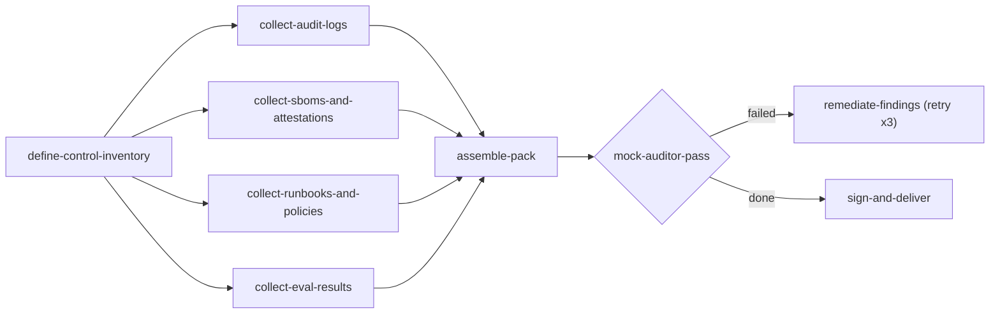

<div align="center">

<picture>
  <source media="(prefers-color-scheme: dark)" srcset="https://raw.githubusercontent.com/sipyourdrink-ltd/bernstein/main/docs/assets/readme-banner-dark.webp">
  
</picture>

<br>

> *"To achieve great things, two things are needed: a plan and not quite enough time."* - [attributed to](https://quoteinvestigator.com/2020/08/19/plan-time/) Leonard Bernstein

### la couche de gouvernance open source pour agents IA
<!-- l10n: en="an open-source governance layer for AI agents" hash="sha256:f988e1e29b9e" -->

[](https://github.com/sipyourdrink-ltd/bernstein/actions/workflows/ci.yml)
[](https://pypi.org/project/bernstein/)
[](https://python.org)
[](https://github.com/sipyourdrink-ltd/bernstein/blob/main/LICENSE)
[](https://scorecard.dev/viewer/?uri=github.com/sipyourdrink-ltd/bernstein)


[website](https://bernstein.run) &middot; [docs](https://docs.bernstein.run/) &middot; [deepwiki](https://deepwiki.com/sipyourdrink-ltd/bernstein) &middot; [install](https://docs.bernstein.run/en/latest/getting-started/install/) &middot; [first run](https://github.com/sipyourdrink-ltd/bernstein/blob/main/docs/getting-started/first-run.md) &middot; [plugins](https://github.com/sipyourdrink-ltd/bernstein-addons) &middot; [org-kit](https://github.com/sipyourdrink-ltd/bernstein-addons/tree/main/plugins/org-kit) &middot; [glossary](https://github.com/sipyourdrink-ltd/bernstein/blob/main/docs/reference/GLOSSARY.md) &middot; [limitations](https://github.com/sipyourdrink-ltd/bernstein/blob/main/docs/reference/KNOWN_LIMITATIONS.md) &middot; [name policy](https://github.com/sipyourdrink-ltd/bernstein/blob/main/TRADEMARKS.md)

[简体中文](https://github.com/sipyourdrink-ltd/bernstein/blob/main/docs/i18n/README.zh-Hans.md) &middot; [繁體中文](https://github.com/sipyourdrink-ltd/bernstein/blob/main/docs/i18n/README.zh-TW.md) &middot; [日本語](https://github.com/sipyourdrink-ltd/bernstein/blob/main/docs/i18n/README.ja.md) &middot; [한국어](https://github.com/sipyourdrink-ltd/bernstein/blob/main/docs/i18n/README.ko.md) &middot; [हिन्दी](https://github.com/sipyourdrink-ltd/bernstein/blob/main/docs/i18n/README.hi.md) &middot; [বাংলা](https://github.com/sipyourdrink-ltd/bernstein/blob/main/docs/i18n/README.bn.md) &middot; [Русский](https://github.com/sipyourdrink-ltd/bernstein/blob/main/docs/i18n/README.ru.md) &middot; [Español](https://github.com/sipyourdrink-ltd/bernstein/blob/main/docs/i18n/README.es.md) &middot; [Português](https://github.com/sipyourdrink-ltd/bernstein/blob/main/docs/i18n/README.pt.md) &middot; [Deutsch](https://github.com/sipyourdrink-ltd/bernstein/blob/main/docs/i18n/README.de.md) &middot; [Français](https://github.com/sipyourdrink-ltd/bernstein/blob/main/docs/i18n/README.fr.md) &middot; [Italiano](https://github.com/sipyourdrink-ltd/bernstein/blob/main/docs/i18n/README.it.md) &middot; [Nederlands](https://github.com/sipyourdrink-ltd/bernstein/blob/main/docs/i18n/README.nl.md) &middot; [Polski](https://github.com/sipyourdrink-ltd/bernstein/blob/main/docs/i18n/README.pl.md) &middot; [Svenska](https://github.com/sipyourdrink-ltd/bernstein/blob/main/docs/i18n/README.sv.md) &middot; [Suomi](https://github.com/sipyourdrink-ltd/bernstein/blob/main/docs/i18n/README.fi.md) &middot; [Українська](https://github.com/sipyourdrink-ltd/bernstein/blob/main/docs/i18n/README.uk.md) &middot; [Türkçe](https://github.com/sipyourdrink-ltd/bernstein/blob/main/docs/i18n/README.tr.md) &middot; [العربية](https://github.com/sipyourdrink-ltd/bernstein/blob/main/docs/i18n/README.ar.md) &middot; [עברית](https://github.com/sipyourdrink-ltd/bernstein/blob/main/docs/i18n/README.he.md) &middot; [Bahasa Indonesia](https://github.com/sipyourdrink-ltd/bernstein/blob/main/docs/i18n/README.id.md) &middot; [Tiếng Việt](https://github.com/sipyourdrink-ltd/bernstein/blob/main/docs/i18n/README.vi.md) &middot; [ไทย](https://github.com/sipyourdrink-ltd/bernstein/blob/main/docs/i18n/README.th.md)

</div>

---

> **Statut : bêta.** Maintenu par une seule personne, en développement actif. Le numéro de version compte les releases, pas la maturité — les versions mineures peuvent modifier les interfaces. Épinglez la version pour tout usage critique ; les régressions sont corrigées rapidement, [signalez-les](https://github.com/sipyourdrink-ltd/bernstein/issues).

Bernstein est la couche de gouvernance open source pour agents IA. Il fonctionne en policy as code : vous écrivez la politique - qui a le droit de faire quoi, ce qui exige une approbation, ce qui doit être consigné - et Bernstein l'applique et produit l'enregistrement vérifiable. Un ordonnanceur déterministe - aucun modèle dans la boucle de coordination - exécute les agents en parallèle, filtre ce qu'ils produisent derrière des gates et consigne chaque étape, si bien qu'une exécution se vérifie après coup, hors ligne, à partir des seuls artefacts. Les agents CLI de code fonctionnent d'emblée (Claude Code, Codex, Gemini CLI), et la même couche gouverne toute charge agentique : le livrable peut être un diff, un rapport de recherche, un dataset ou un dossier de preuves d'audit. Profil d'installation air-gap inclus. Apache-2.0.

### en un coup d'œil
<!-- l10n: en="at a glance" hash="sha256:3c95f239d9cf" -->

Cinq points le distinguent ; tout le reste est détail.

- **Aucun LLM dans la boucle de coordination.** L'ordonnancement est en pur Python, garantissant une reproductibilité de bout en bout. Rejouez le plan d'hier et obtenez exactement le graphe de tâches d'hier.
- **Preuves de clés matérielles.** Les vérificateurs hors ligne de garde PIV et d’approbation FIDO2 partagent le protocole de reçus, avec une confiance épinglée et un instant explicite. La garde du jeton n’élève pas les niveaux de confiance TRACE. [Preuves de clés matérielles](https://github.com/sipyourdrink-ltd/bernstein/blob/main/docs/operations/hardware-key-evidence.md).
- **Vérifiable a posteriori.** Le journal de relecture enregistre chaque exécution, et la colonne vertébrale de lignage (lineage spine) toujours active enregistre chaque étape productrice de lignage ; le journal d'audit optionnel chaîné par HMAC (`BERNSTEIN_AUDIT=1`) ajoute des reçus vérifiables hors ligne. Le non-déterminisme apparaît sous forme de non-concordance de hachage à l'étape exacte, plutôt que par un nouvel essai instable. Les livrables autres que le code reçoivent le même traitement : une tâche peut déclarer un contrat d'artefact (rapport, jeu de données, journal d'actions, résultat d'exploitation) et se conclut par un reçu de lignage signé plutôt que par un commit git.
- **Isolé par conception.** Chaque tâche de codage obtient son propre git worktree protégé par des barrières de fusion ; les tâches en mode artefact obtiennent un répertoire de travail sous `.sdd/workspaces/`. Les agents ne partagent aucun espace de travail modifiable par défaut ; le seul état partagé est le backlog de tâches, réservé de manière atomique. Un contrôle plus strict du système de fichiers est optionnel via les [backends de sandbox](https://github.com/sipyourdrink-ltd/bernstein/blob/main/docs/architecture/sandbox.md). Désactivez les worktrees et chaque tâche s'exécute dans l'espace partagé.
- **Large et local.** 55 noms sélectionnables d’adaptateurs d’agents CLI, dont le wrapper générique `--prompt`. état basé sur fichiers, sans dépendance SaaS, sans plan de données tiers.

La liste complète figure sur la [page des capacités](https://github.com/sipyourdrink-ltd/bernstein/blob/main/docs/reference/capabilities.md) ; la [matrice des fonctionnalités](https://github.com/sipyourdrink-ltd/bernstein/blob/main/docs/reference/FEATURE_MATRIX.md) en est l'index exhaustif.

Le serveur de tâches permet un contrôle persistant par l’opérateur de l’attribution de nouvelles tâches ; voir le [guide](https://github.com/sipyourdrink-ltd/bernstein/blob/main/docs/operations/claim-admission.md).

La politique des adaptateurs par rôle permet de définir une liste facultative d’adaptateurs autorisés par défaut pour les rôles non répertoriés ; voir le [guide](https://github.com/sipyourdrink-ltd/bernstein/blob/main/docs/operations/role-adapter-policy.md).

### à quoi ressemble une exécution
<!-- l10n: en="what a run looks like" hash="sha256:8279488abf5a" -->

Un seul fichier YAML déclare l'exécution : phases, rôles, dépendances et conditions sous lesquelles un nœud s'exécute. L'ordonnanceur l'exécute comme du Python pur - rien dans le fichier n'est un prompt, et aucun modèle ne décide de la suite. Ce graphe produit un dossier de preuves d'audit ; le fichier complet est dans [`.bernstein/workflows/audit-evidence-pack.yaml`](https://github.com/sipyourdrink-ltd/bernstein/blob/main/.bernstein/workflows/audit-evidence-pack.yaml).

```yaml
name: audit-evidence-pack
version: "1.0.0"

phases:
  - name: scope
    allowed_roles: [manager, architect]
  - name: collect
  - name: validate
    allowed_roles: [qa, security]
  - name: deliver
    allowed_roles: [security, manager]

nodes:
  define-control-inventory:
    phase: scope
    role: architect

  collect-audit-logs:
    phase: collect
    role: security
    depends_on: [define-control-inventory]

  # three more evidence streams collect in parallel:
  # collect-sboms-and-attestations, collect-runbooks-and-policies,
  # collect-eval-results

  assemble-pack:
    phase: validate
    role: docs
    depends_on:
      - collect-audit-logs
      - collect-sboms-and-attestations
      - collect-runbooks-and-policies
      - collect-eval-results

  mock-auditor-pass:
    phase: validate
    role: qa
    depends_on: [assemble-pack]

  remediate-findings:
    phase: collect
    role: docs
    depends_on:
      - source: mock-auditor-pass
        condition: "status == 'failed'"
    retry:
      max_attempts: 3
      until: "status == 'done'"

  sign-and-deliver:
    phase: deliver
    role: security
    depends_on:
      - source: mock-auditor-pass
        condition: "status == 'done'"
```



Chaque nœud est pris par un agent dont le rôle est autorisé par la phase ; les clôtures de rôle et les gates d'approbation tiennent quoi que fasse l'agent dans la tâche. Un nœud de code se termine derrière des merge gates dans son propre git worktree. Les nœuds ci-dessus se terminent autrement : un [contrat d'artefact](https://github.com/sipyourdrink-ltd/bernstein/blob/main/docs/operations/artifacts.md) nomme le livrable (rapport, dataset, scan, journal d'actions), et le nœud se clôt sur un reçu de lineage signé plutôt qu'un commit. Même ordonnanceur, même journal, même vérification hors ligne - que le graphe livre du code, de la recherche, un changement d'ops ou un mélange des trois. Des graphes prêts à l'emploi pour le logiciel, la recherche, la doc, l'enterprise et les workflows de contribution vivent dans [`.bernstein/scenarios/`](https://github.com/sipyourdrink-ltd/bernstein/tree/main/.bernstein/scenarios).

Les nouvelles tentatives conservent `dispatch_tier` ; la réouverture d’une tâche permet de choisir explicitement le niveau. Voir le [contrat des niveaux d’exécution](https://github.com/sipyourdrink-ltd/bernstein/blob/main/docs/operations/task-tier-classification.md#retry-and-reopen).

### installation en 30 secondes
<!-- l10n: en="install in 30 seconds" hash="sha256:b24c255f61fb" -->

```bash
uv tool install bernstein    # or: pipx install bernstein
bernstein demo               # zero-key local run (4 mock tasks); prints project path & run_id
# Inside the printed demo directory, sign and verify your own receipt offline:
openssl genpkey -algorithm ED25519 -out demo.key && openssl pkey -in demo.key -pubout -out demo.pub
bernstein verify run <run_id> --signing-key-path demo.key
bernstein verify receipt .sdd/runs/<run_id>/run-receipt.json --public-key demo.pub
```

Lancez la tâche depuis une branche de travail. Bernstein y fusionne les modifications vérifiées et bloque les exécutions susceptibles de fusionner des modifications dans la branche par défaut. Relisez les modifications sur la branche de travail avant d’ouvrir une demande de fusion.

pipx, pip, brew, dnf, npm et Docker sont abordés dans le [guide d'installation](https://docs.bernstein.run/en/latest/getting-started/install/) ; le wheelhouse air-gap dispose de son propre [guide air-gap](https://docs.bernstein.run/en/latest/installation/air-gap/).

[GHCR](https://ghcr.io/sipyourdrink-ltd/bernstein) &middot; [GitHub Codespaces](https://codespaces.new/sipyourdrink-ltd/bernstein?quickstart=1)


L'enregistrement ci-dessus correspond à une exécution réelle et fournit sa propre preuve. La session, le reçu signé issu du journal de cette exécution et la clé publique associée résident dans [`docs/assets/demo-run/`](https://github.com/sipyourdrink-ltd/bernstein/tree/main/docs/assets/demo-run). Vérifiez l'exécution hors ligne :

```bash
bernstein verify receipt docs/assets/demo-run/run-receipt.json \
    --public-key docs/assets/demo-run/run-receipt.pub.pem
```

Le reçu enregistré peut être revérifié à tout moment avec la commande ci-dessus ; une copie altérée échoue à la même vérification. `scripts/record_demo.sh` régénère l'enregistrement, le reçu et la clé depuis une nouvelle exécution réelle ; rien dans le terminal n'est synthétisé.

Une exécution en cours est observable depuis l'une ou l'autre des interfaces opérateur. Toutes deux lisent la même API de tâches, évitant tout décalage d'affichage. Dans `bernstein live`, les colonnes gauche et droite défilent indépendamment sous forme de panneaux entiers, maintenant les composants accessibles sur des terminaux courts.

|  |  |
|:---:|:---:|
| `BERNSTEIN_SERVER_URL="<task-server-url>"` `bernstein live` — le tableau de bord terminal (nœuds de calcul distants) | `<task-server-url>/ui/` — tableau de bord web du serveur de tâches en cours, si les fichiers de l’interface sont installés. `bernstein gui serve` démarre un serveur autonome dans l’espace de travail courant. |

Si le serveur exige une authentification, définissez `BERNSTEIN_AUTH_TOKEN` pour le terminal et saisissez un jeton autorisé sur l’écran de connexion du navigateur. [GUI authentication](https://github.com/sipyourdrink-ltd/bernstein/blob/main/docs/gui/index.md#quickstart).

### prouver une exécution
<!-- l10n: en="prove a run" hash="sha256:d4095258a0e7" -->

Le déterminisme est ici un élément vérifiable, non un acte de foi. Lancez une exécution avec audit activé, puis vérifiez les enregistrements :

```bash
BERNSTEIN_AUDIT=1 bernstein -g "fix the failing test in tests/test_foo.py"
bernstein replay list                 # run ids recorded on disk
bernstein replay latest --verify      # recompute the journal head, name the first divergent step
bernstein lineage verify <run_id>     # recompute the always-on lineage spine
bernstein audit verify                # HMAC chain + Merkle seal (written because audit was enabled)
bernstein audit diagnose <run_id> --signal gate --sign-key KEY
                                      # name the exact step a failure entered the run, as a signed receipt
bernstein verify run <run_id> --signing-key-path key.pem   # sign one portable run receipt
bernstein verify receipt .sdd/runs/<run_id>/run-receipt.json  # verify it offline: file only
```

Le journal est écrit à chaque exécution ; la colonne vertébrale de lignage est active en permanence et s'enrichit d'une entrée pour chaque étape traçable, permettant à une exécution brève de se terminer avec une structure valide et vide. `bernstein audit verify` n'a de chaîne à vérifier que si le lancement a utilisé `BERNSTEIN_AUDIT=1`, un profil de conformité ou `bernstein run --audit`. L'option `--audit` appartient à `bernstein run` ; avec la commande `bernstein -g` ci-dessus, définissez la variable d'environnement.

Un reçu d'exécution lie la tête du journal, la tête de lignage (si des entrées ont été écrites) et, en option, une plage de chaîne d'audit, sous un objet signé Ed25519 intégrant la clé publique. Un relecteur disposant de ce fichier et de la clé publique de l'opérateur peut vérifier l'intégrité des actions et chaînes sans clé HMAC ni dossier `.sdd/` actif, avec un code de sortie `2` précisant la première divergence en cas d'altération. Ce reçu certifie l'état du journal qu'il intègre ; prouver que cet état constitue l'intégralité du journal final requiert en outre un scellé indépendant d'en-tête et de décompte. Sans spécifier de clé via `--public-key`, le contrôle valide l'intégrité interne sans certifier l'émetteur. Détails dans le [guide de relecture déterministe](https://github.com/sipyourdrink-ltd/bernstein/blob/main/docs/operations/deterministic-replay.md#signed-run-receipt-one-file-offline-verification).

Dans l'interface web, ouvrez **Governance** et utilisez **Verify a receipt** pour vérifier un reçu d'exécution sur le serveur. Le navigateur affiche le résultat du contrôle d'intégrité seul et la provenance de la clé. Consultez [Governance operator guide](https://github.com/sipyourdrink-ltd/bernstein/blob/main/docs/operations/governance.md#verifying-a-dropped-receipt).

La même vérifiabilité s'applique aux métriques d'évaluation. `bernstein bench run <suite> --reliability k` (aussi disponible sous `bernstein eval --reliability k`) exécute chaque tâche `k` fois sous coordination fixe, puis rapporte le plancher `pass^k` (les `k` tentatives doivent réussir) ainsi que le plafond `pass@1`. Ce résultat est scellé dans un reçu signé recalculé hors ligne par `bernstein bench reliability-verify`, invalidant toute valeur falsifiée. Détails : [plancher de fiabilité pass^k](https://github.com/sipyourdrink-ltd/bernstein/blob/main/docs/eval/reliability.md).

Utilisez `bernstein govern audit --format json` ou `--format sarif` pour des résultats lisibles par machine, et `--strict --quiet` pour conditionner la validation en CI. Voir [govern audit](https://github.com/sipyourdrink-ltd/bernstein/blob/main/docs/operations/governance.md#govern-audit-machine-readable-output-and-ci-gates). Le dossier de preuves `cosai` inclut les classes de menaces MCP de la version figée du document du 2026-01-08 et précise les lacunes de couverture restantes.

`bernstein delegation verify RUN` compare la chaîne de reçus à la tête finale et au nombre de sauts scellés dans le manifeste d’exécution par un HMAC utilisant la clé d’audit. La vérification détecte la suppression de la fin de la chaîne, la substitution et l’allongement après clôture, y compris la réécriture de la déclaration sans la clé. Supprimer la déclaration laisse l’exécution incomplète (code de sortie `3`), jamais valide. Cela ne détecte pas la réutilisation d’un ancien instantané authentique et ne protège pas contre un auteur qui détient la clé d’audit. Voir le [processus de vérification des délégations](https://github.com/sipyourdrink-ltd/bernstein/blob/main/docs/operations/delegation-verify.md).

### comment ça marche
<!-- l10n: en="how it works" hash="sha256:b734c935f998" -->

Chaque objectif franchit quatre étapes :

1. **Décomposer (Decompose)**. Le gestionnaire scinde votre objectif en tâches assorties de rôles, de fichiers assignés et de critères d'achèvement. Un appel LLM unique, puis du pur Python.
2. **Instancier (Spawn)**. Les agents démarrent dans des [git worktrees](https://git-scm.com/docs/git-worktree) isolés, un par tâche de code ; les tâches en mode artefact reçoivent un répertoire standard. La branche principale reste intacte.
3. **Vérifier (Verify)**. Le vérificateur (janitor) valide les signaux concrets : tests au vert, présence des fichiers, conformité du lint, exactitude des types.
4. **Fusionner (Merge)**. Les réalisations validées intègrent main. Les tâches en échec sont réessayées ou redirigées vers un autre modèle.

Pourquoi l'ordonnanceur est en pur Python et quels sont les compromis associés : [pourquoi déterministe](https://github.com/sipyourdrink-ltd/bernstein/blob/main/docs/architecture/WHY_DETERMINISTIC.md).

La vérification `can_spawn()` du module de suivi des coûts renvoie `False` lorsque les dépenses cumulées après correction atteignent ou dépassent le seuil d’arrêt budgétaire configuré, même si aucun nouveau jeton n’a été signalé. Après un redémarrage, les compteurs de jetons enregistrés ne suffisent pas à reconstituer le coût cumulé exact précédemment déclaré pour une combinaison donnée d’agent, de tâche et de modèle.

### commandes courantes
<!-- l10n: en="everyday commands" hash="sha256:b1ed81e59b08" -->

```bash
cd your-project
bernstein init                    # creates .sdd/ workspace, bernstein.yaml + templates/
bernstein -g "Add rate limiting"  # agents spawn, work in parallel, verify, exit
bernstein live                    # watch progress in the TUI dashboard
bernstein run plan.yaml           # multi-stage plan: skip LLM planning, execute directly
bernstein stop                    # graceful shutdown with drain
```

Si une tâche d’une exécution SSH détachée se termine avec un code de sortie non nul, la tâche et l’exécution échouent. Le reçu de la tâche consigne le code de sortie et les tâches suivantes restent en attente.

L'ensemble des commandes opérateur (automatisation de PR, planifications, passerelles de discussion, démon d'autofix) est détaillé dans [commandes opérateur](https://github.com/sipyourdrink-ltd/bernstein/blob/main/docs/operations/commands.md).

Une boucle de commandes reprend à son dernier point de contrôle en conservant la limite d’itérations initiale. Si une commande a pu être exécutée ou une condition évaluée sans que le résultat soit enregistré, la reprise s’arrête. La reprise s’arrête également si un point de contrôle manque alors que la boucle a pu commencer. Vérifiez les effets avant de lancer une nouvelle exécution.

`bernstein workflow` exécute des DAGs déclaratifs en YAML composés de nœuds agent, command et loop - avec prise en charge de la reprise pour les exécutions interrompues :

```bash
bernstein workflow run idea-to-pr -g "Add JWT auth"   # prints run_id
bernstein workflow resume <run_id> -g "Add JWT auth" # picks up at the first non-completed node
```

L'état d'exécution enregistre un point de contrôle dans `runs/<run_id>/` à chaque nœud. La reprise valide l'empreinte du manifeste au démarrage de l'exécution, de sorte qu'une modification de spécification est refusée plutôt que d'exécuter silencieusement un manifeste différent. Les nœuds de nettoyage peuvent définir `always_run: true` pour s'exécuter après un échec de commande ou de répartition sans transformer une exécution abandonnée en succès (le contrôle d'achèvement d'agent est suivi dans [#6639](https://github.com/sipyourdrink-ltd/bernstein/issues/6639)). Consultez [manifestes de workflow](https://github.com/sipyourdrink-ltd/bernstein/blob/main/docs/operations/workflows.md). À la reprise, fournissez à nouveau la même valeur de `-g` pour remplacer `{goal}` dans les prompts des nœuds non terminés.

`bernstein compliance controls` affiche les suites de tests de chaque contrôle et la dernière mesure complète disponible. [Couverture des tests](https://github.com/sipyourdrink-ltd/bernstein/blob/main/docs/compliance/regulator-mapped-packs.md#cli-inspection)

Contrôles d'hygiène du dépôt : `bernstein readme-l10n verify` invalide une PR dont les READMEs traduits divergent de la source anglaise (en pointant la section obsolète), `bernstein readme-l10n sync` réaligne les liaisons après modification anglaise. Consultez [readme-l10n](https://github.com/sipyourdrink-ltd/bernstein/blob/main/docs/playbooks/readme-l10n.md).

### agents pris en charge
<!-- l10n: en="supported agents" hash="sha256:d674cd57d15a" -->

Claude Code, Codex CLI, Gemini CLI, GitHub Copilot CLI, Cursor, Aider, Goose, Muse Code, OpenAI Agents SDK, Amp, Cody, Continue, Devin Terminal, Junie, Kilo, Kiro, AWS Q Developer, Ollama, OpenCode, OpenHands, Open Interpreter, gptme, Plandex, AIChat, Letta Code, Qwen et bien d'autres. L'[index des adaptateurs](https://github.com/sipyourdrink-ltd/bernstein/blob/main/docs/adapters/index.md) fournit les commandes d'installation pour 30 d'entre eux. `bernstein integrations list` recense les 57 intégrations actives de `src/bernstein/adapters/registry.py`, référence unique de résolution. 55 constituent des adaptateurs sélectionnables ; les deux autres lignes correspondent au bouchon de test `mock` et au profil `self-hosted-endpoints`. Tout autre outil doté d'une option `--prompt` fonctionne via le wrapper générique. `bernstein adapters list` → `Selectable CLI agent adapter names: 55` (`generic`; `agy` = `antigravity`).

Combinez différents agents au cours d'une même session : modèles locaux économiques pour le code générique, modèles cloud plus robustes pour l'architecture. `bernstein integrations list --installed` indique les outils disponibles sur votre machine.

### au-delà de la page d'accueil
<!-- l10n: en="beyond the front page" hash="sha256:63d7eefff374" -->

Toutes les ressources approfondies sont réunies sur le [site de documentation](https://docs.bernstein.run/) :

| page | contenu |
|---|---|
| [capabilities](https://github.com/sipyourdrink-ltd/bernstein/blob/main/docs/reference/capabilities.md) | liste exhaustive des capacités : mode serveur MCP, cartes d'agent signées, moteurs de sandbox, collecteurs d'artefacts, conformité réglementaire |
| [Agent Manifest export](https://github.com/sipyourdrink-ltd/bernstein/blob/main/docs/operations/agent-manifest.md) | `bernstein manifest export-agent` · `composition-only` · `agent-manifest==0.12.0` |
| [`bernstein_create_task`](https://github.com/sipyourdrink-ltd/bernstein/blob/main/docs/operations/bare-tasks.md) | `POST /api/v1/tasks` → `bernstein_claim` → `bernstein_complete` |
| [who this is for](https://github.com/sipyourdrink-ltd/bernstein/blob/main/docs/use-cases.md) | cas d'usage pertinents et situations où Bernstein n'est pas adapté |
| [workflows](https://github.com/sipyourdrink-ltd/bernstein/blob/main/docs/operations/workflow-manifests.md) | DAGs déclaratifs en YAML composés de nœuds agent / command / loop |
| [web UI](https://github.com/sipyourdrink-ltd/bernstein/blob/main/docs/gui/index.md) | tableau de bord web reposant sur la même API que la TUI (créer et examiner des tâches) |
| [état des nœuds de calcul](https://github.com/sipyourdrink-ltd/bernstein/blob/main/docs/operations/cluster-mode.md#worker-health-telemetry) (`bernstein worker`) | Les nœuds cessent de prendre de nouvelles tâches lorsque l’espace disque libre, la mémoire utilisée ou la latence réseau sort des limites configurées. |
| [datasources](https://github.com/sipyourdrink-ltd/bernstein/blob/main/docs/operations/datasources.md) | reçus de requêtes en lecture seule et pilote associant chaque résultat à l'empreinte du schéma sous-jacent |
| [agent catalogs](https://github.com/sipyourdrink-ltd/bernstein/blob/main/docs/operations/agent-catalogs.md) | liaison de rôles vers des définitions d'agents personnalisées — arborescence YAML/SKILL.md générique ou structure de plugin Claude Code |
| [security](https://github.com/sipyourdrink-ltd/bernstein/blob/main/docs/operations/security.md) | scorecard, fuzzing, durcissement |
| [architecture](https://github.com/sipyourdrink-ltd/bernstein/blob/main/docs/architecture/ARCHITECTURE.md) | fonctionnement interne du système |

### pourquoi ce nom ?
<!-- l10n: en="why the name?" hash="sha256:e9839a1c718d" -->

Bernstein rend hommage à Leonard Bernstein, chef d'orchestre et compositeur américain. L’orchestrateur du projet coordonne un ensemble d'agents IA comme Bernstein dirigeait le New York Philharmonic : chaque interprète entre au bon moment, la partition est déterministe et le chef répond du résultat final. La métaphore du chef d’orchestre décrit la capacité de Bernstein à orchestrer des tâches d’agents qui produisent du code, des rapports de recherche ou des jeux de données.

Bernstein a été conçu comme un harnais déterministe pour éviter les fusions non déterministes et les états non vérifiés entre agents de code en parallèle. Apache-2.0. Versions et documentation : [bernstein.run](https://bernstein.run).

### contribution, support, licence
<!-- l10n: en="contributing, support, license" hash="sha256:cb937af4a6cc" -->

Les contributions sont les bienvenues ; [CONTRIBUTING.md](https://github.com/sipyourdrink-ltd/bernstein/blob/main/CONTRIBUTING.md) présente l'installation et les règles de style. Les signalements de sécurité s'effectuent via [SECURITY.md](https://github.com/sipyourdrink-ltd/bernstein/blob/main/SECURITY.md). Contact : [forte@bernstein.run](mailto:forte@bernstein.run).

Les métadonnées de citation sont disponibles dans [CITATION.cff](https://github.com/sipyourdrink-ltd/bernstein/blob/main/CITATION.cff). Licence : [Apache-2.0](https://github.com/sipyourdrink-ltd/bernstein/blob/main/LICENSE) ; le nom du projet est protégé séparément dans [TRADEMARKS.md](https://github.com/sipyourdrink-ltd/bernstein/blob/main/TRADEMARKS.md).

---

[Alex Chernysh](https://alexchernysh.com) &middot; [GitHub](https://github.com/chernistry) &middot; [X](https://x.com/alex_chernysh) &middot; [bernstein.run](https://bernstein.run) &middot; [task notifications](https://github.com/sipyourdrink-ltd/bernstein/blob/main/docs/operations/notifications.md#role-task-subscriptions-sse)

<!-- mcp-name: io.github.sipyourdrink-ltd/bernstein -->
