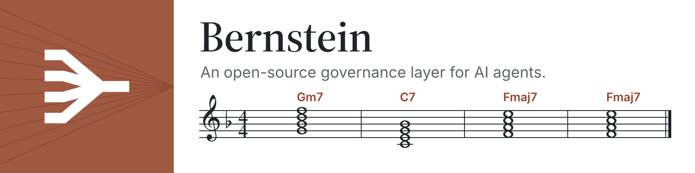
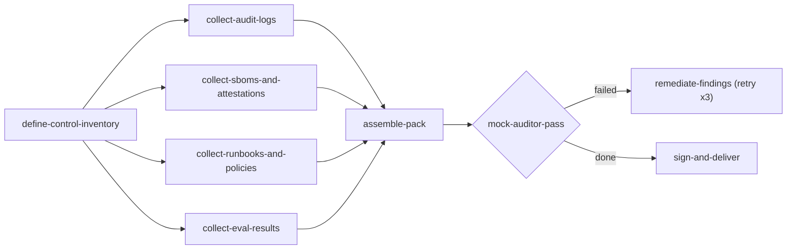

<div align="center">

<picture>
  <source media="(prefers-color-scheme: dark)" srcset="https://raw.githubusercontent.com/sipyourdrink-ltd/bernstein/main/docs/assets/readme-banner-dark.webp">
  
</picture>

<br>

> *"To achieve great things, two things are needed: a plan and not quite enough time."* - [attributed to](https://quoteinvestigator.com/2020/08/19/plan-time/) Leonard Bernstein

### lapisan governance open source untuk agen AI
<!-- l10n: en="an open-source governance layer for AI agents" hash="sha256:f988e1e29b9e" -->

[](https://github.com/sipyourdrink-ltd/bernstein/actions/workflows/ci.yml)
[](https://pypi.org/project/bernstein/)
[](https://python.org)
[](https://github.com/sipyourdrink-ltd/bernstein/blob/main/LICENSE)
[](https://scorecard.dev/viewer/?uri=github.com/sipyourdrink-ltd/bernstein)


[website](https://bernstein.run) &middot; [docs](https://docs.bernstein.run/) &middot; [deepwiki](https://deepwiki.com/sipyourdrink-ltd/bernstein) &middot; [install](https://docs.bernstein.run/en/latest/getting-started/install/) &middot; [first run](https://github.com/sipyourdrink-ltd/bernstein/blob/main/docs/getting-started/first-run.md) &middot; [plugins](https://github.com/sipyourdrink-ltd/bernstein-addons) &middot; [org-kit](https://github.com/sipyourdrink-ltd/bernstein-addons/tree/main/plugins/org-kit) &middot; [glossary](https://github.com/sipyourdrink-ltd/bernstein/blob/main/docs/reference/GLOSSARY.md) &middot; [limitations](https://github.com/sipyourdrink-ltd/bernstein/blob/main/docs/reference/KNOWN_LIMITATIONS.md) &middot; [name policy](https://github.com/sipyourdrink-ltd/bernstein/blob/main/TRADEMARKS.md)

[简体中文](https://github.com/sipyourdrink-ltd/bernstein/blob/main/docs/i18n/README.zh-Hans.md) &middot; [繁體中文](https://github.com/sipyourdrink-ltd/bernstein/blob/main/docs/i18n/README.zh-TW.md) &middot; [日本語](https://github.com/sipyourdrink-ltd/bernstein/blob/main/docs/i18n/README.ja.md) &middot; [한국어](https://github.com/sipyourdrink-ltd/bernstein/blob/main/docs/i18n/README.ko.md) &middot; [हिन्दी](https://github.com/sipyourdrink-ltd/bernstein/blob/main/docs/i18n/README.hi.md) &middot; [বাংলা](https://github.com/sipyourdrink-ltd/bernstein/blob/main/docs/i18n/README.bn.md) &middot; [Русский](https://github.com/sipyourdrink-ltd/bernstein/blob/main/docs/i18n/README.ru.md) &middot; [Español](https://github.com/sipyourdrink-ltd/bernstein/blob/main/docs/i18n/README.es.md) &middot; [Português](https://github.com/sipyourdrink-ltd/bernstein/blob/main/docs/i18n/README.pt.md) &middot; [Deutsch](https://github.com/sipyourdrink-ltd/bernstein/blob/main/docs/i18n/README.de.md) &middot; [Français](https://github.com/sipyourdrink-ltd/bernstein/blob/main/docs/i18n/README.fr.md) &middot; [Italiano](https://github.com/sipyourdrink-ltd/bernstein/blob/main/docs/i18n/README.it.md) &middot; [Nederlands](https://github.com/sipyourdrink-ltd/bernstein/blob/main/docs/i18n/README.nl.md) &middot; [Polski](https://github.com/sipyourdrink-ltd/bernstein/blob/main/docs/i18n/README.pl.md) &middot; [Svenska](https://github.com/sipyourdrink-ltd/bernstein/blob/main/docs/i18n/README.sv.md) &middot; [Suomi](https://github.com/sipyourdrink-ltd/bernstein/blob/main/docs/i18n/README.fi.md) &middot; [Українська](https://github.com/sipyourdrink-ltd/bernstein/blob/main/docs/i18n/README.uk.md) &middot; [Türkçe](https://github.com/sipyourdrink-ltd/bernstein/blob/main/docs/i18n/README.tr.md) &middot; [العربية](https://github.com/sipyourdrink-ltd/bernstein/blob/main/docs/i18n/README.ar.md) &middot; [עברית](https://github.com/sipyourdrink-ltd/bernstein/blob/main/docs/i18n/README.he.md) &middot; [Bahasa Indonesia](https://github.com/sipyourdrink-ltd/bernstein/blob/main/docs/i18n/README.id.md) &middot; [Tiếng Việt](https://github.com/sipyourdrink-ltd/bernstein/blob/main/docs/i18n/README.vi.md) &middot; [ไทย](https://github.com/sipyourdrink-ltd/bernstein/blob/main/docs/i18n/README.th.md)

</div>

---

> **Status: beta.** Dikelola secara mandiri, dalam pengembangan aktif. Nomor versi menghitung rilis, bukan kematangan — versi minor dapat mengubah antarmuka. Kunci versi untuk ketergantungan penting; regresi diperbaiki dengan cepat, [laporkan di sini](https://github.com/sipyourdrink-ltd/bernstein/issues).

Bernstein adalah lapisan governance open source untuk agen AI. Berjalan di atas policy as code: kamu menulis kebijakannya - siapa boleh melakukan apa, apa yang butuh persetujuan, apa yang harus dicatat - dan Bernstein menegakkannya serta menghasilkan catatan yang bisa diverifikasi. Penjadwal deterministik - tanpa model di loop koordinasi - menjalankan agen secara paralel, menyaring hasilnya lewat gate, dan mencatat setiap langkah, sehingga sebuah run bisa diverifikasi setelahnya, offline, hanya dari artefaknya. Agen CLI untuk kode langsung jalan (Claude Code, Codex, Gemini CLI), dan lapisan yang sama menggoverne beban kerja agen apa pun: hasilnya bisa berupa diff, laporan riset, dataset, atau paket bukti audit. Profil instalasi air-gap disertakan. Apache-2.0.

### sekilas pandang
<!-- l10n: en="at a glance" hash="sha256:3c95f239d9cf" -->

Lima hal membedakannya; selebihnya adalah detail.

- **Tanpa LLM dalam loop koordinasi.** Penjadwalan murni menggunakan Python, sehingga eksekusi dapat direproduksi secara menyeluruh dari awal hingga akhir. Jalankan kembali rencana kemarin dan dapatkan graf tugas yang sama persis.
- **Bukti kunci perangkat keras.** Pemverifikasi offline penguasaan PIV dan persetujuan FIDO2 berbagi protokol tanda terima, dengan kepercayaan yang dipatok dan waktu eksplisit. Penguasaan token tidak meningkatkan tingkat kepercayaan TRACE. [Bukti kunci perangkat keras](https://github.com/sipyourdrink-ltd/bernstein/blob/main/docs/operations/hardware-key-evidence.md).
- **Dapat diaudit setelah selesai.** Jurnal pemutaran ulang (replay journal) mencatat setiap eksekusi, dan tulang punggung asal-usul (lineage spine) yang selalu aktif merekam setiap langkah bernilai silsilah; log audit berantai HMAC opsional (`BERNSTEIN_AUDIT=1`) menambahkan tanda terima (receipts) yang dapat diverifikasi secara offline. Non-determinisme muncul sebagai ketidakcocokan hash pada langkah yang tepat, bukan sebagai kegagalan acak saat eksekusi ulang. Hasil kerja non-kode diperlakukan sama: tugas dapat mendeklarasikan kontrak artefak (laporan, dataset, log tindakan, hasil ops) dan diselesaikan dengan tanda terima silsilah yang ditandatangani, bukan commit git.
- **Terisolasi secara terstruktur.** Setiap tugas pengodean mendapatkan git worktree terpisah di balik gerbang penggabungan; tugas mode artefak mendapatkan direktori kerja di bawah `.sdd/workspaces/`. Agen secara default tidak berbagi ruang kerja yang dapat diubah; satu-satunya status bersama adalah backlog tugas, yang diklaim secara atomik. Penegakan sistem berkas yang lebih ketat bersifat opsional melalui [backend sandbox](https://github.com/sipyourdrink-ltd/bernstein/blob/main/docs/architecture/sandbox.md). Nonaktifkan worktree dan setiap tugas akan berjalan di direktori bersama.
- **Luas dan lokal.** 55 nama adapter agen CLI yang dapat dipilih, termasuk wrapper generik `--prompt`. status berbasis berkas, tanpa perantara SaaS, tanpa lapisan data pihak ketiga.

Daftar lengkap ada di [halaman kemampuan](https://github.com/sipyourdrink-ltd/bernstein/blob/main/docs/reference/capabilities.md); [matriks fitur](https://github.com/sipyourdrink-ltd/bernstein/blob/main/docs/reference/FEATURE_MATRIX.md) adalah indeks lengkapnya.

Server tugas mendukung gerbang pengambilan tugas baru yang dikendalikan operator dan menyimpan statusnya; lihat [panduan](https://github.com/sipyourdrink-ltd/bernstein/blob/main/docs/operations/claim-admission.md).

Kebijakan adaptor per peran mendukung daftar adaptor yang diizinkan secara default dan bersifat opsional untuk peran yang tidak tercantum; lihat [panduan](https://github.com/sipyourdrink-ltd/bernstein/blob/main/docs/operations/role-adapter-policy.md).

### seperti apa sebuah run
<!-- l10n: en="what a run looks like" hash="sha256:8279488abf5a" -->

Satu file YAML mendeklarasikan seluruh run: fase, peran, dependensi, dan kondisi kapan sebuah node dijalankan. Penjadwal mengeksekusinya sebagai Python murni - tidak ada yang berupa prompt di file itu, dan tidak ada model yang memutuskan langkah berikutnya. Graf ini menghasilkan paket bukti audit; file lengkapnya ada di [`.bernstein/workflows/audit-evidence-pack.yaml`](https://github.com/sipyourdrink-ltd/bernstein/blob/main/.bernstein/workflows/audit-evidence-pack.yaml).

```yaml
name: audit-evidence-pack
version: "1.0.0"

phases:
  - name: scope
    allowed_roles: [manager, architect]
  - name: collect
  - name: validate
    allowed_roles: [qa, security]
  - name: deliver
    allowed_roles: [security, manager]

nodes:
  define-control-inventory:
    phase: scope
    role: architect

  collect-audit-logs:
    phase: collect
    role: security
    depends_on: [define-control-inventory]

  # three more evidence streams collect in parallel:
  # collect-sboms-and-attestations, collect-runbooks-and-policies,
  # collect-eval-results

  assemble-pack:
    phase: validate
    role: docs
    depends_on:
      - collect-audit-logs
      - collect-sboms-and-attestations
      - collect-runbooks-and-policies
      - collect-eval-results

  mock-auditor-pass:
    phase: validate
    role: qa
    depends_on: [assemble-pack]

  remediate-findings:
    phase: collect
    role: docs
    depends_on:
      - source: mock-auditor-pass
        condition: "status == 'failed'"
    retry:
      max_attempts: 3
      until: "status == 'done'"

  sign-and-deliver:
    phase: deliver
    role: security
    depends_on:
      - source: mock-auditor-pass
        condition: "status == 'done'"
```



Setiap node diambil oleh agen yang perannya diizinkan fase; pagar peran dan gate persetujuan tetap berlaku apa pun yang dilakukan agen di dalam tugas. Node kode selesai di balik merge gate dalam git worktree-nya sendiri. Node di atas selesai dengan cara lain: [kontrak artefak](https://github.com/sipyourdrink-ltd/bernstein/blob/main/docs/operations/artifacts.md) menamai hasilnya (laporan, dataset, pemindaian, log aksi), dan node ditutup dengan tanda terima lineage yang ditandatangani, bukan commit. Penjadwal yang sama, journal yang sama, verifikasi offline yang sama - entah graf itu membawa kode, riset, perubahan ops, atau campuran ketiganya. Graf siap pakai untuk software, riset, dokumentasi, enterprise, dan alur kontributor ada di [`.bernstein/scenarios/`](https://github.com/sipyourdrink-ltd/bernstein/tree/main/.bernstein/scenarios).

Percobaan ulang mempertahankan `dispatch_tier`; saat tugas dibuka kembali, tingkat dapat dipilih secara eksplisit. Lihat [kontrak tingkat dispatch](https://github.com/sipyourdrink-ltd/bernstein/blob/main/docs/operations/task-tier-classification.md#retry-and-reopen).

### instal dalam 30 detik
<!-- l10n: en="install in 30 seconds" hash="sha256:b24c255f61fb" -->

```bash
uv tool install bernstein    # or: pipx install bernstein
bernstein demo               # zero-key local run (4 mock tasks); prints project path & run_id
# Inside the printed demo directory, sign and verify your own receipt offline:
openssl genpkey -algorithm ED25519 -out demo.key && openssl pkey -in demo.key -pubout -out demo.pub
bernstein verify run <run_id> --signing-key-path demo.key
bernstein verify receipt .sdd/runs/<run_id>/run-receipt.json --public-key demo.pub
```

Jalankan tugas dari cabang kerja. Bernstein menggabungkan perubahan yang telah diperiksa ke cabang aktif dan menghentikan proses yang dapat menggabungkan perubahan ke cabang bawaan. Tinjau perubahan di cabang kerja sebelum membuka pull request.

pipx, pip, brew, dnf, npm, dan Docker dibahas dalam [panduan instalasi](https://docs.bernstein.run/en/latest/getting-started/install/); paket terisolasi memiliki [panduan air-gap](https://docs.bernstein.run/en/latest/installation/air-gap/) tersendiri.

[GHCR](https://ghcr.io/sipyourdrink-ltd/bernstein) &middot; [GitHub Codespaces](https://codespaces.new/sipyourdrink-ltd/bernstein?quickstart=1)


Rekaman di atas adalah eksekusi nyata dan menyertakan buktinya sendiri. Rekaman sesi, tanda terima eksekusi bertanda tangan yang diturunkan dari jurnal eksekusi tersebut, dan kunci publik penyematnya berada di [`docs/assets/demo-run/`](https://github.com/sipyourdrink-ltd/bernstein/tree/main/docs/assets/demo-run). Verifikasi eksekusi yang baru saja Anda tonton secara offline:

```bash
bernstein verify receipt docs/assets/demo-run/run-receipt.json \
    --public-key docs/assets/demo-run/run-receipt.pub.pem
```

Tanda terima yang tersimpan dapat diperiksa ulang kapan saja dengan perintah di atas; salinan yang diubah gagal dalam pemeriksaan yang sama. `scripts/record_demo.sh` membuat ulang rekaman, tanda terima, dan kunci dari eksekusi nyata yang baru; tidak ada simulasi di dalam terminal.

Eksekusi yang sedang berjalan dapat dipantau dari salah satu antarmuka operator. Keduanya membaca API tugas yang sama, sehingga tidak ada tampilan yang tertinggal. Di `bernstein live`, kolom kiri dan kanan bergulir secara independen sebagai panel utuh, menjaga widget tetap terjangkau pada terminal yang lebih pendek.

|  |  |
|:---:|:---:|
| `BERNSTEIN_SERVER_URL="<task-server-url>"` `bernstein live` — dasbor terminal (simpul pekerja jarak jauh) | `<task-server-url>/ui/` — dasbor peramban server tugas yang sedang berjalan jika berkas GUI terpasang. `bernstein gui serve` memulai server terpisah di ruang kerja saat ini. |

Jika server memerlukan autentikasi, tetapkan `BERNSTEIN_AUTH_TOKEN` untuk terminal dan masukkan token yang diizinkan pada layar masuk peramban. [GUI authentication](https://github.com/sipyourdrink-ltd/bernstein/blob/main/docs/gui/index.md#quickstart).

### buktikan eksekusi
<!-- l10n: en="prove a run" hash="sha256:d4095258a0e7" -->

Determinisme di sini adalah sesuatu yang Anda buktikan sendiri, bukan diterima atas dasar keyakinan semata. Jalankan sekali dengan audit aktif, lalu verifikasi apa yang tercatat:

```bash
BERNSTEIN_AUDIT=1 bernstein -g "fix the failing test in tests/test_foo.py"
bernstein replay list                 # run ids recorded on disk
bernstein replay latest --verify      # recompute the journal head, name the first divergent step
bernstein lineage verify <run_id>     # recompute the always-on lineage spine
bernstein audit verify                # HMAC chain + Merkle seal (written because audit was enabled)
bernstein audit diagnose <run_id> --signal gate --sign-key KEY
                                      # name the exact step a failure entered the run, as a signed receipt
bernstein verify run <run_id> --signing-key-path key.pem   # sign one portable run receipt
bernstein verify receipt .sdd/runs/<run_id>/run-receipt.json  # verify it offline: file only
```

Jurnal dicatat pada setiap eksekusi; tulang punggung silsilah selalu aktif dan menambah entri untuk setiap langkah yang memiliki silsilah, sehingga eksekusi singkat dapat berakhir dengan tulang punggung valid yang kosong. `bernstein audit verify` hanya memiliki rantai untuk diperiksa jika eksekusi dimulai dengan `BERNSTEIN_AUDIT=1`, preset kepatuhan, atau `bernstein run --audit`. Flag `--audit` milik `bernstein run`; pada format `bernstein -g` di atas, atur variabel lingkungan.

Tanda terima eksekusi mengikat kepala jurnal, kepala tulang punggung silsilah (jika ada entri tercatat), dan rentang rantai audit opsional di bawah satu subjek bertanda tangan Ed25519 dengan kunci publik tersemat. Peninjau yang memegang berkas tersebut beserta kunci publik operator dapat memastikan tindakan dan rantai tidak diubah: tanpa kunci HMAC, tanpa direktori `.sdd/` aktif, dan kode keluar `2` yang menyebutkan langkah penyimpangan pertama jika terjadi manipulasi. Tanda terima tersebut mengidentifikasi status jurnal di dalamnya; membuktikan status tersebut adalah jurnal lengkap yang selesai membutuhkan segel kepala/jumlah independen. Tanpa menyematkan `--public-key`, pemeriksaan hanya untuk integritas internal. Detail di [pemutaran ulang deterministik](https://github.com/sipyourdrink-ltd/bernstein/blob/main/docs/operations/deterministic-replay.md#signed-run-receipt-one-file-offline-verification).

Di antarmuka web, buka **Governance** dan gunakan **Verify a receipt** untuk memeriksa tanda terima eksekusi di server. Browser menampilkan hasil pemeriksaan integritas saja dan sumber kunci. Lihat [Governance operator guide](https://github.com/sipyourdrink-ltd/bernstein/blob/main/docs/operations/governance.md#verifying-a-dropped-receipt).

Verifikasi yang sama berlaku untuk angka evaluasi. `bernstein bench run <suite> --reliability k` (juga ditulis `bernstein eval --reliability k`) menjalankan setiap tugas `k` kali di bawah koordinasi tetap, lalu melaporkan batas bawah `pass^k` (semua `k` percobaan harus berhasil) di samping batas atas `pass@1`. Hasil tersebut disegel dalam tanda terima bertanda tangan yang dihitung ulang secara offline oleh `bernstein bench reliability-verify`, sehingga batas bawah palsu akan gagal diverifikasi. Detail: [batas keandalan pass^k](https://github.com/sipyourdrink-ltd/bernstein/blob/main/docs/eval/reliability.md).

Gunakan `bernstein govern audit --format json` atau `--format sarif` untuk hasil pemeriksaan yang dapat dibaca mesin, dan `--strict --quiet` sebagai syarat kelulusan CI. Lihat [govern audit](https://github.com/sipyourdrink-ltd/bernstein/blob/main/docs/operations/governance.md#govern-audit-machine-readable-output-and-ci-gates). Paket bukti `cosai` mencakup kelas ancaman MCP dari versi tetap makalah bertanggal 2026-01-08 dan menjelaskan celah cakupan yang masih ada.

`bernstein delegation verify RUN` membandingkan rantai tanda terima dengan kepala akhir dan jumlah hop yang disegel dalam manifes proses menggunakan HMAC dengan kunci audit, sehingga mendeteksi penghapusan ujung rantai, penggantian, dan penambahan setelah penutupan, termasuk penulisan ulang deklarasi tanpa kunci. Menghapus deklarasi membuat proses tetap tidak lengkap (kode keluar `3`), tidak pernah dinyatakan valid. Pemeriksaan ini tidak mendeteksi penggunaan ulang snapshot autentik yang lebih lama dan tidak melindungi dari penulis yang memegang kunci audit. Lihat [alur verifikasi delegasi](https://github.com/sipyourdrink-ltd/bernstein/blob/main/docs/operations/delegation-verify.md).

### cara kerja
<!-- l10n: en="how it works" hash="sha256:b734c935f998" -->

Setiap target melalui empat tahapan:

1. **Dekomposisi (Decompose)**. Manajer memecah target Anda menjadi tugas-tugas dengan peran, kepemilikan berkas, dan sinyal penyelesaian. Satu panggilan LLM, lalu murni Python seterusnya.
2. **Inisialisasi (Spawn)**. Agen dimulai di [git worktrees](https://git-scm.com/docs/git-worktree) terisolasi, satu per tugas pengodean; tugas mode artefak mendapatkan direktori kerja standar. Branch utama tetap bersih.
3. **Verifikasi (Verify)**. Janitor memeriksa sinyal konkret: pengujian lolos, berkas ada, lint bersih, tipe data sesuai.
4. **Penggabungan (Merge)**. Pekerjaan yang terverifikasi digabungkan ke main. Tugas yang gagal dicoba ulang atau dialihkan ke model lain.

Mengapa penjadwal menggunakan Python murni dan konsekuensi rancangannya: [mengapa deterministik](https://github.com/sipyourdrink-ltd/bernstein/blob/main/docs/architecture/WHY_DETERMINISTIC.md).

Pemeriksaan `can_spawn()` pada pelacak biaya mengembalikan `False` ketika pengeluaran kumulatif setelah koreksi mencapai atau melampaui ambang penghentian anggaran yang ditetapkan, meskipun tidak ada token baru yang dilaporkan. Setelah sistem dimulai ulang, jumlah token yang tersimpan saja tidak cukup untuk mengetahui kembali biaya kumulatif persis yang sebelumnya dilaporkan untuk kombinasi agen, tugas, dan model tertentu.

### perintah sehari-hari
<!-- l10n: en="everyday commands" hash="sha256:85f90687f750" -->

```bash
cd your-project
bernstein init                    # creates .sdd/ workspace, bernstein.yaml + templates/
bernstein -g "Add rate limiting"  # agents spawn, work in parallel, verify, exit
bernstein live                    # watch progress in the TUI dashboard
bernstein run plan.yaml           # multi-stage plan: skip LLM planning, execute directly
bernstein stop                    # graceful shutdown with drain
```

Jika tugas dalam proses SSH yang berjalan terpisah berakhir dengan kode keluar selain nol, tugas dan proses tersebut gagal. Bukti pelaksanaan tugas mencatat kode keluar, dan tugas berikutnya tetap menunggu.

Seluruh antarmuka operator (otomatisasi PR, jadwal, jembatan obrolan, daemon autofix) terdapat dalam [perintah operator](https://github.com/sipyourdrink-ltd/bernstein/blob/main/docs/operations/commands.md).

`bernstein workflow` menjalankan DAG YAML deklaratif dari node agent, command, dan loop - dengan dukungan untuk melanjutkan eksekusi yang terinterupsi:

```bash
bernstein workflow run idea-to-pr -g "Add JWT auth"   # prints run_id
bernstein workflow resume <run_id> -g "Add JWT auth" # picks up at the first non-completed node
```

Perintah workflow langsung menyimpan checkpoint di `runs/<run_id>/` relatif terhadap direktori kerja saat ini. Saat dilanjutkan, digest manifes asli divalidasi. Jika digest tujuan tercatat, masukkan nilai asli `-g` secara persis, termasuk saat memakai `-m`. Anda dapat menghilangkan `-g` jika tujuan awal kosong atau jika tidak ada prompt agen yang tersisa pada eksekusi lama yang dapat menggunakan `{goal}`. [manifes workflow](https://github.com/sipyourdrink-ltd/bernstein/blob/main/docs/operations/workflows.md) Node pembersihan dapat menetapkan `always_run: true` agar dijalankan setelah kegagalan perintah atau pengiriman tanpa mengubah eksekusi yang dibatalkan menjadi keberhasilan (pembatasan penyelesaian agent dilacak di [#6639](https://github.com/sipyourdrink-ltd/bernstein/issues/6639)).

`bernstein compliance controls` menampilkan rangkaian uji untuk setiap kontrol dan pengukuran lengkap terakhir jika tersedia. [Cakupan tolok ukur](https://github.com/sipyourdrink-ltd/bernstein/blob/main/docs/compliance/regulator-mapped-packs.md#cli-inspection)

Gerbang kebersihan repositori: `bernstein readme-l10n verify` menggagalkan PR yang terjemahan README-nya menyimpang dari sumber bahasa Inggris (menyebutkan bagian yang usang), `bernstein readme-l10n sync` mengikat ulang tautan setelah pengeditan bahasa Inggris. Lihat [readme-l10n](https://github.com/sipyourdrink-ltd/bernstein/blob/main/docs/playbooks/readme-l10n.md).

### agen yang didukung
<!-- l10n: en="supported agents" hash="sha256:d674cd57d15a" -->

Claude Code, Codex CLI, Gemini CLI, GitHub Copilot CLI, Cursor, Aider, Goose, Muse Code, OpenAI Agents SDK, Amp, Cody, Continue, Devin Terminal, Junie, Kilo, Kiro, AWS Q Developer, Ollama, OpenCode, OpenHands, Open Interpreter, gptme, Plandex, AIChat, Letta Code, Qwen, dan banyak lagi. [Indeks adaptor](https://github.com/sipyourdrink-ltd/bernstein/blob/main/docs/adapters/index.md) memuat perintah instalasi untuk 30 di antaranya. `bernstein integrations list` menampilkan ke-57 integrasi aktif dari `src/bernstein/adapters/registry.py`, satu-satunya sumber kebenaran. 55 di antaranya adalah adaptor agen yang dapat dipilih; dua baris lainnya adalah stub uji `mock` dan profil endpoint `self-hosted-endpoints`. Alat lain dengan flag `--prompt` dapat berjalan melalui wrapper generik. `bernstein adapters list` → `Selectable CLI agent adapter names: 55` (`generic`; `agy` = `antigravity`).

Gabungkan berbagai agen dalam satu eksekusi: model lokal hemat biaya untuk kode repetitif, model cloud berkapasitas besar untuk arsitektur. `bernstein integrations list --installed` menampilkan apa saja yang tersedia di mesin Anda.

### di luar halaman utama
<!-- l10n: en="beyond the front page" hash="sha256:63d7eefff374" -->

Semua dokumentasi mendalam tersedia di [situs dokumentasi](https://docs.bernstein.run/):

| halaman | cakupan materi |
|---|---|
| [capabilities](https://github.com/sipyourdrink-ltd/bernstein/blob/main/docs/reference/capabilities.md) | daftar kemampuan lengkap: mode server MCP, kartu agen bertanda tangan, backend sandbox, penampung artefak, kepatuhan regulasi |
| [Agent Manifest export](https://github.com/sipyourdrink-ltd/bernstein/blob/main/docs/operations/agent-manifest.md) | `bernstein manifest export-agent` · `composition-only` · `agent-manifest==0.12.0` |
| [`bernstein_create_task`](https://github.com/sipyourdrink-ltd/bernstein/blob/main/docs/operations/bare-tasks.md) | `POST /api/v1/tasks` → `bernstein_claim` → `bernstein_complete` |
| [who this is for](https://github.com/sipyourdrink-ltd/bernstein/blob/main/docs/use-cases.md) | di mana nilai gunanya dan kapan Bernstein bukan alat yang tepat |
| [workflows](https://github.com/sipyourdrink-ltd/bernstein/blob/main/docs/operations/workflow-manifests.md) | DAG YAML deklaratif dari node agent / command / loop |
| [web UI](https://github.com/sipyourdrink-ltd/bernstein/blob/main/docs/gui/index.md) | dasbor peramban berbasis API yang sama dengan TUI (membuat dan meninjau tugas) |
| [kondisi pekerja klaster](https://github.com/sipyourdrink-ltd/bernstein/blob/main/docs/operations/cluster-mode.md#worker-health-telemetry) (`bernstein worker`) | Pekerja berhenti mengambil tugas baru selama ruang disk kosong, penggunaan memori, atau latensi jaringan berada di luar batas yang ditetapkan. |
| [datasources](https://github.com/sipyourdrink-ltd/bernstein/blob/main/docs/operations/datasources.md) | tanda terima kueri hanya-baca, ditambah driver kueri yang mengaitkan setiap hasil dengan snapshot skema terkait |
| [agent catalogs](https://github.com/sipyourdrink-ltd/bernstein/blob/main/docs/operations/agent-catalogs.md) | arahkan peran ke definisi agen di luar templat bawaan — direktori YAML/SKILL.md generik atau tata letak plugin Claude Code |
| [security](https://github.com/sipyourdrink-ltd/bernstein/blob/main/docs/operations/security.md) | kartu skor, fuzzing, pengerasan keamanan |
| [architecture](https://github.com/sipyourdrink-ltd/bernstein/blob/main/docs/architecture/ARCHITECTURE.md) | cara kerja arsitektur di balik layar |

### mengapa dinamai bernstein?
<!-- l10n: en="why the name?" hash="sha256:e9839a1c718d" -->

Bernstein dinamai berdasarkan Leonard Bernstein, konduktor dan komposer asal Amerika Serikat. Orkestrator proyek ini mengatur tim agen AI seperti Bernstein memimpin New York Philharmonic: setiap pemain masuk tepat waktu, partitur deterministik, konduktor bertanggung jawab atas hasil akhirnya. Metafora konduktor menggambarkan kemampuan orkestrasi Bernstein untuk tugas agen yang menghasilkan kode, laporan penelitian, atau kumpulan data.

Bernstein dimulai sebagai lapisan deterministik untuk mencegah merge yang tidak deterministik dan state yang tidak terverifikasi di antara agen pengkodean paralel. Apache-2.0. Rilis dan dokumentasi: [bernstein.run](https://bernstein.run).

### kontribusi, dukungan, lisensi
<!-- l10n: en="contributing, support, license" hash="sha256:cb937af4a6cc" -->

Pull request selalu diterima; [CONTRIBUTING.md](https://github.com/sipyourdrink-ltd/bernstein/blob/main/CONTRIBUTING.md) memuat panduan pengaturan dan gaya kode. Laporan keamanan disampaikan melalui [SECURITY.md](https://github.com/sipyourdrink-ltd/bernstein/blob/main/SECURITY.md). Kontak: [forte@bernstein.run](mailto:forte@bernstein.run).

Metadata sitasi tersedia di [CITATION.cff](https://github.com/sipyourdrink-ltd/bernstein/blob/main/CITATION.cff). Lisensi: [Apache-2.0](https://github.com/sipyourdrink-ltd/bernstein/blob/main/LICENSE); nama proyek dilindungi secara terpisah dalam [TRADEMARKS.md](https://github.com/sipyourdrink-ltd/bernstein/blob/main/TRADEMARKS.md).

---

[Alex Chernysh](https://alexchernysh.com) &middot; [GitHub](https://github.com/chernistry) &middot; [X](https://x.com/alex_chernysh) &middot; [bernstein.run](https://bernstein.run) &middot; [task notifications](https://github.com/sipyourdrink-ltd/bernstein/blob/main/docs/operations/notifications.md#role-task-subscriptions-sse)

<!-- mcp-name: io.github.sipyourdrink-ltd/bernstein -->
