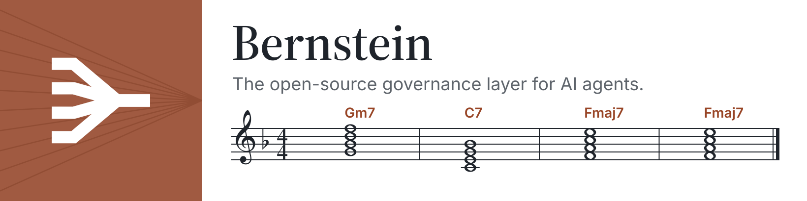
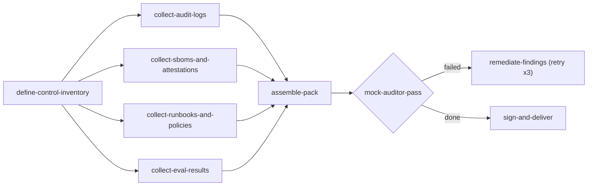
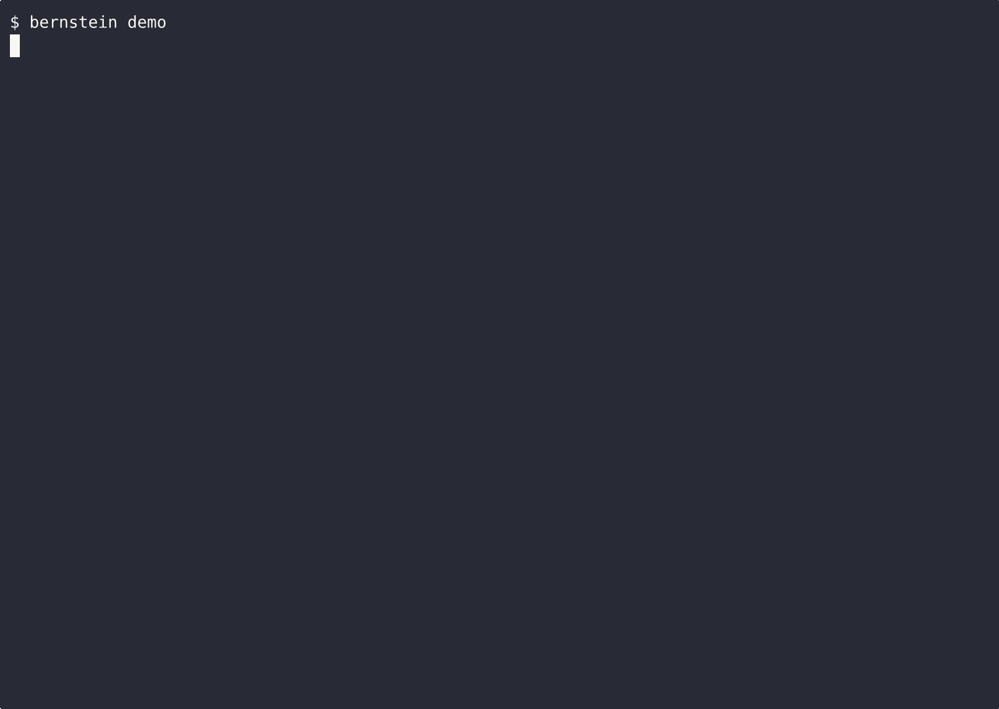
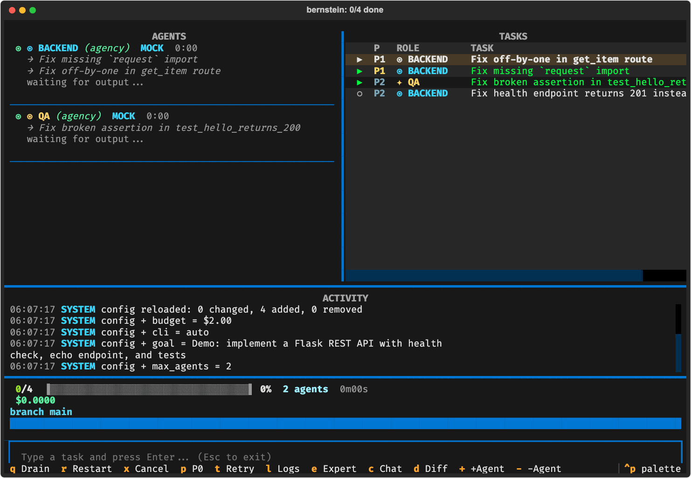
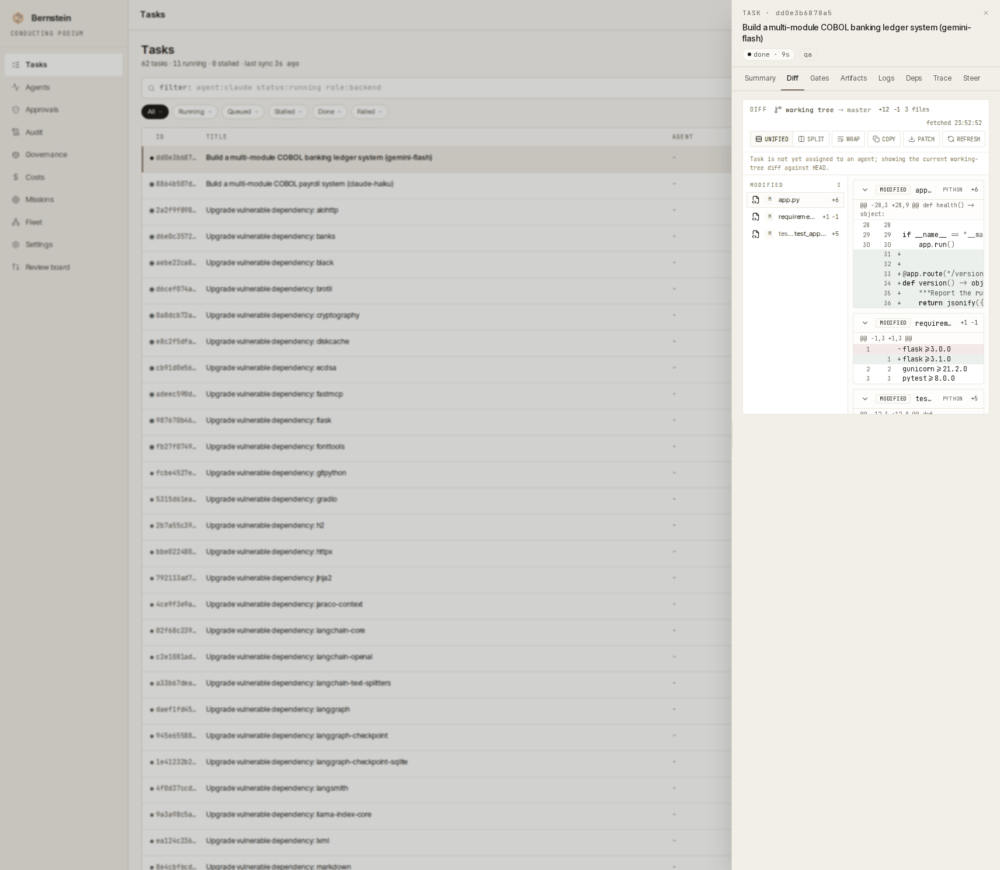

<div align="center">

<picture>
  <source media="(prefers-color-scheme: dark)" srcset="https://raw.githubusercontent.com/sipyourdrink-ltd/bernstein/main/docs/assets/readme-banner-dark.webp">
  
</picture>

<br>

> *"To achieve great things, two things are needed: a plan and not quite enough time."* - [attributed to](https://quoteinvestigator.com/2020/08/19/plan-time/) Leonard Bernstein

### il layer di governance open source per agenti IA
<!-- l10n: en="the open-source governance layer for AI agents" hash="sha256:60d1439d3749" -->

[](https://github.com/sipyourdrink-ltd/bernstein/actions/workflows/ci.yml)
[](https://pypi.org/project/bernstein/)
[](https://python.org)
[](https://github.com/sipyourdrink-ltd/bernstein/blob/main/LICENSE)
[](https://scorecard.dev/viewer/?uri=github.com/sipyourdrink-ltd/bernstein)


[website](https://bernstein.run) &middot; [docs](https://docs.bernstein.run/) &middot; [deepwiki](https://deepwiki.com/sipyourdrink-ltd/bernstein) &middot; [install](https://docs.bernstein.run/en/latest/getting-started/install/) &middot; [first run](https://github.com/sipyourdrink-ltd/bernstein/blob/main/docs/getting-started/first-run.md) &middot; [glossary](https://github.com/sipyourdrink-ltd/bernstein/blob/main/docs/reference/GLOSSARY.md) &middot; [limitations](https://github.com/sipyourdrink-ltd/bernstein/blob/main/docs/reference/KNOWN_LIMITATIONS.md) &middot; [name policy](https://github.com/sipyourdrink-ltd/bernstein/blob/main/TRADEMARKS.md)

[简体中文](https://github.com/sipyourdrink-ltd/bernstein/blob/main/docs/i18n/README.zh-Hans.md) &middot; [繁體中文](https://github.com/sipyourdrink-ltd/bernstein/blob/main/docs/i18n/README.zh-TW.md) &middot; [日本語](https://github.com/sipyourdrink-ltd/bernstein/blob/main/docs/i18n/README.ja.md) &middot; [한국어](https://github.com/sipyourdrink-ltd/bernstein/blob/main/docs/i18n/README.ko.md) &middot; [हिन्दी](https://github.com/sipyourdrink-ltd/bernstein/blob/main/docs/i18n/README.hi.md) &middot; [বাংলা](https://github.com/sipyourdrink-ltd/bernstein/blob/main/docs/i18n/README.bn.md) &middot; [Русский](https://github.com/sipyourdrink-ltd/bernstein/blob/main/docs/i18n/README.ru.md) &middot; [Español](https://github.com/sipyourdrink-ltd/bernstein/blob/main/docs/i18n/README.es.md) &middot; [Português](https://github.com/sipyourdrink-ltd/bernstein/blob/main/docs/i18n/README.pt.md) &middot; [Deutsch](https://github.com/sipyourdrink-ltd/bernstein/blob/main/docs/i18n/README.de.md) &middot; [Français](https://github.com/sipyourdrink-ltd/bernstein/blob/main/docs/i18n/README.fr.md) &middot; [Italiano](https://github.com/sipyourdrink-ltd/bernstein/blob/main/docs/i18n/README.it.md) &middot; [Nederlands](https://github.com/sipyourdrink-ltd/bernstein/blob/main/docs/i18n/README.nl.md) &middot; [Polski](https://github.com/sipyourdrink-ltd/bernstein/blob/main/docs/i18n/README.pl.md) &middot; [Svenska](https://github.com/sipyourdrink-ltd/bernstein/blob/main/docs/i18n/README.sv.md) &middot; [Suomi](https://github.com/sipyourdrink-ltd/bernstein/blob/main/docs/i18n/README.fi.md) &middot; [Українська](https://github.com/sipyourdrink-ltd/bernstein/blob/main/docs/i18n/README.uk.md) &middot; [Türkçe](https://github.com/sipyourdrink-ltd/bernstein/blob/main/docs/i18n/README.tr.md) &middot; [العربية](https://github.com/sipyourdrink-ltd/bernstein/blob/main/docs/i18n/README.ar.md) &middot; [עברית](https://github.com/sipyourdrink-ltd/bernstein/blob/main/docs/i18n/README.he.md) &middot; [Bahasa Indonesia](https://github.com/sipyourdrink-ltd/bernstein/blob/main/docs/i18n/README.id.md) &middot; [Tiếng Việt](https://github.com/sipyourdrink-ltd/bernstein/blob/main/docs/i18n/README.vi.md) &middot; [ไทย](https://github.com/sipyourdrink-ltd/bernstein/blob/main/docs/i18n/README.th.md)

</div>

---

> **Stato: beta.** Mantenuto da una sola persona, in sviluppo attivo. Il numero di versione conta i rilasci, non la maturità: le versioni minori possono modificare le interfacce. Fissa la versione per qualsiasi dipendenza critica; le regressioni vengono risolte rapidamente, [segnalale](https://github.com/sipyourdrink-ltd/bernstein/issues).

Bernstein è il layer di governance open source per agenti IA. Funziona a policy as code: tu scrivi la policy - chi può fare cosa, cosa richiede approvazione, cosa va registrato - e Bernstein la applica e produce il registro verificabile. Uno scheduler deterministico - nessun modello nel loop di coordinamento - esegue gli agenti in parallelo, filtra ciò che producono con dei gate e registra ogni passo, così un run si può verificare a posteriori, offline, dai soli artefatti. Gli agenti CLI di codice funzionano subito (Claude Code, Codex, Gemini CLI e altri 50+), e lo stesso layer governa qualsiasi carico agentico: il deliverable può essere un diff, un report di ricerca, un dataset o un pacchetto di evidenze di audit. Profilo di installazione air-gap incluso. Apache-2.0.

### in sintesi
<!-- l10n: en="at a glance" hash="sha256:24180098a385" -->

Cinque aspetti lo distinguono; il resto sono dettagli.

- **Nessun LLM nel ciclo di coordinamento.** La pianificazione è in puro Python, rendendo ogni esecuzione riproducibile da cima a fondo. Riproduci il piano di ieri e otterrai esattamente il grafo delle attività di ieri.
- **Prove delle chiavi hardware.** I verificatori offline di custodia PIV e approvazione FIDO2 condividono il protocollo delle ricevute, con fiducia fissata e tempo esplicito. La custodia del token non aumenta i livelli di fiducia TRACE. [Prove delle chiavi hardware](https://github.com/sipyourdrink-ltd/bernstein/blob/main/docs/operations/hardware-key-evidence.md).
- **Verificabile a posteriori.** Il giornale di replay registra ogni esecuzione, e la colonna vertebrale di lineage sempre attiva memorizza ogni passaggio dotato di tracciabilità; il log di audit opzionale concatenato con HMAC (`BERNSTEIN_AUDIT=1`) aggiunge ricevute verificabili offline. Il non determinismo emerge come discrepanza di hash nel passaggio esatto, non come riesecuzione intermittente. I deliverable non costituiti da codice ricevono lo stesso trattamento: un task può dichiarare un contratto di artefatto (report, dataset, log di azioni, risultati ops) e si conclude con una ricevuta di lineage firmata anziché un commit git.
- **Isolato per progettazione.** Ogni task di codifica ottiene il proprio git worktree protetto da merge gate; i task in modalità artefatto ottengono una directory di lavoro in `.sdd/workspaces/`. Gli agenti non condividono alcuno spazio di lavoro modificabile per impostazione predefinita; l'unico stato condiviso è il backlog dei task, acquisito in modo atomico. Restrizioni più severe sul filesystem sono opzionali, fornite dai [backend sandbox](https://github.com/sipyourdrink-ltd/bernstein/blob/main/docs/architecture/sandbox.md). Disattivando i worktree, ogni task viene eseguito nel checkout condiviso.
- **Ampio e locale.** Oltre 53 adapter per agenti CLI più un wrapper generico `--prompt`, stato basato su file, nessun passaggio SaaS, nessun piano dati di terze parti.

L'elenco completo è disponibile nella [pagina delle funzionalità](https://github.com/sipyourdrink-ltd/bernstein/blob/main/docs/reference/capabilities.md); la [matrice delle caratteristiche](https://github.com/sipyourdrink-ltd/bernstein/blob/main/docs/reference/FEATURE_MATRIX.md) costituisce l'indice esaustivo.

### come appare un run
<!-- l10n: en="what a run looks like" hash="sha256:980d54d982be" -->

Un unico file YAML dichiara il run: fasi, ruoli, dipendenze e le condizioni sotto cui un nodo viene eseguito. Lo scheduler lo esegue come Python puro - nulla nel file è un prompt e nessun modello decide cosa succede dopo. Questo grafo produce un pacchetto di evidenze di audit; il file completo è in [`.bernstein/workflows/audit-evidence-pack.yaml`](https://github.com/sipyourdrink-ltd/bernstein/blob/main/.bernstein/workflows/audit-evidence-pack.yaml).

```yaml
name: audit-evidence-pack
version: "1.0.0"

phases:
  - name: scope
    allowed_roles: [manager, architect]
  - name: collect
  - name: validate
    allowed_roles: [qa, security]
  - name: deliver
    allowed_roles: [security, manager]

nodes:
  define-control-inventory:
    phase: scope
    role: architect

  collect-audit-logs:
    phase: collect
    role: security
    depends_on: [define-control-inventory]

  # three more evidence streams collect in parallel:
  # collect-sboms-and-attestations, collect-runbooks-and-policies,
  # collect-eval-results

  assemble-pack:
    phase: validate
    role: docs
    depends_on:
      - collect-audit-logs
      - collect-sboms-and-attestations
      - collect-runbooks-and-policies
      - collect-eval-results

  mock-auditor-pass:
    phase: validate
    role: qa
    depends_on: [assemble-pack]

  remediate-findings:
    phase: collect
    role: docs
    depends_on:
      - source: mock-auditor-pass
        condition: "status == 'failed'"
    retry:
      max_attempts: 3
      until: "status == 'done'"

  sign-and-deliver:
    phase: deliver
    role: security
    depends_on:
      - source: mock-auditor-pass
        condition: "status == 'done'"
```



Ogni nodo viene preso da un agente il cui ruolo è ammesso dalla fase; i recinti di ruolo e i gate di approvazione reggono qualunque cosa l'agente faccia dentro il task. Un nodo di codice termina dietro merge gate nel proprio git worktree. I nodi qui sopra terminano diversamente: un [contratto di artefatto](https://github.com/sipyourdrink-ltd/bernstein/blob/main/docs/operations/artifacts.md) nomina il deliverable (report, dataset, scansione, log di azioni) e il nodo si chiude con una ricevuta di lineage firmata invece di un commit. Stesso scheduler, stesso journal, stessa verifica offline - che il grafo consegni codice, ricerca, un cambio ops o un mix dei tre. Grafi pronti per software, ricerca, documentazione, enterprise e workflow dei contributor vivono in [`.bernstein/scenarios/`](https://github.com/sipyourdrink-ltd/bernstein/tree/main/.bernstein/scenarios).

### installazione in 30 secondi
<!-- l10n: en="install in 30 seconds" hash="sha256:0ab125f7e5af" -->

```bash
uv tool install bernstein    # or: pipx install bernstein
bernstein init
bernstein doctor             # checks a CLI agent is installed and authenticated
bernstein -g "fix the failing test in tests/test_foo.py"
```

`bernstein doctor --json` espone anche i risultati del contratto di audit `findings`, identici a quelli di `bernstein govern audit --only INS --json` per le stesse osservazioni sull’installazione. Il normale rapporto doctor mantiene la visualizzazione attuale. Consulta la [guida operativa di doctor](https://github.com/sipyourdrink-ltd/bernstein/blob/main/docs/operations/doctor.md) per gli identificatori stabili dei controlli.

pipx, pip, brew, dnf, npm e Docker sono trattati nella [guida all'installazione](https://docs.bernstein.run/en/latest/getting-started/install/); la wheelhouse per ambienti isolati dispone della propria [guida air-gap](https://docs.bernstein.run/en/latest/installation/air-gap/).

`bernstein worktrees sweep` mostra un’anteprima degli alberi di lavoro e delle sessioni sandbox lasciati dalle attività concluse, con età e uso del disco. È possibile rimuovere solo gli alberi di lavoro, con `--apply` e un’approvazione di rimozione separata. Le sandbox vengono solo incluse nel rapporto (rimozione: #6571); `doctor` segnala le risorse abbandonate da tempo. Vedi la [procedura di pulizia](https://github.com/sipyourdrink-ltd/bernstein/blob/main/docs/operations/worktrees.md#task-terminal-lane-sweep).

Gli errori di inizializzazione delle skill vengono messi in [quarantena](https://github.com/sipyourdrink-ltd/bernstein/blob/main/docs/operations/declaration-quarantine.md), con il motivo e un evento di audit salvati in modo persistente. `bernstein status` mostra il conteggio; `doctor` e `govern audit` segnalano le dichiarazioni disabilitate. Dopo aver corretto la causa, rimuovi esplicitamente il marcatore con `bernstein quarantine re-enable DECLARATION_ID`.

[GHCR](https://ghcr.io/sipyourdrink-ltd/bernstein) &middot; [GitHub Codespaces](https://codespaces.new/sipyourdrink-ltd/bernstein?quickstart=1)



La registrazione sopra mostra un'esecuzione reale e include la propria prova. La registrazione, la ricevuta firmata derivata dal giornale di quell'esecuzione e la chiave pubblica associata si trovano in [`docs/assets/demo-run/`](https://github.com/sipyourdrink-ltd/bernstein/tree/main/docs/assets/demo-run). Verifica l'esecuzione appena visualizzata, offline:

```bash
bernstein verify receipt docs/assets/demo-run/run-receipt.json \
    --public-key docs/assets/demo-run/run-receipt.pub.pem
```

La ricevuta salvata può essere verificata di nuovo in qualsiasi momento con il comando precedente; una copia alterata non supera la stessa verifica. `scripts/record_demo.sh` rigenera registrazione, ricevuta e chiave da una nuova esecuzione reale; nulla nel terminale è sintetizzato.

Un'esecuzione in corso può essere monitorata da entrambe le interfacce operatore. Entrambe leggono la stessa API dei task, garantendo che nessuna delle due sia uno specchio in ritardo dell'altra. In `bernstein live`, le colonne sinistra e destra scorrono in modo indipendente come pannelli completi, mantenendo i widget accessibili anche su terminali compatti.

|  |  |
|:---:|:---:|
| `bernstein live` — la dashboard da terminale | `bernstein gui serve` — la dashboard da browser |

### provare un'esecuzione
<!-- l10n: en="prove a run" hash="sha256:2bf0bf2378da" -->

Il determinismo qui è una proprietà che puoi verificare, non un dogma da accettare per fede. Esegui una volta con l'audit abilitato, quindi verifica quanto registrato:

```bash
BERNSTEIN_AUDIT=1 bernstein -g "fix the failing test in tests/test_foo.py"
bernstein replay list                 # run ids recorded on disk
bernstein replay latest --verify      # recompute the journal head, name the first divergent step
bernstein lineage verify <run_id>     # recompute the always-on lineage spine
bernstein audit verify                # HMAC chain + Merkle seal (written because audit was enabled)
bernstein audit diagnose <run_id> --signal gate --sign-key KEY
                                      # name the exact step a failure entered the run, as a signed receipt
bernstein verify run <run_id> --signing-key-path key.pem   # sign one portable run receipt
bernstein verify receipt .sdd/runs/<run_id>/run-receipt.json  # verify it offline: file only
```

Il giornale viene scritto a ogni esecuzione; la colonna vertebrale di lineage è sempre attiva e acquisisce una voce per ogni passaggio tracciabile, consentendo a un'esecuzione breve di terminare con una struttura valida e vuota. `bernstein audit verify` ha una catena da controllare solo quando l'esecuzione è stata avviata con `BERNSTEIN_AUDIT=1`, un preset di conformità o `bernstein run --audit`. Il flag `--audit` appartiene a `bernstein run`; nella forma `bernstein -g` sopra, imposta la variabile di ambiente.

Una ricevuta di esecuzione vincola la testa del giornale, la testa della colonna vertebrale di lineage (se sono state scritte voci) e, opzionalmente, un intervallo della catena di audit, sotto un unico soggetto firmato con Ed25519 con chiave pubblica incorporata. Un revisore in possesso di tale file e della chiave pubblica dell'operatore può confermare che le azioni e le catene incorporate non sono state alterate: nessuna chiave HMAC richiesta, nessun ambiente `.sdd/` attivo e codice di uscita `2` con indicazione del primo passaggio divergente in caso di manomissione. Tale ricevuta identifica lo stato del giornale incorporato; dimostrare che tale stato corrisponde all'intero giornale completato richiede inoltre un sigillo indipendente di testa/conteggio. Con il solo file senza vincolo `--public-key`, il controllo verifica unicamente l'integrità interna. Dettagli in [replay deterministico](https://github.com/sipyourdrink-ltd/bernstein/blob/main/docs/operations/deterministic-replay.md#signed-run-receipt-one-file-offline-verification).

Nell'interfaccia web, apri **Governance** e usa **Verify a receipt** per verificare una ricevuta di esecuzione sul server. Il browser mostra l'esito della sola verifica di integrità e la provenienza della chiave. Vedi [Governance operator guide](https://github.com/sipyourdrink-ltd/bernstein/blob/main/docs/operations/governance.md#verifying-a-dropped-receipt).

La stessa verificabilità si applica ai parametri di valutazione. `bernstein bench run <suite> --reliability k` (anche scritto `bernstein eval --reliability k`) esegue ciascun task `k` volte con coordinamento fisso, riportando la soglia minima `pass^k` (tutti i `k` tentativi devono riuscire) insieme alla soglia massima `pass@1`. Tale risultato è sigillato in una ricevuta firmata che `bernstein bench reliability-verify` ricalcola offline, invalidando qualsiasi valore falsificato. Dettagli: [soglia di affidabilità pass^k](https://github.com/sipyourdrink-ltd/bernstein/blob/main/docs/eval/reliability.md).

Usa `bernstein govern audit --format json` o `--format sarif` per risultati leggibili da una macchina e `--strict --quiet` come criterio di approvazione nella CI. Vedi [govern audit](https://github.com/sipyourdrink-ltd/bernstein/blob/main/docs/operations/governance.md#govern-audit-machine-readable-output-and-ci-gates).

`bernstein delegation verify RUN` confronta la catena di ricevute con la testa finale e il numero di passaggi sigillati nel manifesto dell’esecuzione tramite HMAC con la chiave di audit, rilevando la cancellazione della coda, la sostituzione e l’estensione dopo la chiusura, inclusa la riscrittura della dichiarazione senza la chiave. Rimuovere la dichiarazione lascia l’esecuzione incompleta (codice di uscita `3`), mai valida. Questo non rileva il riutilizzo di un’istantanea autentica precedente e non protegge da chi scrive possedendo la chiave di audit. Vedi il [flusso di verifica delle deleghe](https://github.com/sipyourdrink-ltd/bernstein/blob/main/docs/operations/delegation-verify.md).

### come funziona
<!-- l10n: en="how it works" hash="sha256:f818df2e6cbb" -->

Ogni obiettivo attraversa quattro fasi:

1. **Decomposizione (Decompose)**. Il manager suddivide l'obiettivo in task con ruoli, file assegnati e segnali di completamento. Una singola chiamata LLM, poi esclusivamente puro Python.
2. **Creazione (Spawn)**. Gli agenti si avviano in [git worktrees](https://git-scm.com/docs/git-worktree) isolati, uno per ciascun task di codifica; i task in modalità artefatto ottengono una directory di lavoro standard. Il branch principale resta pulito.
3. **Verifica (Verify)**. Il janitor verifica segnali concreti: test superati, file presenti, lint conforme, tipi corretti.
4. **Unione (Merge)**. Il lavoro verificato entra in main. I task non riusciti vengono ritentati o reindirizzati a un modello differente.

Perché lo scheduler è in puro Python e quali sono i compromessi adottati: [perché deterministico](https://github.com/sipyourdrink-ltd/bernstein/blob/main/docs/architecture/WHY_DETERMINISTIC.md).

### comandi quotidiani
<!-- l10n: en="everyday commands" hash="sha256:7d149b09b9bc" -->

```bash
cd your-project
bernstein init                    # creates .sdd/ workspace, bernstein.yaml + templates/
bernstein -g "Add rate limiting"  # agents spawn, work in parallel, verify, exit
bernstein live                    # watch progress in the TUI dashboard
bernstein run plan.yaml           # multi-stage plan: skip LLM planning, execute directly
bernstein stop                    # graceful shutdown with drain
```

L'intera interfaccia operatore (automazione PR, pianificazioni, bridge di chat, demone autofix) è descritta in [comandi operatore](https://github.com/sipyourdrink-ltd/bernstein/blob/main/docs/operations/commands.md).

`bernstein workflow` esegue DAG dichiarativi in YAML composti da nodi agent, command e loop - con supporto alla ripresa per le esecuzioni interrotte:

```bash
bernstein workflow run idea-to-pr -g "Add JWT auth"   # prints run_id
bernstein workflow resume <run_id>                    # picks up at the first non-completed node
```

Lo stato di esecuzione salva un checkpoint in `.sdd/runs/<run_id>/` a ogni nodo. La ripresa convalida il digest del manifesto all'avvio dell'esecuzione, quindi una modifica alla specifica viene rifiutata invece di eseguire silenziosamente un manifesto diverso. Consulta [manifesti dei workflow](https://github.com/sipyourdrink-ltd/bernstein/blob/main/docs/operations/workflows.md).

Gate di igiene del repository: `bernstein readme-l10n verify` blocca le PR i cui README tradotti divergono dalla versione inglese (indicando la sezione obsoleta), mentre `bernstein readme-l10n sync` aggiorna i collegamenti dopo modifiche al testo inglese. Consulta [readme-l10n](https://github.com/sipyourdrink-ltd/bernstein/blob/main/docs/playbooks/readme-l10n.md).

### agenti supportati
<!-- l10n: en="supported agents" hash="sha256:45abeaa3624d" -->

Claude Code, Codex CLI, Gemini CLI, GitHub Copilot CLI, Cursor, Aider, Goose, Muse Code, OpenAI Agents SDK, Amp, Cody, Continue, Devin Terminal, Junie, Kilo, Kiro, AWS Q Developer, Ollama, OpenCode, OpenHands, Open Interpreter, gptme, Plandex, AIChat, Letta Code, Qwen e altri ancora. L'[indice degli adapter](https://github.com/sipyourdrink-ltd/bernstein/blob/main/docs/adapters/index.md) contiene i comandi di installazione per 30 di essi. `bernstein integrations list` elenca tutte le 57 integrazioni collegate da `src/bernstein/adapters/registry.py`, unica fonte di verità. 55 sono adapter per agenti selezionabili; le altre due righe corrispondono allo stub di test `mock` e al profilo endpoint `self-hosted-endpoints`. Qualsiasi altro strumento dotato di flag `--prompt` funziona tramite il wrapper generico.

Combina agenti diversi nella stessa esecuzione: modelli locali economici per il codice boilerplate, modelli cloud più potenti per le scelte architetturali. `bernstein integrations list --installed` mostra gli strumenti disponibili sul tuo sistema.

### calcolo volontario
<!-- l10n: en="volunteer compute" hash="sha256:3795224c8f81" -->

Un progetto può contrassegnare le issue come aperte ai volontari, e chiunque può eseguirne una sulla propria macchina senza account e senza coordinatore. Il progetto dichiara ciò che a un task è consentito fare in un manifesto `volunteer.json` - backend della sandbox, elenco di rete consentito, tetti di tempo e memoria - e i limiti propri del donatore possono solo restringerlo, mai allargarlo. La ricevuta prodotta da un task completato lega il risultato alla decisione di contenimento sotto cui è girato, così un manutentore può verificare mesi dopo a cosa il lavoro fosse davvero autorizzato ad accedere.

```bash
bernstein volunteer verify .
bernstein volunteer browse --budget 60
```

La [guida del donatore](https://github.com/sipyourdrink-ltd/bernstein/blob/main/docs/volunteer/donor-guide.md) copre l'esecuzione di un worker e il budget che imposti, la [guida del progetto](https://github.com/sipyourdrink-ltd/bernstein/blob/main/docs/volunteer/project-guide.md) copre la dichiarazione di un manifesto, e il [modello delle minacce](https://github.com/sipyourdrink-ltd/bernstein/blob/main/docs/volunteer/threat-model.md) indica cosa ciascun confine protegge e cosa no. L'esecutore a comando singolo non è ancora rilasciato: oggi `verify`, `browse`, `budget`, `verify-bundle` e `hub` sono i sottocomandi funzionanti. `autopilot` è registrato, ma rifiuta l’esecuzione finché non viene implementato un `TaskSource`.

### oltre la pagina principale
<!-- l10n: en="beyond the front page" hash="sha256:4e9c035c508e" -->

Tutte le informazioni approfondite sono disponibili sul [sito della documentazione](https://docs.bernstein.run/):

| pagina | argomenti trattati |
|---|---|
| [capabilities](https://github.com/sipyourdrink-ltd/bernstein/blob/main/docs/reference/capabilities.md) | elenco completo delle funzionalità: modalità server MCP, schede agenti firmate, backend sandbox, sink di artefatti, conformità normativa |
| [`bernstein_create_task`](https://github.com/sipyourdrink-ltd/bernstein/blob/main/docs/operations/bare-tasks.md) | `POST /api/v1/tasks` → `bernstein_claim` → `bernstein_complete` |
| [who this is for](https://github.com/sipyourdrink-ltd/bernstein/blob/main/docs/use-cases.md) | in quali contesti porta valore e quando Bernstein non è lo strumento appropriato |
| [workflows](https://github.com/sipyourdrink-ltd/bernstein/blob/main/docs/operations/workflow-manifests.md) | DAG dichiarativi in YAML composti da nodi agent / command / loop |
| [web UI](https://github.com/sipyourdrink-ltd/bernstein/blob/main/docs/gui/index.md) | dashboard web basata sulla stessa API impiegata dalla TUI (creare ed esaminare le attività) |
| [cloud execution](https://github.com/sipyourdrink-ltd/bernstein/blob/main/docs/cloudflare/cloudflare-overview.md) | sperimentale: esegui agenti su Cloudflare Workers con sincronizzazione workspace su R2 tramite il tuo account. Il servizio gestito `api.bernstein.run` non è ancora disponibile |
| [datasources](https://github.com/sipyourdrink-ltd/bernstein/blob/main/docs/operations/datasources.md) | ricevute di query in sola lettura e driver che collega ciascun risultato allo snapshot dello schema corrispondente |
| [agent catalogs](https://github.com/sipyourdrink-ltd/bernstein/blob/main/docs/operations/agent-catalogs.md) | indirizza i ruoli a definizioni di agenti esterne ai template inclusi: directory generiche YAML/SKILL.md o alberature di plugin Claude Code |
| [security](https://github.com/sipyourdrink-ltd/bernstein/blob/main/docs/operations/security.md) | scorecard, fuzzing, irrobustimento |
| [architecture](https://github.com/sipyourdrink-ltd/bernstein/blob/main/docs/architecture/ARCHITECTURE.md) | funzionamento interno del sistema |

### perché questo nome?
<!-- l10n: en="why the name?" hash="sha256:2444448b9e03" -->

Bernstein prende il nome da Leonard Bernstein, celebre direttore d'orchestra e compositore statunitense. Il progetto dirige un team di agenti di codifica CLI nello stesso modo in cui Bernstein guidava la Filarmonica di New York: ogni esecutore al momento giusto, la partitura deterministica, il direttore responsabile del risultato complessivo.

ho creato bernstein perché spendevo 400 $/mese in fatture claude eseguendo tre agenti di codifica in parallelo e ottenendo merge non deterministici. Apache 2.0, mantenuto da una sola persona. Statistiche in tempo reale: [bernstein.run](https://bernstein.run).

### menzioni e citazioni
<!-- l10n: en="mentioned in" hash="sha256:e1dfaf62cb5d" -->

Incluso in [vinta/awesome-python](https://github.com/vinta/awesome-python), recensito nella panoramica di Augment Code sugli [orchestratori di agenti open source](https://www.augmentcode.com/tools/open-source-agent-orchestrators) e citato in [Python Weekly #742](https://www.pythonweekly.com/p/python-weekly-issue-742-april-23-2026). Abbiamo inoltre documentato questo approccio come pattern di [orchestrazione deterministica senza LLM](https://github.com/nibzard/awesome-agentic-patterns/blob/main/patterns/deterministic-zero-llm-orchestration.md) in awesome-agentic-patterns.

<details>
<summary>Tutte le citazioni: oltre 20 liste awesome, directory, newsletter e riferimenti tra pari</summary>
<br>

L'elenco completo monitorato, comprendente ogni voce in elenchi awesome, cataloghi, citazioni di stato dell'arte e menzioni in newsletter, è disponibile in [docs/mentions.md](https://github.com/sipyourdrink-ltd/bernstein/blob/main/docs/mentions.md). Nuove voci vengono aggiunte progressivamente; correzioni e integrazioni sono benvenute via issue o PR.

</details>

### esecuzioni amministrative
<!-- l10n: en="Administrative runs" hash="sha256:df8939f8352a" -->

Usa `bernstein_run(template="administrative", goal="Weekly sprint")` per creare un contenitore vuoto e verificabile senza pianificatore né processi agente. Aggiungi attività manuali con `bernstein_create_task(title="Review brief", description="...", run_id="admin-...")` e consulta `bernstein_run_status(run_id="admin-...")`. Le attività restano assegnabili tramite la normale API, ma sono escluse dall’orchestrazione automatica. Un’esecuzione non vuota termina quando ogni attività ha lo stato `done`, `closed` o `cancelled`; una vuota resta aperta. [Procedura operativa](https://github.com/sipyourdrink-ltd/bernstein/blob/main/docs/operations/administrative-runs.md).

### contribuzione, supporto, licenza
<!-- l10n: en="contributing, support, license" hash="sha256:cb937af4a6cc" -->

I contributi via PR sono benvenuti; [CONTRIBUTING.md](https://github.com/sipyourdrink-ltd/bernstein/blob/main/CONTRIBUTING.md) descrive configurazione e convenzioni di codice. Le segnalazioni di sicurezza vanno inoltrate tramite [SECURITY.md](https://github.com/sipyourdrink-ltd/bernstein/blob/main/SECURITY.md). Contatto: [forte@bernstein.run](mailto:forte@bernstein.run).

I metadati di citazione si trovano in [CITATION.cff](https://github.com/sipyourdrink-ltd/bernstein/blob/main/CITATION.cff). Licenza: [Apache-2.0](https://github.com/sipyourdrink-ltd/bernstein/blob/main/LICENSE); il nome del progetto è tutelato separatamente in [TRADEMARKS.md](https://github.com/sipyourdrink-ltd/bernstein/blob/main/TRADEMARKS.md).

---

[Alex Chernysh](https://alexchernysh.com) &middot; [GitHub](https://github.com/chernistry) &middot; [X](https://x.com/alex_chernysh) &middot; [bernstein.run](https://bernstein.run) &middot; [task notifications](https://github.com/sipyourdrink-ltd/bernstein/blob/main/docs/operations/notifications.md#role-task-subscriptions-sse)

<!-- mcp-name: io.github.sipyourdrink-ltd/bernstein -->
