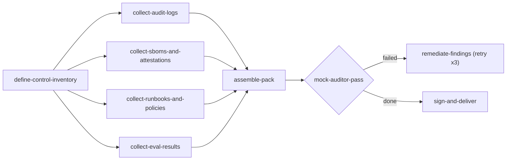
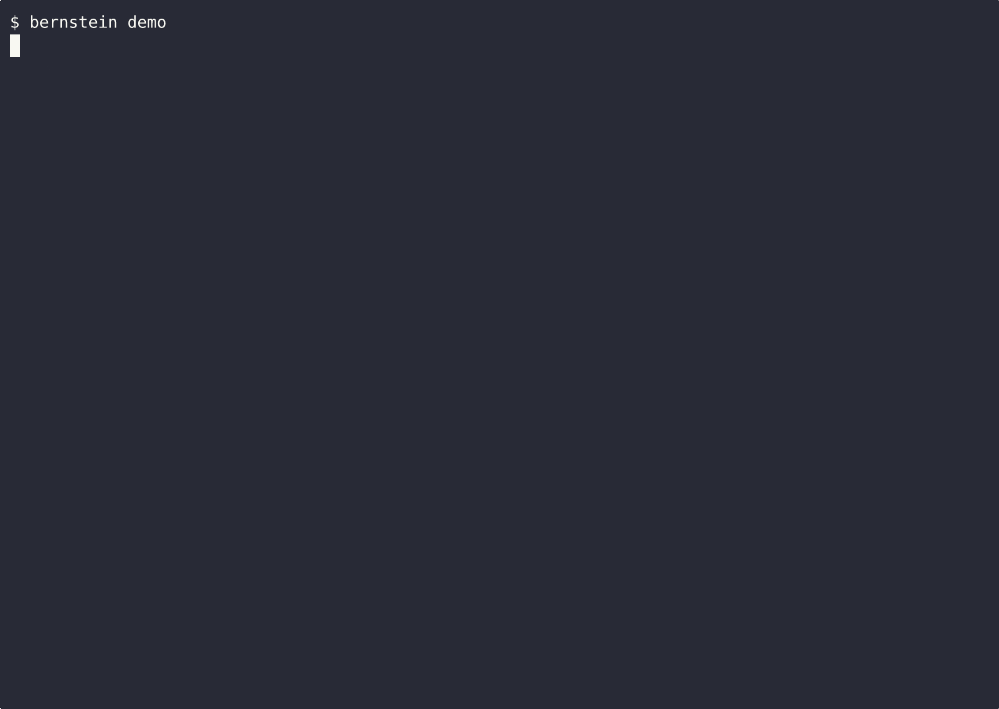

<div align="center">

<picture>
  <source media="(prefers-color-scheme: dark)" srcset="https://raw.githubusercontent.com/sipyourdrink-ltd/bernstein/main/docs/assets/readme-banner-dark.webp">
  
</picture>

<br>

> *"To achieve great things, two things are needed: a plan and not quite enough time."* - [attributed to](https://quoteinvestigator.com/2020/08/19/plan-time/) Leonard Bernstein

### de open-source governancelaag voor AI-agents
<!-- l10n: en="an open-source governance layer for AI agents" hash="sha256:f988e1e29b9e" -->

[](https://github.com/sipyourdrink-ltd/bernstein/actions/workflows/ci.yml)
[](https://pypi.org/project/bernstein/)
[](https://python.org)
[](https://github.com/sipyourdrink-ltd/bernstein/blob/main/LICENSE)
[](https://scorecard.dev/viewer/?uri=github.com/sipyourdrink-ltd/bernstein)


[website](https://bernstein.run) &middot; [docs](https://docs.bernstein.run/) &middot; [deepwiki](https://deepwiki.com/sipyourdrink-ltd/bernstein) &middot; [install](https://docs.bernstein.run/en/latest/getting-started/install/) &middot; [first run](https://github.com/sipyourdrink-ltd/bernstein/blob/main/docs/getting-started/first-run.md) &middot; [plugins](https://github.com/sipyourdrink-ltd/bernstein-addons) &middot; [org-kit](https://github.com/sipyourdrink-ltd/bernstein-addons/tree/main/plugins/org-kit) &middot; [glossary](https://github.com/sipyourdrink-ltd/bernstein/blob/main/docs/reference/GLOSSARY.md) &middot; [limitations](https://github.com/sipyourdrink-ltd/bernstein/blob/main/docs/reference/KNOWN_LIMITATIONS.md) &middot; [name policy](https://github.com/sipyourdrink-ltd/bernstein/blob/main/TRADEMARKS.md)

[简体中文](https://github.com/sipyourdrink-ltd/bernstein/blob/main/docs/i18n/README.zh-Hans.md) &middot; [繁體中文](https://github.com/sipyourdrink-ltd/bernstein/blob/main/docs/i18n/README.zh-TW.md) &middot; [日本語](https://github.com/sipyourdrink-ltd/bernstein/blob/main/docs/i18n/README.ja.md) &middot; [한국어](https://github.com/sipyourdrink-ltd/bernstein/blob/main/docs/i18n/README.ko.md) &middot; [हिन्दी](https://github.com/sipyourdrink-ltd/bernstein/blob/main/docs/i18n/README.hi.md) &middot; [বাংলা](https://github.com/sipyourdrink-ltd/bernstein/blob/main/docs/i18n/README.bn.md) &middot; [Русский](https://github.com/sipyourdrink-ltd/bernstein/blob/main/docs/i18n/README.ru.md) &middot; [Español](https://github.com/sipyourdrink-ltd/bernstein/blob/main/docs/i18n/README.es.md) &middot; [Português](https://github.com/sipyourdrink-ltd/bernstein/blob/main/docs/i18n/README.pt.md) &middot; [Deutsch](https://github.com/sipyourdrink-ltd/bernstein/blob/main/docs/i18n/README.de.md) &middot; [Français](https://github.com/sipyourdrink-ltd/bernstein/blob/main/docs/i18n/README.fr.md) &middot; [Italiano](https://github.com/sipyourdrink-ltd/bernstein/blob/main/docs/i18n/README.it.md) &middot; [Nederlands](https://github.com/sipyourdrink-ltd/bernstein/blob/main/docs/i18n/README.nl.md) &middot; [Polski](https://github.com/sipyourdrink-ltd/bernstein/blob/main/docs/i18n/README.pl.md) &middot; [Svenska](https://github.com/sipyourdrink-ltd/bernstein/blob/main/docs/i18n/README.sv.md) &middot; [Suomi](https://github.com/sipyourdrink-ltd/bernstein/blob/main/docs/i18n/README.fi.md) &middot; [Українська](https://github.com/sipyourdrink-ltd/bernstein/blob/main/docs/i18n/README.uk.md) &middot; [Türkçe](https://github.com/sipyourdrink-ltd/bernstein/blob/main/docs/i18n/README.tr.md) &middot; [العربية](https://github.com/sipyourdrink-ltd/bernstein/blob/main/docs/i18n/README.ar.md) &middot; [עברית](https://github.com/sipyourdrink-ltd/bernstein/blob/main/docs/i18n/README.he.md) &middot; [Bahasa Indonesia](https://github.com/sipyourdrink-ltd/bernstein/blob/main/docs/i18n/README.id.md) &middot; [Tiếng Việt](https://github.com/sipyourdrink-ltd/bernstein/blob/main/docs/i18n/README.vi.md) &middot; [ไทย](https://github.com/sipyourdrink-ltd/bernstein/blob/main/docs/i18n/README.th.md)

</div>

---

> **Status: bèta.** Onderhouden door één persoon, in actieve ontwikkeling. Het versienummer telt releases, geen volwassenheid — minor-versies kunnen interfaces wijzigen. Zet de versie vast voor afhankelijkheden; regressies worden snel opgelost, [meld ze hier](https://github.com/sipyourdrink-ltd/bernstein/issues).

Bernstein is de open-source governancelaag voor AI-agents. Het draait op policy as code: jij schrijft het beleid - wie wat mag doen, wat goedkeuring nodig heeft, wat vastgelegd moet worden - en Bernstein handhaaft dat en levert het verifieerbare bewijs. Een deterministische scheduler - geen model in de coördinatielus - draait agents parallel, toetst wat ze opleveren aan gates en legt elke stap vast, zodat een run achteraf te verifiëren is: offline, puur uit de artefacten. CLI-code-agents werken out of the box (Claude Code, Codex, Gemini CLI), en dezelfde laag governt elke agent-workload: het resultaat kan een diff zijn, een onderzoeksrapport, een dataset of een audit-evidence-pack. Air-gap-installatieprofiel inbegrepen. Apache-2.0.

### in het kort
<!-- l10n: en="at a glance" hash="sha256:3c95f239d9cf" -->

Vijf dingen onderscheiden het; de rest zijn details.

- **Geen LLM in de coördinatielus.** De planning is geschreven in puur Python, waardoor een run van begin tot eind reproduceerbaar is. Speel het plan van gisteren opnieuw af en krijg exact dezelfde taakgraaf.
- **Bewijs voor hardwaresleutels.** Offline verificateurs voor PIV-bewaring en FIDO2-goedkeuring delen het ontvangstprotocol, met vastgelegde vertrouwensankers en expliciete tijd. Tokenbewaring verhoogt de TRACE-vertrouwensniveaus niet. [Bewijs voor hardwaresleutels](https://github.com/sipyourdrink-ltd/bernstein/blob/main/docs/operations/hardware-key-evidence.md).
- **Achteraf controleerbaar.** Het replay-journaal legt elke run vast, en de continu actieve lineage-ruggengraat registreert elke herkomststap; het optionele HMAC-geketende auditlogboek (`BERNSTEIN_AUDIT=1`) voegt ontvangstbewijzen (receipts) toe die u offline kunt verifiëren. Niet-determinisme uit zich als een hash-afwijking bij de exacte stap in plaats van een willekeurige hapering bij een nieuwe run. Niet-code-resultaten krijgen dezelfde behandeling: een taak kan een artefactcontract declareren (rapport, dataset, actielogboek, ops-resultaat) en wordt voltooid met een ondertekend lineage-ontvangstbewijs in plaats van een git-commit.
- **Geïsoleerd door constructie.** Elke programmeertaak krijgt een eigen git worktree achter merge gates; taken in artefactmodus krijgen een werkmap onder `.sdd/workspaces/`. Agents delen standaard geen aanpasbare werkruimte; de enige gedeelde status is de takenbacklog, die atomair wordt geclaimd. Strikt beleid voor het bestandssysteem is optioneel via de [sandbox-backends](https://github.com/sipyourdrink-ltd/bernstein/blob/main/docs/architecture/sandbox.md). Schakel worktrees uit en elke taak draait in de gedeelde checkout.
- **Breed en lokaal.** 55 selecteerbare CLI-agentadapternamen, inclusief de generieke `--prompt`-wrapper. bestandsgebaseerde status, geen SaaS-tussenstap, geen externe gegevenslaag.

De volledige lijst staat op de [mogelijkhedenpagina](https://github.com/sipyourdrink-ltd/bernstein/blob/main/docs/reference/capabilities.md); de [functiematrix](https://github.com/sipyourdrink-ltd/bernstein/blob/main/docs/reference/FEATURE_MATRIX.md) is de uitputtende index.

De taakserver ondersteunt een blijvende, door de beheerder ingestelde controle op het claimen van nieuwe taken; zie de [handleiding](https://github.com/sipyourdrink-ltd/bernstein/blob/main/docs/operations/claim-admission.md).

Het adapterbeleid per rol ondersteunt een optionele standaardlijst met toegestane adapters voor niet afzonderlijk vermelde rollen; zie de [handleiding](https://github.com/sipyourdrink-ltd/bernstein/blob/main/docs/operations/role-adapter-policy.md).

### hoe een run eruitziet
<!-- l10n: en="what a run looks like" hash="sha256:8279488abf5a" -->

Eén YAML-bestand declareert de run: fasen, rollen, afhankelijkheden en de voorwaarden waaronder een node überhaupt draait. De scheduler voert het uit als gewoon Python - niets in het bestand is een prompt, en geen model beslist wat er daarna gebeurt. Deze graaf produceert een audit-evidence-pack; het volledige bestand staat in [`.bernstein/workflows/audit-evidence-pack.yaml`](https://github.com/sipyourdrink-ltd/bernstein/blob/main/.bernstein/workflows/audit-evidence-pack.yaml).

```yaml
name: audit-evidence-pack
version: "1.0.0"

phases:
  - name: scope
    allowed_roles: [manager, architect]
  - name: collect
  - name: validate
    allowed_roles: [qa, security]
  - name: deliver
    allowed_roles: [security, manager]

nodes:
  define-control-inventory:
    phase: scope
    role: architect

  collect-audit-logs:
    phase: collect
    role: security
    depends_on: [define-control-inventory]

  # three more evidence streams collect in parallel:
  # collect-sboms-and-attestations, collect-runbooks-and-policies,
  # collect-eval-results

  assemble-pack:
    phase: validate
    role: docs
    depends_on:
      - collect-audit-logs
      - collect-sboms-and-attestations
      - collect-runbooks-and-policies
      - collect-eval-results

  mock-auditor-pass:
    phase: validate
    role: qa
    depends_on: [assemble-pack]

  remediate-findings:
    phase: collect
    role: docs
    depends_on:
      - source: mock-auditor-pass
        condition: "status == 'failed'"
    retry:
      max_attempts: 3
      until: "status == 'done'"

  sign-and-deliver:
    phase: deliver
    role: security
    depends_on:
      - source: mock-auditor-pass
        condition: "status == 'done'"
```



Elke node wordt geclaimd door een agent wiens rol de fase toestaat; rolhekken en goedkeuringsgates houden stand wat de agent binnen de taak ook doet. Een code-node eindigt achter merge gates in zijn eigen git worktree. De nodes hierboven eindigen anders: een [artefactcontract](https://github.com/sipyourdrink-ltd/bernstein/blob/main/docs/operations/artifacts.md) benoemt het resultaat (rapport, dataset, scan, actielog) en de node sluit af met een ondertekend lineage-bewijs in plaats van een commit. Dezelfde scheduler, hetzelfde journal, dezelfde offline verificatie - of de graaf nu code, onderzoek, een ops-wijziging of een mix van alle drie levert. Kant-en-klare grafen voor software, onderzoek, docs, enterprise en contributor-workflows staan in [`.bernstein/scenarios/`](https://github.com/sipyourdrink-ltd/bernstein/tree/main/.bernstein/scenarios).

Nieuwe pogingen behouden `dispatch_tier`; bij het heropenen van een taak kan het niveau expliciet worden gekozen. Zie het [contract voor dispatchniveaus](https://github.com/sipyourdrink-ltd/bernstein/blob/main/docs/operations/task-tier-classification.md#retry-and-reopen).

### installeren in 30 seconden
<!-- l10n: en="install in 30 seconds" hash="sha256:b24c255f61fb" -->

```bash
uv tool install bernstein    # or: pipx install bernstein
bernstein demo               # zero-key local run (4 mock tasks); prints project path & run_id
# Inside the printed demo directory, sign and verify your own receipt offline:
openssl genpkey -algorithm ED25519 -out demo.key && openssl pkey -in demo.key -pubout -out demo.pub
bernstein verify run <run_id> --signing-key-path demo.key
bernstein verify receipt .sdd/runs/<run_id>/run-receipt.json --public-key demo.pub
```

Start de taak vanuit een werkbranch. Bernstein voegt gecontroleerde wijzigingen samen in de huidige branch en stopt uitvoeringen die wijzigingen in de standaardbranch zouden samenvoegen. Controleer de wijzigingen op de werkbranch voordat je een pull request opent.

pipx, pip, brew, dnf, npm en Docker worden behandeld in de [installatiehandleiding](https://docs.bernstein.run/en/latest/getting-started/install/); de geïsoleerde wheelhouse heeft een eigen [air-gap-handleiding](https://docs.bernstein.run/en/latest/installation/air-gap/).

[GHCR](https://ghcr.io/sipyourdrink-ltd/bernstein) &middot; [GitHub Codespaces](https://codespaces.new/sipyourdrink-ltd/bernstein?quickstart=1)



De bovenstaande opname toont een echte run en bevat zijn eigen bewijs. De opname, het ondertekende ontvangstbewijs afgeleid van het journaal van die run en de openbare sleutel die alles vastlegt, bevinden zich in [`docs/assets/demo-run/`](https://github.com/sipyourdrink-ltd/bernstein/tree/main/docs/assets/demo-run). Verifieer de zojuist bekeken run offline:

```bash
bernstein verify receipt docs/assets/demo-run/run-receipt.json \
    --public-key docs/assets/demo-run/run-receipt.pub.pem
```

Het vastgelegde ontvangstbewijs kan op elk moment opnieuw worden gecontroleerd met de bovenstaande opdracht; een gewijzigde kopie doorstaat dezelfde controle niet. `scripts/record_demo.sh` regenereert de opname, het ontvangstbewijs en de sleutel vanuit een nieuwe echte run; niets in de terminal is gesimuleerd.

Een actieve run kan worden gevolgd vanaf beide gebruikersinterfaces. Beide lezen dezelfde taken-API, zodat geen van beide een achterlopende weergave is. In `bernstein live` scrollen de linker- en rechterkolom onafhankelijk als complete panelen, zodat widgets bereikbaar blijven op kleinere terminals.

|  |  |
|:---:|:---:|
| `BERNSTEIN_SERVER_URL="<task-server-url>"` `bernstein live` — het terminaldashboard (externe worker-nodes) | `<task-server-url>/ui/` — browserdashboard van de actieve taakserver als de GUI-bestanden zijn geïnstalleerd. `bernstein gui serve` start een zelfstandige server in de huidige werkmap. |

Als de server authenticatie vereist, stel dan `BERNSTEIN_AUTH_TOKEN` in voor de terminal en voer een geautoriseerd token in op het aanmeldscherm in de browser. [GUI authentication](https://github.com/sipyourdrink-ltd/bernstein/blob/main/docs/gui/index.md#quickstart).

### een run bewijzen
<!-- l10n: en="prove a run" hash="sha256:d4095258a0e7" -->

Determinisme is hier iets wat u controleert, niet iets wat u op goed vertrouwen aanneemt. Voer eenmaal uit met audit ingeschakeld en controleer wat is vastgelegd:

```bash
BERNSTEIN_AUDIT=1 bernstein -g "fix the failing test in tests/test_foo.py"
bernstein replay list                 # run ids recorded on disk
bernstein replay latest --verify      # recompute the journal head, name the first divergent step
bernstein lineage verify <run_id>     # recompute the always-on lineage spine
bernstein audit verify                # HMAC chain + Merkle seal (written because audit was enabled)
bernstein audit diagnose <run_id> --signal gate --sign-key KEY
                                      # name the exact step a failure entered the run, as a signed receipt
bernstein verify run <run_id> --signing-key-path key.pem   # sign one portable run receipt
bernstein verify receipt .sdd/runs/<run_id>/run-receipt.json  # verify it offline: file only
```

Het journaal wordt bij elke run geschreven; de lineage-ruggengraat staat altijd aan en krijgt een regel voor elke herkomststap, zodat een korte run kan eindigen met een geldige, lege ruggengraat. `bernstein audit verify` heeft alleen een keten om te controleren wanneer de run is gestart met `BERNSTEIN_AUDIT=1`, een compliance-voorinstelling of `bernstein run --audit`. De vlag `--audit` hoort bij `bernstein run`; stel bij de bovenstaande `bernstein -g`-vorm de omgevingsvariabele in.

Een run-receipt bindt de journaalkop, de lineage-kop (als er stappen zijn vastgelegd) en optioneel een auditketenbereik onder één met Ed25519 ondertekend subject met ingesloten openbare sleutel. Een controleur met dat bestand en de openbare sleutel van de beheerder kan bevestigen dat de ingesloten acties en ketens ongewijzigd zijn: geen HMAC-sleutel nodig, geen actieve `.sdd/`, en exitcode `2` met vermelding van de eerste afwijkende stap bij manipulatie. Dat ontvangstbewijs identificeert de ingesloten journaalstatus; om te bewijzen dat die status het volledige voltooide journaal is, is bovendien een onafhankelijk kop/telling-zegel vereist. Zonder `--public-key` controleert het bestand alleen de interne integriteit. Details in [deterministische replay](https://github.com/sipyourdrink-ltd/bernstein/blob/main/docs/operations/deterministic-replay.md#signed-run-receipt-one-file-offline-verification).

Open **Governance** in de webinterface en gebruik **Verify a receipt** om een run-receipt op de server te controleren. De browser toont de uitkomst van de controle van alleen de integriteit en de herkomst van de sleutel. Zie [Governance operator guide](https://github.com/sipyourdrink-ltd/bernstein/blob/main/docs/operations/governance.md#verifying-a-dropped-receipt).

Dezelfde controleerbaarheid geldt voor evaluatiecijfers. `bernstein bench run <suite> --reliability k` (ook geschreven als `bernstein eval --reliability k`) voert elke taak `k` keer uit onder vaste coördinatie en rapporteert een `pass^k`-ondergrens (alle `k` pogingen moeten slagen) naast het `pass@1`-plafond. Dat resultaat wordt verzegeld in een ondertekend ontvangstbewijs dat `bernstein bench reliability-verify` offline herberekenen kan, zodat een gemanipuleerde ondergrens faalt bij verificatie. Details: [pass^k betrouwbaarheidsondergrens](https://github.com/sipyourdrink-ltd/bernstein/blob/main/docs/eval/reliability.md).

Gebruik `bernstein govern audit --format json` of `--format sarif` voor machineleesbare controleresultaten en `--strict --quiet` als goedkeuringscriterium in CI. Zie [govern audit](https://github.com/sipyourdrink-ltd/bernstein/blob/main/docs/operations/governance.md#govern-audit-machine-readable-output-and-ci-gates). Het `cosai`-bewijspakket bevat de MCP-dreigingsklassen uit de vastgelegde versie van het document van 2026-01-08 en benoemt de resterende hiaten in de dekking.

`bernstein delegation verify RUN` vergelijkt de keten van ontvangstbewijzen met de definitieve ketenkop en het aantal delegatiestappen, die in het uitvoeringsmanifest met een HMAC op basis van de auditsleutel zijn verzegeld. Zo worden het verwijderen van het keteneinde, vervanging en uitbreiding na afsluiting gedetecteerd, inclusief het herschrijven van de declaratie zonder sleutel. Als de declaratie wordt verwijderd, blijft de uitvoering onvolledig (exitcode `3`) en geldt deze nooit als geldig. Dit detecteert geen hergebruik van een oudere authentieke momentopname en biedt geen bescherming tegen een schrijver die de auditsleutel bezit. Zie de [werkwijze voor delegatieverificatie](https://github.com/sipyourdrink-ltd/bernstein/blob/main/docs/operations/delegation-verify.md).

### hoe het werkt
<!-- l10n: en="how it works" hash="sha256:b734c935f998" -->

Elk doel doorloopt vier fasen:

1. **Ontleden (Decompose)**. De manager verdeelt uw doel in taken met rollen, toegewezen bestanden en voltooiingssignalen. Eén LLM-aanroep, daarna puur Python.
2. **Opstarten (Spawn)**. Agents starten in geïsoleerde [git worktrees](https://git-scm.com/docs/git-worktree), één per programmeertaak; een artefacttaak krijgt een normale werkmap. De hoofdbranch blijft schoon.
3. **Verifiëren (Verify)**. De janitor controleert concrete signalen: tests slagen, bestanden bestaan, linting is schoon, types kloppen.
4. **Samenvoegen (Merge)**. Geverifieerd werk landt in main. Mislukte taken worden opnieuw geprobeerd of doorgestuurd naar een ander model.

Waarom de planner in puur Python is geschreven en welke afwegingen daarbij horen: [waarom deterministisch](https://github.com/sipyourdrink-ltd/bernstein/blob/main/docs/architecture/WHY_DETERMINISTIC.md).

De controle `can_spawn()` van de kostenregistratie geeft `False` terug wanneer de gecorrigeerde totale uitgaven de ingestelde stopgrens voor het budget bereiken of overschrijden, ook als er geen nieuwe tokens zijn gemeld. Na een herstart zijn de opgeslagen tokenaantallen alleen niet voldoende om de exacte cumulatieve kosten te reconstrueren die eerder voor een bepaalde combinatie van agent, taak en model zijn gemeld.

### dagelijkse commando's
<!-- l10n: en="everyday commands" hash="sha256:254fa66255e2" -->

```bash
cd your-project
bernstein init                    # creates .sdd/ workspace, bernstein.yaml + templates/
bernstein -g "Add rate limiting"  # agents spawn, work in parallel, verify, exit
bernstein live                    # watch progress in the TUI dashboard
bernstein run plan.yaml           # multi-stage plan: skip LLM planning, execute directly
bernstein stop                    # graceful shutdown with drain
```

Als een taak in een losgekoppelde SSH-run eindigt met een afsluitcode die niet nul is, mislukken de taak en de run. Het taakbewijs vermeldt de afsluitcode en de volgende taken blijven in de wachtrij.

Het volledige beheerderoppervlak (PR-automatisering, planningen, chat-koppelingen, de autofix-daemon) is te vinden in [beheerderscommando's](https://github.com/sipyourdrink-ltd/bernstein/blob/main/docs/operations/commands.md).

`bernstein workflow` voert declaratieve YAML-DAG's van agent-, commando- en lusknooppunten uit - met ondersteuning voor het hervatten van onderbroken runs:

```bash
bernstein workflow run idea-to-pr -g "Add JWT auth"   # prints run_id
bernstein workflow resume <run_id> -g "Add JWT auth" # picks up at the first non-completed node
```

De runstatus wordt bij elk knooppunt als checkpoint onder `.sdd/runs/<run_id>/` vastgelegd. Hervatten valideert de manifest-digest bij de start van de run, zodat een wijziging van de specificatie wordt geweigerd in plaats van stilzwijgend een ander manifest uit te voeren. Zie [workflow-manifesten](https://github.com/sipyourdrink-ltd/bernstein/blob/main/docs/operations/workflows.md). Geef bij het hervatten opnieuw dezelfde `-g`-waarde op, zodat `{goal}` wordt vervangen in de prompts van onvoltooide knooppunten.

`bernstein compliance controls` toont per controle de testsuites en de laatste volledige meting, indien beschikbaar. [Benchmarkdekking](https://github.com/sipyourdrink-ltd/bernstein/blob/main/docs/compliance/regulator-mapped-packs.md#cli-inspection)

Kwaliteitscontroles voor de repository: `bernstein readme-l10n verify` laat een PR falen waarvan de vertaalde README's afwijken van de Engelse bron (met vermelding van de verouderde sectie), `bernstein readme-l10n sync` werkt de koppelingen bij na Engelse wijzigingen. Zie [readme-l10n](https://github.com/sipyourdrink-ltd/bernstein/blob/main/docs/playbooks/readme-l10n.md).

### ondersteunde agents
<!-- l10n: en="supported agents" hash="sha256:d674cd57d15a" -->

Claude Code, Codex CLI, Gemini CLI, GitHub Copilot CLI, Cursor, Aider, Goose, Muse Code, OpenAI Agents SDK, Amp, Cody, Continue, Devin Terminal, Junie, Kilo, Kiro, AWS Q Developer, Ollama, OpenCode, OpenHands, Open Interpreter, gptme, Plandex, AIChat, Letta Code, Qwen en meer. De [adapterindex](https://github.com/sipyourdrink-ltd/bernstein/blob/main/docs/adapters/index.md) bevat installatiecommando's voor 30 ervan. `bernstein integrations list` somt alle 57 ingebouwde integraties op uit `src/bernstein/adapters/registry.py`, de enige bron van waarheid. 55 daarvan zijn selecteerbare agentadapters; de andere twee rijen zijn de teststub `mock` en het eindpuntprofiel `self-hosted-endpoints`. Elk ander programma met een `--prompt`-vlag werkt via de generieke wrapper. `bernstein adapters list` → `Selectable CLI agent adapter names: 55` (`generic`; `agy` = `antigravity`).

Combineer agents binnen dezelfde run: goedkope lokale modellen voor routinematige code, krachtigere cloudmodellen voor architectuur. `bernstein integrations list --installed` toont wat er beschikbaar is op uw machine.

### voorbij de voorpagina
<!-- l10n: en="beyond the front page" hash="sha256:63d7eefff374" -->

Alle diepgaande documentatie staat op de [documentatiesite](https://docs.bernstein.run/):

| pagina | wat het behandelt |
|---|---|
| [capabilities](https://github.com/sipyourdrink-ltd/bernstein/blob/main/docs/reference/capabilities.md) | de volledige lijst met mogelijkheden: MCP-servermodus, ondertekende agent-cards, sandbox-backends, artefact-sinks, wettelijke kaders |
| [Agent Manifest export](https://github.com/sipyourdrink-ltd/bernstein/blob/main/docs/operations/agent-manifest.md) | `bernstein manifest export-agent` · `composition-only` · `agent-manifest==0.12.0` |
| [`bernstein_create_task`](https://github.com/sipyourdrink-ltd/bernstein/blob/main/docs/operations/bare-tasks.md) | `POST /api/v1/tasks` → `bernstein_claim` → `bernstein_complete` |
| [who this is for](https://github.com/sipyourdrink-ltd/bernstein/blob/main/docs/use-cases.md) | waar de waarde ligt en wanneer Bernstein het verkeerde gereedschap is |
| [workflows](https://github.com/sipyourdrink-ltd/bernstein/blob/main/docs/operations/workflow-manifests.md) | declaratieve YAML-DAG's van agent- / commando- / lusknooppunten |
| [web UI](https://github.com/sipyourdrink-ltd/bernstein/blob/main/docs/gui/index.md) | browserdashboard gebaseerd op dezelfde API als de TUI (taken aanmaken en bekijken) |
| [status van clusterworkers](https://github.com/sipyourdrink-ltd/bernstein/blob/main/docs/operations/cluster-mode.md#worker-health-telemetry) (`bernstein worker`) | Workers nemen geen nieuwe taken aan zolang de vrije schijfruimte, het geheugengebruik of de netwerkvertraging buiten de ingestelde grenzen valt. |
| [datasources](https://github.com/sipyourdrink-ltd/bernstein/blob/main/docs/operations/datasources.md) | alleen-lezen query-ontvangstbewijzen, plus een querydriver die elk resultaat koppelt aan de gebruikte schemasnapshot |
| [agent catalogs](https://github.com/sipyourdrink-ltd/bernstein/blob/main/docs/operations/agent-catalogs.md) | verwijs rollen naar externe agentdefinities buiten de ingebouwde sjablonen — een generieke YAML/SKILL.md-map of een Claude Code-plugin-structuur |
| [security](https://github.com/sipyourdrink-ltd/bernstein/blob/main/docs/operations/security.md) | scorecard, fuzzing, beveiliging |
| [architecture](https://github.com/sipyourdrink-ltd/bernstein/blob/main/docs/architecture/ARCHITECTURE.md) | hoe het onder de motorkap werkt |

### waarom deze naam?
<!-- l10n: en="why the name?" hash="sha256:e9839a1c718d" -->

Bernstein is vernoemd naar Leonard Bernstein, de Amerikaanse dirigent en componist. De orkestrator van het project bestuurt een team van AI-agents zoals Bernstein het New York Philharmonic dirigeerde: elke muzikant op het juiste moment, de partituur deterministisch, de dirigent verantwoordelijk voor het eindresultaat. De dirigentenmetafoor beschrijft Bernsteins vermogen om agenttaken te orkestreren die code, onderzoeksrapporten of datasets opleveren.

Bernstein begon als een deterministisch harnas om niet-deterministische merges en ongeverifieerde toestanden tussen parallelle code-agenten te voorkomen. Apache-2.0. Releases en documentatie: [bernstein.run](https://bernstein.run).

### bijdragen, ondersteuning, licentie
<!-- l10n: en="contributing, support, license" hash="sha256:cb937af4a6cc" -->

Pull requests zijn welkom; [CONTRIBUTING.md](https://github.com/sipyourdrink-ltd/bernstein/blob/main/CONTRIBUTING.md) bevat installatie-instructies en codestijl. Beveiligingsmeldingen verlopen via [SECURITY.md](https://github.com/sipyourdrink-ltd/bernstein/blob/main/SECURITY.md). Contact: [forte@bernstein.run](mailto:forte@bernstein.run).

Citatiemetagegevens staan in [CITATION.cff](https://github.com/sipyourdrink-ltd/bernstein/blob/main/CITATION.cff). Licentie: [Apache-2.0](https://github.com/sipyourdrink-ltd/bernstein/blob/main/LICENSE); de projectnaam is afzonderlijk beschermd in [TRADEMARKS.md](https://github.com/sipyourdrink-ltd/bernstein/blob/main/TRADEMARKS.md).

---

[Alex Chernysh](https://alexchernysh.com) &middot; [GitHub](https://github.com/chernistry) &middot; [X](https://x.com/alex_chernysh) &middot; [bernstein.run](https://bernstein.run) &middot; [task notifications](https://github.com/sipyourdrink-ltd/bernstein/blob/main/docs/operations/notifications.md#role-task-subscriptions-sse)

<!-- mcp-name: io.github.sipyourdrink-ltd/bernstein -->
