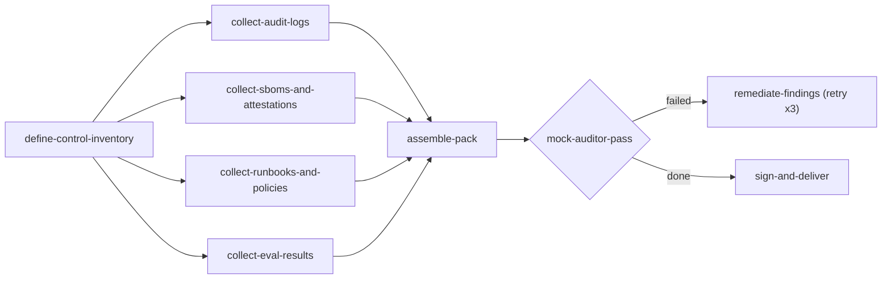
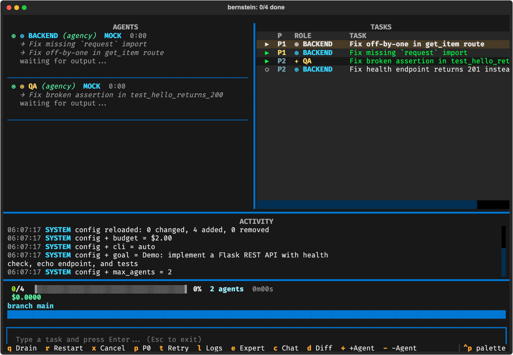
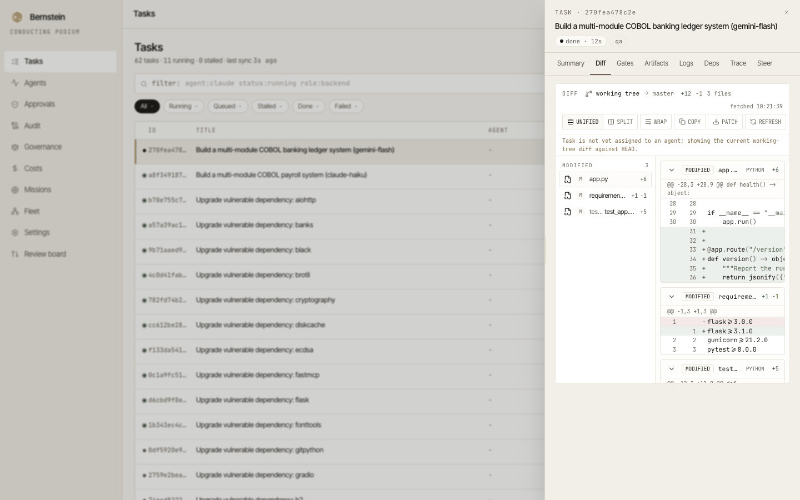

<div align="center">

<picture>
  <source media="(prefers-color-scheme: dark)" srcset="https://raw.githubusercontent.com/sipyourdrink-ltd/bernstein/main/docs/assets/readme-banner-dark.webp">
  
</picture>

<br>

> *"To achieve great things, two things are needed: a plan and not quite enough time."* - [attributed to](https://quoteinvestigator.com/2020/08/19/plan-time/) Leonard Bernstein

### governance-lagret med öppen källkod för AI-agenter
<!-- l10n: en="the open-source governance layer for AI agents" hash="sha256:84e7f64086f5" -->

[](https://github.com/sipyourdrink-ltd/bernstein/actions/workflows/ci.yml)
[](https://pypi.org/project/bernstein/)
[](https://python.org)
[](https://github.com/sipyourdrink-ltd/bernstein/blob/main/LICENSE)
[](https://scorecard.dev/viewer/?uri=github.com/sipyourdrink-ltd/bernstein)


[website](https://bernstein.run) &middot; [docs](https://docs.bernstein.run/) &middot; [deepwiki](https://deepwiki.com/sipyourdrink-ltd/bernstein) &middot; [install](https://docs.bernstein.run/en/latest/getting-started/install/) &middot; [first run](https://github.com/sipyourdrink-ltd/bernstein/blob/main/docs/getting-started/first-run.md) &middot; [glossary](https://github.com/sipyourdrink-ltd/bernstein/blob/main/docs/reference/GLOSSARY.md) &middot; [limitations](https://github.com/sipyourdrink-ltd/bernstein/blob/main/docs/reference/KNOWN_LIMITATIONS.md) &middot; [name policy](https://github.com/sipyourdrink-ltd/bernstein/blob/main/TRADEMARKS.md)

[简体中文](https://github.com/sipyourdrink-ltd/bernstein/blob/main/docs/i18n/README.zh-Hans.md) &middot; [繁體中文](https://github.com/sipyourdrink-ltd/bernstein/blob/main/docs/i18n/README.zh-TW.md) &middot; [日本語](https://github.com/sipyourdrink-ltd/bernstein/blob/main/docs/i18n/README.ja.md) &middot; [한국어](https://github.com/sipyourdrink-ltd/bernstein/blob/main/docs/i18n/README.ko.md) &middot; [हिन्दी](https://github.com/sipyourdrink-ltd/bernstein/blob/main/docs/i18n/README.hi.md) &middot; [বাংলা](https://github.com/sipyourdrink-ltd/bernstein/blob/main/docs/i18n/README.bn.md) &middot; [Русский](https://github.com/sipyourdrink-ltd/bernstein/blob/main/docs/i18n/README.ru.md) &middot; [Español](https://github.com/sipyourdrink-ltd/bernstein/blob/main/docs/i18n/README.es.md) &middot; [Português](https://github.com/sipyourdrink-ltd/bernstein/blob/main/docs/i18n/README.pt.md) &middot; [Deutsch](https://github.com/sipyourdrink-ltd/bernstein/blob/main/docs/i18n/README.de.md) &middot; [Français](https://github.com/sipyourdrink-ltd/bernstein/blob/main/docs/i18n/README.fr.md) &middot; [Italiano](https://github.com/sipyourdrink-ltd/bernstein/blob/main/docs/i18n/README.it.md) &middot; [Nederlands](https://github.com/sipyourdrink-ltd/bernstein/blob/main/docs/i18n/README.nl.md) &middot; [Polski](https://github.com/sipyourdrink-ltd/bernstein/blob/main/docs/i18n/README.pl.md) &middot; [Svenska](https://github.com/sipyourdrink-ltd/bernstein/blob/main/docs/i18n/README.sv.md) &middot; [Suomi](https://github.com/sipyourdrink-ltd/bernstein/blob/main/docs/i18n/README.fi.md) &middot; [Українська](https://github.com/sipyourdrink-ltd/bernstein/blob/main/docs/i18n/README.uk.md) &middot; [Türkçe](https://github.com/sipyourdrink-ltd/bernstein/blob/main/docs/i18n/README.tr.md) &middot; [العربية](https://github.com/sipyourdrink-ltd/bernstein/blob/main/docs/i18n/README.ar.md) &middot; [עברית](https://github.com/sipyourdrink-ltd/bernstein/blob/main/docs/i18n/README.he.md) &middot; [Bahasa Indonesia](https://github.com/sipyourdrink-ltd/bernstein/blob/main/docs/i18n/README.id.md) &middot; [Tiếng Việt](https://github.com/sipyourdrink-ltd/bernstein/blob/main/docs/i18n/README.vi.md) &middot; [ไทย](https://github.com/sipyourdrink-ltd/bernstein/blob/main/docs/i18n/README.th.md)

</div>

---

> **Status: beta.** Underhålls av en person, under aktiv utveckling. Versionsnumret räknar utgåvor, inte mognadsgrad — delversioner kan ändra gränssnitt. Lås versionen för kritiska beroenden; regressioner åtgärdas snabbt, [rapportera dem](https://github.com/sipyourdrink-ltd/bernstein/issues).

Bernstein är governance-lagret med öppen källkod för AI-agenter. Det körs på policy as code: du skriver policyn - vem som får göra vad, vad som kräver godkännande, vad som måste loggas - och Bernstein tillämpar den och tar fram det verifierbara beviset. En deterministisk schemaläggare - ingen modell i koordinationsloopen - kör agenter parallellt, grindar det de producerar och loggar varje steg, så att en körning kan verifieras i efterhand, offline, enbart från artefakterna. CLI-kodagenter fungerar direkt (Claude Code, Codex, Gemini CLI), och samma lager governar vilken agentlast som helst: leveransen kan vara en diff, en forskningsrapport, ett dataset eller ett paket med revisionsbevis. Air-gap-installationsprofil ingår. Apache-2.0.

### i korthet
<!-- l10n: en="at a glance" hash="sha256:1b8e3b26778a" -->

Fem saker skiljer det från andra; resten är detaljer.

- **Ingen LLM i koordineringsloopen.** Schemaläggningen sker i ren Python, vilket gör en körning reproducerbar från början till slut. Återuppspela gårdagens plan och få exakt samma uppgiftsgraf.
- **Bevis för hårdvarunycklar.** Offlineverifierare för PIV-förvaring och FIDO2-godkännanden delar kvittoprotokollet, med fastlagd tillit och explicit tid. Tokenförvaring höjer inte TRACE:s tillitsnivåer. [Bevis för hårdvarunycklar](https://github.com/sipyourdrink-ltd/bernstein/blob/main/docs/operations/hardware-key-evidence.md).
- **Verifierbar i efterhand.** Replay-journalen registrerar varje körning, och den ständigt aktiva lineage-ryggraden loggar varje spårbarhetspunkt; den valfria HMAC-kedjade granskningsloggen (`BERNSTEIN_AUDIT=1`) lägger till kvitton (receipts) som du kan verifiera offline. Icke-determinism visar sig som en hash-avvikelse vid det exakta steget, inte som ett instabilt testfel vid omkörning. Leverabler som inte är kod behandlas på samma sätt: en uppgift kan deklarera ett artefaktkontrakt (rapport, dataset, åtgärdslogg, ops-resultat) och slutförs med ett signerat lineage-kvitto istället för en git-commit.
- **Isolerad genom konstruktion.** Varje kodningsuppgift får ett eget git worktree bakom merge gates; uppgifter i artefaktläge får en arbetskatalog under `.sdd/workspaces/`. Agenter delar som standard ingen föränderlig arbetsyta; det enda delade tillståndet är uppgiftskön, som reserveras atomärt. Striktare filsystemsbegränsningar är valfria via [sandbox-backends](https://github.com/sipyourdrink-ltd/bernstein/blob/main/docs/architecture/sandbox.md). Inaktivera worktrees så körs varje uppgift i den delade arbetskatalogen.
- **Bred och lokal.** 55 valbara namn på CLI-agentadaptrar, inklusive det generiska `--prompt`-omslaget. filbaserat tillstånd, inga SaaS-mellanled, inget externt dataplan.

Hela listan finns på [funktionssidan](https://github.com/sipyourdrink-ltd/bernstein/blob/main/docs/reference/capabilities.md); [funktionsmatrisen](https://github.com/sipyourdrink-ltd/bernstein/blob/main/docs/reference/FEATURE_MATRIX.md) är det fullständiga indexet.

Uppgiftsservern stöder en beständig, operatörsstyrd spärr för att ta nya uppgifter; se [guiden](https://github.com/sipyourdrink-ltd/bernstein/blob/main/docs/operations/claim-admission.md).

Adapterpolicyn för roller stöder en valfri standardlista över tillåtna adaptrar för roller som inte anges separat; se [guiden](https://github.com/sipyourdrink-ltd/bernstein/blob/main/docs/operations/role-adapter-policy.md).

### hur en körning ser ut
<!-- l10n: en="what a run looks like" hash="sha256:8279488abf5a" -->

En enda YAML-fil deklarerar körningen: faser, roller, beroenden och villkoren under vilka en nod alls körs. Schemaläggaren exekverar den som ren Python - inget i filen är en prompt, och ingen modell bestämmer vad som händer härnäst. Den här grafen bygger ett paket med revisionsbevis; hela filen finns i [`.bernstein/workflows/audit-evidence-pack.yaml`](https://github.com/sipyourdrink-ltd/bernstein/blob/main/.bernstein/workflows/audit-evidence-pack.yaml).

```yaml
name: audit-evidence-pack
version: "1.0.0"

phases:
  - name: scope
    allowed_roles: [manager, architect]
  - name: collect
  - name: validate
    allowed_roles: [qa, security]
  - name: deliver
    allowed_roles: [security, manager]

nodes:
  define-control-inventory:
    phase: scope
    role: architect

  collect-audit-logs:
    phase: collect
    role: security
    depends_on: [define-control-inventory]

  # three more evidence streams collect in parallel:
  # collect-sboms-and-attestations, collect-runbooks-and-policies,
  # collect-eval-results

  assemble-pack:
    phase: validate
    role: docs
    depends_on:
      - collect-audit-logs
      - collect-sboms-and-attestations
      - collect-runbooks-and-policies
      - collect-eval-results

  mock-auditor-pass:
    phase: validate
    role: qa
    depends_on: [assemble-pack]

  remediate-findings:
    phase: collect
    role: docs
    depends_on:
      - source: mock-auditor-pass
        condition: "status == 'failed'"
    retry:
      max_attempts: 3
      until: "status == 'done'"

  sign-and-deliver:
    phase: deliver
    role: security
    depends_on:
      - source: mock-auditor-pass
        condition: "status == 'done'"
```



Varje nod tas av en agent vars roll fasen tillåter; rollstängsel och godkännandegrindar håller oavsett vad agenten gör i uppgiften. En kodnod avslutas bakom merge gates i sitt eget git worktree. Noderna ovan avslutas annorlunda: ett [artefaktkontrakt](https://github.com/sipyourdrink-ltd/bernstein/blob/main/docs/operations/artifacts.md) namnger leveransen (rapport, dataset, skanning, åtgärdslogg) och noden stängs med ett signerat lineage-kvitto i stället för en commit. Samma schemaläggare, samma journal, samma offlineverifiering - oavsett om grafen levererar kod, forskning, en ops-ändring eller en blandning av alla tre. Färdiga grafer för mjukvara, forskning, dokumentation, enterprise och bidragsflöden finns i [`.bernstein/scenarios/`](https://github.com/sipyourdrink-ltd/bernstein/tree/main/.bernstein/scenarios).

Nya försök behåller `dispatch_tier`; när en uppgift öppnas igen kan nivån väljas uttryckligen. Se [kontraktet för körningsnivåer](https://github.com/sipyourdrink-ltd/bernstein/blob/main/docs/operations/task-tier-classification.md#retry-and-reopen).

### installera på 30 sekunder
<!-- l10n: en="install in 30 seconds" hash="sha256:21359f31e683" -->

```bash
uv tool install bernstein    # or: pipx install bernstein
bernstein init
# Set goal, cli, model and budget in bernstein.yaml. Use internal_llm_provider: none for the single-worker example.
git switch -c bernstein/first-run  # skip if already on a working branch
bernstein doctor             # shows setup steps for the current project
bernstein run --worker backend
```

Starta körningen från en arbetsgren. Bernstein slår ihop verifierade ändringar med den utcheckade grenen och stoppar körningar som kan slå ihop ändringar med standardgrenen. Granska ändringarna i arbetsgrenen innan du öppnar en pull request.

`bernstein doctor --json` visar också auditkontraktets resultat `findings`, som är identiska med resultaten från `bernstein govern audit --only INS --json` för samma installationsobservationer. Den vanliga doctor-rapportens visning ändras inte. Se [driftguiden för doctor](https://github.com/sipyourdrink-ltd/bernstein/blob/main/docs/operations/doctor.md) för stabila kontroll-ID:n.

Doctor rapporterar kvarlämnade körningsbanor som överskrider åldersgränsen i JSON. Kontrollen misslyckas om underlaget inte kan verifieras; ingenting tas bort.

pipx, pip, brew, dnf, npm och Docker beskrivs i [installationsguiden](https://docs.bernstein.run/en/latest/getting-started/install/); det isolerade paketet har en egen [air-gap-guide](https://docs.bernstein.run/en/latest/installation/air-gap/).

`bernstein worktrees sweep` förhandsvisar arbetsträd och sandboxsessioner som avslutade uppgifter lämnat kvar, med ålder och diskanvändning. Endast arbetsträd kan tas bort, med `--apply` och ett separat godkännande för borttagning. Sandboxar tas endast med i rapporten (borttagning: #6571); `doctor` varnar för äldre kvarlämnade resurser. Se [rensningsflödet](https://github.com/sipyourdrink-ltd/bernstein/blob/main/docs/operations/worktrees.md#task-terminal-lane-sweep).

Fel vid initiering av färdigheter leder till [karantän](https://github.com/sipyourdrink-ltd/bernstein/blob/main/docs/operations/declaration-quarantine.md), med beständigt sparad orsak och granskningshändelse. `bernstein status` visar antalet; `doctor` och `govern audit` rapporterar de inaktiverade deklarationerna. Åtgärda orsaken och ta sedan uttryckligen bort markeringen med `bernstein quarantine re-enable DECLARATION_ID`.

[GHCR](https://ghcr.io/sipyourdrink-ltd/bernstein) &middot; [GitHub Codespaces](https://codespaces.new/sipyourdrink-ltd/bernstein?quickstart=1)


Inspelningen ovan visar en verklig körning och innehåller sitt eget bevis. Sessionen, det signerade körkvittot genererat från journalen och den offentliga nyckeln finns i [`docs/assets/demo-run/`](https://github.com/sipyourdrink-ltd/bernstein/tree/main/docs/assets/demo-run). Verifiera körningen offline:

```bash
bernstein verify receipt docs/assets/demo-run/run-receipt.json \
    --public-key docs/assets/demo-run/run-receipt.pub.pem
```

Det incheckade kvittot kan kontrolleras igen när som helst med kommandot ovan; en manipulerad kopia klarar inte samma kontroll. `scripts/record_demo.sh` återskapar inspelning, kvitto och nyckel från en ny verklig körning; ingenting i terminalen är syntetiserat.

En pågående körning kan följas från båda operatörsgränssnitten. Båda läser samma uppgifts-API, vilket gör att ingen av dem är en fördröjd spegling. I `bernstein live` rullar vänster och höger kolumn oberoende som hela paneler, så att kontroller förblir åtkomliga på mindre terminaler.

|  |  |
|:---:|:---:|
| `BERNSTEIN_SERVER_URL="<task-server-url>"` `bernstein live` — terminalpanelen (fjärranslutna arbetsnoder) | `<task-server-url>/ui/` — webbpanelen för den körande uppgiftsservern när GUI-filerna är installerade. `bernstein gui serve` startar en fristående server i den aktuella arbetsytan. |

Om servern kräver autentisering, ange `BERNSTEIN_AUTH_TOKEN` för terminalen och mata in en auktoriserad token på webbläsarens inloggningssida. [GUI authentication](https://github.com/sipyourdrink-ltd/bernstein/blob/main/docs/gui/index.md#quickstart).

### bevisa en körning
<!-- l10n: en="prove a run" hash="sha256:d4095258a0e7" -->

Determinism är här något du verifierar, inte något du accepterar på god tro. Kör en gång med granskning aktiverad och kontrollera sedan vad som loggades:

```bash
BERNSTEIN_AUDIT=1 bernstein -g "fix the failing test in tests/test_foo.py"
bernstein replay list                 # run ids recorded on disk
bernstein replay latest --verify      # recompute the journal head, name the first divergent step
bernstein lineage verify <run_id>     # recompute the always-on lineage spine
bernstein audit verify                # HMAC chain + Merkle seal (written because audit was enabled)
bernstein audit diagnose <run_id> --signal gate --sign-key KEY
                                      # name the exact step a failure entered the run, as a signed receipt
bernstein verify run <run_id> --signing-key-path key.pem   # sign one portable run receipt
bernstein verify receipt .sdd/runs/<run_id>/run-receipt.json  # verify it offline: file only
```

Journalen skrivs vid varje körning; lineage-ryggraden är alltid aktiv och lägger till en post för varje spårbart steg, så att en kort körning kan avslutas med en giltig, tom ryggrad. `bernstein audit verify` har bara en kedja att kontrollera när körningen startades med `BERNSTEIN_AUDIT=1`, en regelefterlevnadsprofil eller `bernstein run --audit`. Flaggan `--audit` tillhör `bernstein run`; i `bernstein -g`-formen ovan anger du miljövariabeln.

Ett körkvitto binder samman journalens topp, lineage-ryggradens topp (om poster sparats) och valfritt ett granskningskedjeintervall under ett enda Ed25519-signerat objekt med inbäddad offentlig nyckel. En granskare med den filen och operatörens offentliga nyckel kan bekräfta att åtgärder och kedjor är oförvanskade: ingen HMAC-nyckel krävs, ingen aktiv `.sdd/`, och slutkod `2` med angivelse av det första avvikande steget vid manipulation. Kvittot identifierar det inbäddade journaltillståndet; att bevisa att tillståndet utgör hela den färdiga journalen kräver dessutom ett oberoende kontrollsigill. Utan `--public-key` kontrolleras endast intern integritet. Detaljer i [deterministisk återuppspelning](https://github.com/sipyourdrink-ltd/bernstein/blob/main/docs/operations/deterministic-replay.md#signed-run-receipt-one-file-offline-verification).

Öppna **Governance** i webbgränssnittet och använd **Verify a receipt** för att kontrollera ett körkvitto på servern. Webbläsaren visar resultatet av enbart integritetskontrollen och nyckelns källa. Se [Governance operator guide](https://github.com/sipyourdrink-ltd/bernstein/blob/main/docs/operations/governance.md#verifying-a-dropped-receipt).

Samma verifierbarhet gäller för utvärderingsresultat. `bernstein bench run <suite> --reliability k` (även `bernstein eval --reliability k`) kör varje uppgift `k` gånger under fast koordinering och rapporterar ett `pass^k`-golv (alla `k` försök måste lyckas) tillsammans med `pass@1`-taket. Resultatet förseglas i ett signerat kvitto som `bernstein bench reliability-verify` räknar om offline, så att ett manipulerat golv underkänns. Detaljer: [pass^k tillförlitlighetsgolv](https://github.com/sipyourdrink-ltd/bernstein/blob/main/docs/eval/reliability.md).

Använd `bernstein govern audit --format json` eller `--format sarif` för maskinläsbara kontrollresultat och `--strict --quiet` som godkännandekrav i CI. Se [govern audit](https://github.com/sipyourdrink-ltd/bernstein/blob/main/docs/operations/governance.md#govern-audit-machine-readable-output-and-ci-gates). Evidenspaketet `cosai` innehåller MCP-hotklasserna från den låsta versionen av dokumentet daterat 2026-01-08 och anger de återstående luckorna i täckningen.

`bernstein delegation verify RUN` jämför kvittokedjan med det slutliga kedjehuvudet och antalet delegeringssteg, som förseglats i körningsmanifestet med en HMAC baserad på granskningsnyckeln. Det upptäcker borttagning av kedjans slut, utbyte och förlängning efter avslut, inklusive omskrivning av deklarationen utan nyckeln. Om deklarationen tas bort förblir körningen ofullständig (avslutskod `3`) och betraktas aldrig som giltig. Detta upptäcker inte återanvändning av en äldre autentisk ögonblicksbild och skyddar inte mot en skribent som har granskningsnyckeln. Se [arbetsflödet för delegeringsverifiering](https://github.com/sipyourdrink-ltd/bernstein/blob/main/docs/operations/delegation-verify.md).

### hur det fungerar
<!-- l10n: en="how it works" hash="sha256:f818df2e6cbb" -->

Varje mål rör sig genom fyra steg:

1. **Dela upp (Decompose)**. Managern bryter ned målet i uppgifter med roller, tilldelade filer och slutförandesignaler. Ett LLM-anrop, därefter ren Python.
2. **Starta (Spawn)**. Agenter startar i isolerade [git worktrees](https://git-scm.com/docs/git-worktree), en per kodningsuppgift; uppgifter i artefaktläge får en vanlig arbetskatalog. Huvudgrenen förblir ren.
3. **Verifiera (Verify)**. Janitorn kontrollerar konkreta signaler: tester passerar, filer finns, lint är godkänd, typer stämmer.
4. **Slå ihop (Merge)**. Verifierat arbete slås samman till main. Misslyckade uppgifter prövas igen eller styrs om till en annan modell.

Varför schemaläggaren är i ren Python och vilka avvägningar det innebär: [varför deterministisk](https://github.com/sipyourdrink-ltd/bernstein/blob/main/docs/architecture/WHY_DETERMINISTIC.md).

### vardagliga kommandon
<!-- l10n: en="everyday commands" hash="sha256:d6c36bf4f993" -->

```bash
cd your-project
bernstein init                    # creates .sdd/ workspace, bernstein.yaml + templates/
bernstein -g "Add rate limiting"  # agents spawn, work in parallel, verify, exit
bernstein live                    # watch progress in the TUI dashboard
bernstein run plan.yaml           # multi-stage plan: skip LLM planning, execute directly
bernstein stop                    # graceful shutdown with drain
```

Hela operatörsytan (PR-automatisering, scheman, chattbryggor, autofix-demonen) finns i [operatörskommandon](https://github.com/sipyourdrink-ltd/bernstein/blob/main/docs/operations/commands.md).

`bernstein workflow` kör deklarativa YAML-DAG:ar av agent-, kommando- och loop-noder - med stöd för att återuppta avbrutna körningar:

```bash
bernstein workflow run idea-to-pr -g "Add JWT auth"   # prints run_id
bernstein workflow resume <run_id> -g "Add JWT auth" # picks up at the first non-completed node
```

Körningens tillstånd sparas som en checkpoint under `.sdd/runs/<run_id>/` vid varje nod. Återupptagning validerar manifest-digesten vid körningens start, så en ändring av specifikationen avvisas i stället för att tyst köra ett annat manifest. Se [workflow-manifest](https://github.com/sipyourdrink-ltd/bernstein/blob/main/docs/operations/workflows.md). Ange samma `-g`-värde igen vid återupptagning så att `{goal}` ersätts i promptarna för ofärdiga noder.

Grindar för kodhygien: `bernstein readme-l10n verify` underkänner en PR vars översatta README-filer avviker från den engelska källan (med angivande av inaktuellt avsnitt), `bernstein readme-l10n sync` uppdaterar kopplingarna efter engelska ändringar. Se [readme-l10n](https://github.com/sipyourdrink-ltd/bernstein/blob/main/docs/playbooks/readme-l10n.md).

### agenter som stöds
<!-- l10n: en="supported agents" hash="sha256:d674cd57d15a" -->

Claude Code, Codex CLI, Gemini CLI, GitHub Copilot CLI, Cursor, Aider, Goose, Muse Code, OpenAI Agents SDK, Amp, Cody, Continue, Devin Terminal, Junie, Kilo, Kiro, AWS Q Developer, Ollama, OpenCode, OpenHands, Open Interpreter, gptme, Plandex, AIChat, Letta Code, Qwen och fler. [Adapterindexet](https://github.com/sipyourdrink-ltd/bernstein/blob/main/docs/adapters/index.md) innehåller installationskommandon för 30 av dem. `bernstein integrations list` listar alla 57 anslutna integrationer från `src/bernstein/adapters/registry.py`, källan till sanning. 55 av dem är valbara agentadaptrar; de övriga två raderna är teststubben `mock` och slutpunktsprofilen `self-hosted-endpoints`. Allt annat med en `--prompt`-flagga fungerar via den generiska wrappern. `bernstein adapters list` → `Selectable CLI agent adapter names: 55` (`generic`; `agy` = `antigravity`).

Kombinera agenter i samma körning: billiga lokala modeller för standardkod, tyngre molnmodeller för arkitektur. `bernstein integrations list --installed` visar vad som finns tillgängligt på din maskin.

### frivillig beräkningskraft
<!-- l10n: en="volunteer compute" hash="sha256:3795224c8f81" -->

Ett projekt kan märka ärenden som öppna för frivilliga, och vem som helst kan köra ett av dem på sin egen maskin, utan konto och utan samordnare. Vad en uppgift får göra deklarerar projektet i ett `volunteer.json`-manifest - sandlådebackend, tillåten nätverkslista, tak för väggklockstid och minne - och givarens egna gränser kan bara snäva åt detta, aldrig vidga det. Kvittot som en färdig uppgift ger binder resultatet till det inneslutningsbeslut det kördes under, så att en underhållare månader senare kan kontrollera vad arbetet faktiskt fick röra.

```bash
bernstein volunteer verify .
bernstein volunteer browse --budget 60
```

[Givarguiden](https://github.com/sipyourdrink-ltd/bernstein/blob/main/docs/volunteer/donor-guide.md) täcker hur du kör en worker och budgeten du sätter, [projektguiden](https://github.com/sipyourdrink-ltd/bernstein/blob/main/docs/volunteer/project-guide.md) täcker att deklarera ett manifest, och [hotmodellen](https://github.com/sipyourdrink-ltd/bernstein/blob/main/docs/volunteer/threat-model.md) anger vad varje gräns skyddar mot och inte. Körning med ett enda kommando är ännu inte släppt: i dag är `verify`, `browse`, `budget`, `verify-bundle` och `hub` de underkommandon som fungerar. `autopilot` är registrerat men vägrar att köras tills en `TaskSource` har implementerats.

### bortom förstasidan
<!-- l10n: en="beyond the front page" hash="sha256:6ab887e728da" -->

All fördjupad information finns på [dokumentationswebbplatsen](https://docs.bernstein.run/):

| sida | vad den täcker |
|---|---|
| [capabilities](https://github.com/sipyourdrink-ltd/bernstein/blob/main/docs/reference/capabilities.md) | hela funktionslistan: MCP-serverläge, signerade agentkort, sandbox-backends, artefaktsänkor, regulatoriska mappningar |
| [Agent Manifest export](https://github.com/sipyourdrink-ltd/bernstein/blob/main/docs/operations/agent-manifest.md) | `bernstein manifest export-agent` · `composition-only` · `agent-manifest==0.12.0` |
| [`bernstein_create_task`](https://github.com/sipyourdrink-ltd/bernstein/blob/main/docs/operations/bare-tasks.md) | `POST /api/v1/tasks` → `bernstein_claim` → `bernstein_complete` |
| [who this is for](https://github.com/sipyourdrink-ltd/bernstein/blob/main/docs/use-cases.md) | var värdet finns och när Bernstein är fel verktyg |
| [workflows](https://github.com/sipyourdrink-ltd/bernstein/blob/main/docs/operations/workflow-manifests.md) | deklarativa YAML-DAG:ar av agent- / kommando- / loop-noder |
| [web UI](https://github.com/sipyourdrink-ltd/bernstein/blob/main/docs/gui/index.md) | webbläsardashboard baserad på samma API som TUI använder (skapa och granska uppgifter) |
| [cloud execution](https://github.com/sipyourdrink-ltd/bernstein/blob/main/docs/cloudflare/cloudflare-overview.md) | experimentellt: kör agenter på Cloudflare Workers med R2-synkronisering av arbetsytan mot ditt eget konto. Den hostade tjänsten `api.bernstein.run` är ännu inte tillgänglig |
| [datasources](https://github.com/sipyourdrink-ltd/bernstein/blob/main/docs/operations/datasources.md) | skrivskyddade frågekvitton plus en frågedrivrutin som binder varje resultat till den schemaögonblicksbild det härleddes mot |
| [agent catalogs](https://github.com/sipyourdrink-ltd/bernstein/blob/main/docs/operations/agent-catalogs.md) | peka roller mot agentdefinitioner utanför de inbyggda mallarna — en generisk YAML/SKILL.md-katalog eller Claude Code-plugin-struktur |
| [security](https://github.com/sipyourdrink-ltd/bernstein/blob/main/docs/operations/security.md) | scorecard, fuzzing, härdning |
| [architecture](https://github.com/sipyourdrink-ltd/bernstein/blob/main/docs/architecture/ARCHITECTURE.md) | hur det fungerar under huven |

### varför namnet?
<!-- l10n: en="why the name?" hash="sha256:e533b42dac5c" -->

Bernstein är uppkallat efter Leonard Bernstein, den amerikanske dirigenten och kompositören. Projektets orkestrerare styr en ensemble av AI-agenter på samma sätt som Bernstein ledde New York Philharmonic: varje musiker på rätt insats, partituret deterministiskt, dirigenten ansvarig för slutresultatet. Dirigentmetaforen beskriver Bernsteins förmåga att orkestrera agentuppgifter som producerar kod, forskningsrapporter eller datamängder.

jag skrev bernstein eftersom jag betalade 400 dollar i månaden i claude-räkningar för att köra tre kodningsagenter parallellt och fick icke-deterministiska sammanslagningar. Apache 2.0, underhålls av en person. Realtidsstatistik: [bernstein.run](https://bernstein.run).

### omnämnanden
<!-- l10n: en="mentioned in" hash="sha256:dc39001819d4" -->

Omskriven i Augment Codes sammanställning över [open source-agentorkestrerare](https://www.augmentcode.com/tools/open-source-agent-orchestrators) och listad i [Python Weekly #742](https://www.pythonweekly.com/p/python-weekly-issue-742-april-23-2026). Vi har också dokumenterat tillvägagångssättet som mönstret [deterministisk noll-LLM-orkestrering](https://github.com/nibzard/awesome-agentic-patterns/blob/main/patterns/deterministic-zero-llm-orchestration.md) i awesome-agentic-patterns.

<details>
<summary>Alla omnämnanden: 20+ awesome-listor, kataloger, nyhetsbrev och citeringar</summary>
<br>

Den fullständiga listan, inklusive varje awesome-list-post, kataloglistning, tidigare referens och omnämnande i nyhetsbrev, finns i [docs/mentions.md](https://github.com/sipyourdrink-ltd/bernstein/blob/main/docs/mentions.md). Nya poster läggs till efter hand; korrigeringar välkomnas via issue eller PR.

</details>

### Administrativa körningar
<!-- l10n: en="Administrative runs" hash="sha256:c50777e49cc8" -->

Dessa anrop använder MCP-bryggan. Använd det returnerade värdet `runId` som `run_id` i efterföljande anrop. Skapa en tom, revisionsloggad behållare utan planerare eller agentprocesser med `bernstein_run(template="administrative", goal="Weekly sprint")`. Lägg till manuella uppgifter med `bernstein_create_task(title="Review brief", description="...", run_id="<returned runId>")` och kontrollera status med `bernstein_run_status(run_id="<returned runId>")`. Uppgifterna kan hämtas via det vanliga claim-API:et men undantas från automatisk orkestrering. En körning med uppgifter avslutas när varje uppgift har status `done`, `closed` eller `cancelled`; en tom körning förblir öppen. [Operatörsflöde](https://github.com/sipyourdrink-ltd/bernstein/blob/main/docs/operations/administrative-runs.md).

### bidra, support, licens
<!-- l10n: en="contributing, support, license" hash="sha256:cb937af4a6cc" -->

Pull requests välkomnas; [CONTRIBUTING.md](https://github.com/sipyourdrink-ltd/bernstein/blob/main/CONTRIBUTING.md) beskriver installation och kodstil. Säkerhetsrapporter lämnas via [SECURITY.md](https://github.com/sipyourdrink-ltd/bernstein/blob/main/SECURITY.md). Kontakt: [forte@bernstein.run](mailto:forte@bernstein.run).

Citeringsmetadata finns i [CITATION.cff](https://github.com/sipyourdrink-ltd/bernstein/blob/main/CITATION.cff). Licens: [Apache-2.0](https://github.com/sipyourdrink-ltd/bernstein/blob/main/LICENSE); projektnamnet omfattas separat i [TRADEMARKS.md](https://github.com/sipyourdrink-ltd/bernstein/blob/main/TRADEMARKS.md).

---

[Alex Chernysh](https://alexchernysh.com) &middot; [GitHub](https://github.com/chernistry) &middot; [X](https://x.com/alex_chernysh) &middot; [bernstein.run](https://bernstein.run) &middot; [task notifications](https://github.com/sipyourdrink-ltd/bernstein/blob/main/docs/operations/notifications.md#role-task-subscriptions-sse)

<!-- mcp-name: io.github.sipyourdrink-ltd/bernstein -->
