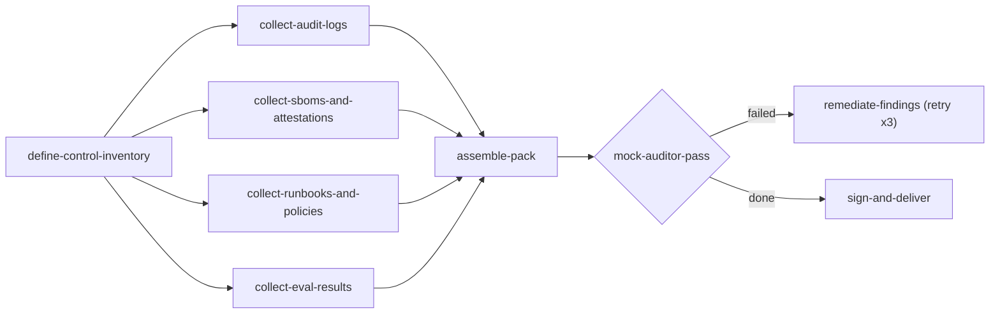

<div align="center">

<picture>
  <source media="(prefers-color-scheme: dark)" srcset="https://raw.githubusercontent.com/sipyourdrink-ltd/bernstein/main/docs/assets/readme-banner-dark.webp">
  
</picture>

<br>

> *"To achieve great things, two things are needed: a plan and not quite enough time."* - [attributed to](https://quoteinvestigator.com/2020/08/19/plan-time/) Leonard Bernstein

### 面向 AI 智能体的开源治理层
<!-- l10n: en="an open-source governance layer for AI agents" hash="sha256:f988e1e29b9e" -->

[](https://github.com/sipyourdrink-ltd/bernstein/actions/workflows/ci.yml)
[](https://pypi.org/project/bernstein/)
[](https://python.org)
[](https://github.com/sipyourdrink-ltd/bernstein/blob/main/LICENSE)
[](https://scorecard.dev/viewer/?uri=github.com/sipyourdrink-ltd/bernstein)


[website](https://bernstein.run) &middot; [docs](https://docs.bernstein.run/) &middot; [deepwiki](https://deepwiki.com/sipyourdrink-ltd/bernstein) &middot; [install](https://docs.bernstein.run/en/latest/getting-started/install/) &middot; [first run](https://github.com/sipyourdrink-ltd/bernstein/blob/main/docs/getting-started/first-run.md) &middot; [plugins](https://github.com/sipyourdrink-ltd/bernstein-addons) &middot; [org-kit](https://github.com/sipyourdrink-ltd/bernstein-addons/tree/main/plugins/org-kit) &middot; [glossary](https://github.com/sipyourdrink-ltd/bernstein/blob/main/docs/reference/GLOSSARY.md) &middot; [limitations](https://github.com/sipyourdrink-ltd/bernstein/blob/main/docs/reference/KNOWN_LIMITATIONS.md) &middot; [name policy](https://github.com/sipyourdrink-ltd/bernstein/blob/main/TRADEMARKS.md)

[简体中文](https://github.com/sipyourdrink-ltd/bernstein/blob/main/docs/i18n/README.zh-Hans.md) &middot; [繁體中文](https://github.com/sipyourdrink-ltd/bernstein/blob/main/docs/i18n/README.zh-TW.md) &middot; [日本語](https://github.com/sipyourdrink-ltd/bernstein/blob/main/docs/i18n/README.ja.md) &middot; [한국어](https://github.com/sipyourdrink-ltd/bernstein/blob/main/docs/i18n/README.ko.md) &middot; [हिन्दी](https://github.com/sipyourdrink-ltd/bernstein/blob/main/docs/i18n/README.hi.md) &middot; [বাংলা](https://github.com/sipyourdrink-ltd/bernstein/blob/main/docs/i18n/README.bn.md) &middot; [Русский](https://github.com/sipyourdrink-ltd/bernstein/blob/main/docs/i18n/README.ru.md) &middot; [Español](https://github.com/sipyourdrink-ltd/bernstein/blob/main/docs/i18n/README.es.md) &middot; [Português](https://github.com/sipyourdrink-ltd/bernstein/blob/main/docs/i18n/README.pt.md) &middot; [Deutsch](https://github.com/sipyourdrink-ltd/bernstein/blob/main/docs/i18n/README.de.md) &middot; [Français](https://github.com/sipyourdrink-ltd/bernstein/blob/main/docs/i18n/README.fr.md) &middot; [Italiano](https://github.com/sipyourdrink-ltd/bernstein/blob/main/docs/i18n/README.it.md) &middot; [Nederlands](https://github.com/sipyourdrink-ltd/bernstein/blob/main/docs/i18n/README.nl.md) &middot; [Polski](https://github.com/sipyourdrink-ltd/bernstein/blob/main/docs/i18n/README.pl.md) &middot; [Svenska](https://github.com/sipyourdrink-ltd/bernstein/blob/main/docs/i18n/README.sv.md) &middot; [Suomi](https://github.com/sipyourdrink-ltd/bernstein/blob/main/docs/i18n/README.fi.md) &middot; [Українська](https://github.com/sipyourdrink-ltd/bernstein/blob/main/docs/i18n/README.uk.md) &middot; [Türkçe](https://github.com/sipyourdrink-ltd/bernstein/blob/main/docs/i18n/README.tr.md) &middot; [العربية](https://github.com/sipyourdrink-ltd/bernstein/blob/main/docs/i18n/README.ar.md) &middot; [עברית](https://github.com/sipyourdrink-ltd/bernstein/blob/main/docs/i18n/README.he.md) &middot; [Bahasa Indonesia](https://github.com/sipyourdrink-ltd/bernstein/blob/main/docs/i18n/README.id.md) &middot; [Tiếng Việt](https://github.com/sipyourdrink-ltd/bernstein/blob/main/docs/i18n/README.vi.md) &middot; [ไทย](https://github.com/sipyourdrink-ltd/bernstein/blob/main/docs/i18n/README.th.md)

</div>

---

> **状态：beta。** 由单人维护，正在积极开发中。版本号计的是发布次数，而非成熟度——次版本（minor）可能改变接口。凡有依赖请锁定版本；回归问题会被尽快修复，[欢迎提交](https://github.com/sipyourdrink-ltd/bernstein/issues)。

Bernstein 是面向 AI 智能体的开源治理层。它运行在 policy as code 之上:你编写策略——谁可以做什么、什么需要审批、什么必须被记录——Bernstein 据此执行并生成可验证的记录。确定性调度器 - 协调环路中没有模型 - 并行运行智能体,用门禁把关它们的产出,并记录每一步,因此一次运行可以在事后离线验证,仅凭工件本身。CLI 编码智能体开箱即用(Claude Code, Codex, Gemini CLI),同一治理层管辖任何智能体工作负载:交付物可以是 diff、研究报告、数据集,或一份审计证据包。附带 air-gap 安装配置。Apache-2.0。

### 一览
<!-- l10n: en="at a glance" hash="sha256:3c95f239d9cf" -->

五点使它与众不同；其余都是细节。

- **协调循环中没有 LLM。** 调度是纯 Python，因此运行可以端到端复现。重放昨天的计划，得到昨天的任务图。
- **硬件密钥证据.** 离线 PIV 保管证明和 FIDO2 批准验证器共用收据协议，使用固定信任和明确时间。令牌保管不会提升 TRACE 信任级别。 [硬件密钥证据](https://github.com/sipyourdrink-ltd/bernstein/blob/main/docs/operations/hardware-key-evidence.md).
- **事后可核查。** 回放日志记录每一次运行，常驻的血统脊柱记录每个产生血统的步骤；可选的 HMAC 链式审计日志（`BERNSTEIN_AUDIT=1`）增加了可离线验证的收据。不确定性会在精确步骤处以哈希失配的形式浮出水面，而不是一次偶发的重跑。非代码交付物也享受同样待遇：任务可以声明产物契约（报告、数据集、动作日志、运维结果），并以签署的血统收据而非 git 提交来宣告完成。
- **构造上即隔离。** 每个编码任务在合并门禁之后获得自己的 git worktree；产物模式任务在 `.sdd/workspaces/` 下获得工作目录。智能体之间默认不共享可变的工作区；唯一共享的状态是任务积压，并以原子方式认领。更严格的文件系统强制是可选的，来自[沙箱后端](https://github.com/sipyourdrink-ltd/bernstein/blob/main/docs/architecture/sandbox.md)（禁用 worktree 会在共享检出中运行每个任务）。
- **广泛且本地。** 55 个可选择的 CLI 智能体适配器名称，包括通用 `--prompt` 包装器。 基于文件的状态、无 SaaS 跳转、无第三方数据平面。

完整列表见[能力页面](https://github.com/sipyourdrink-ltd/bernstein/blob/main/docs/reference/capabilities.md)；[功能矩阵](https://github.com/sipyourdrink-ltd/bernstein/blob/main/docs/reference/FEATURE_MATRIX.md)是详尽的索引。

任务服务器支持由操作员控制的持久化新任务领取门禁；请参阅[指南](https://github.com/sipyourdrink-ltd/bernstein/blob/main/docs/operations/claim-admission.md).

角色适配器策略支持为未列出的角色设置可选的默认允许列表；请参阅[指南](https://github.com/sipyourdrink-ltd/bernstein/blob/main/docs/operations/role-adapter-policy.md)。

### 一次运行长什么样
<!-- l10n: en="what a run looks like" hash="sha256:8279488abf5a" -->

一个 YAML 文件声明整次运行:阶段、角色、依赖,以及节点在什么条件下才会执行。调度器把它当作纯 Python 执行 - 文件里没有任何提示词,也没有模型决定下一步发生什么。这张图生成一份审计证据包;完整文件在 [`.bernstein/workflows/audit-evidence-pack.yaml`](https://github.com/sipyourdrink-ltd/bernstein/blob/main/.bernstein/workflows/audit-evidence-pack.yaml)。

```yaml
name: audit-evidence-pack
version: "1.0.0"

phases:
  - name: scope
    allowed_roles: [manager, architect]
  - name: collect
  - name: validate
    allowed_roles: [qa, security]
  - name: deliver
    allowed_roles: [security, manager]

nodes:
  define-control-inventory:
    phase: scope
    role: architect

  collect-audit-logs:
    phase: collect
    role: security
    depends_on: [define-control-inventory]

  # three more evidence streams collect in parallel:
  # collect-sboms-and-attestations, collect-runbooks-and-policies,
  # collect-eval-results

  assemble-pack:
    phase: validate
    role: docs
    depends_on:
      - collect-audit-logs
      - collect-sboms-and-attestations
      - collect-runbooks-and-policies
      - collect-eval-results

  mock-auditor-pass:
    phase: validate
    role: qa
    depends_on: [assemble-pack]

  remediate-findings:
    phase: collect
    role: docs
    depends_on:
      - source: mock-auditor-pass
        condition: "status == 'failed'"
    retry:
      max_attempts: 3
      until: "status == 'done'"

  sign-and-deliver:
    phase: deliver
    role: security
    depends_on:
      - source: mock-auditor-pass
        condition: "status == 'done'"
```



每个节点由角色被该阶段允许的智能体认领;无论智能体在任务内做什么,角色围栏和审批门禁始终生效。代码节点在自己的 git worktree 里、合并门禁之后完成。上面这些节点的完成方式不同:[工件契约](https://github.com/sipyourdrink-ltd/bernstein/blob/main/docs/operations/artifacts.md)指明交付物(报告、数据集、扫描、操作日志),节点以签名的 lineage 回执而非提交收尾。同一个调度器、同一份日志、同样的离线验证 - 无论图里装的是代码、研究、运维变更,还是三者混合。面向软件、研究、文档、企业和贡献者工作流的现成图都在 [`.bernstein/scenarios/`](https://github.com/sipyourdrink-ltd/bernstein/tree/main/.bernstein/scenarios)。

重试会保留 `dispatch_tier`；重新打开任务时可以显式选择层级。参见[调度层级契约](https://github.com/sipyourdrink-ltd/bernstein/blob/main/docs/operations/task-tier-classification.md#retry-and-reopen)。

### 30 秒安装
<!-- l10n: en="install in 30 seconds" hash="sha256:b24c255f61fb" -->

```bash
uv tool install bernstein    # or: pipx install bernstein
bernstein demo               # zero-key local run (4 mock tasks); prints project path & run_id
# Inside the printed demo directory, sign and verify your own receipt offline:
openssl genpkey -algorithm ED25519 -out demo.key && openssl pkey -in demo.key -pubout -out demo.pub
bernstein verify run <run_id> --signing-key-path demo.key
bernstein verify receipt .sdd/runs/<run_id>/run-receipt.json --public-key demo.pub
```

请在工作分支上运行任务。Bernstein 会将通过验证的更改合并到当前分支。如果当前是默认分支，它会停止可能合并更改的运行。请在工作分支上检查更改，再创建拉取请求。

pipx、pip、brew、dnf、npm 和 Docker 都涵盖在[安装指南](https://docs.bernstein.run/en/latest/getting-started/install/)中；离线 wheelhouse 有单独的 [air-gap 指南](https://docs.bernstein.run/en/latest/installation/air-gap/)。

[GHCR](https://ghcr.io/sipyourdrink-ltd/bernstein) &middot; [GitHub Codespaces](https://codespaces.new/sipyourdrink-ltd/bernstein?quickstart=1)


上面的录像是真实运行，并且自带证明：录制文件、从那次运行的日志导出的签署运行收据，以及将其钉死的公钥，一起存放在 [`docs/assets/demo-run/`](https://github.com/sipyourdrink-ltd/bernstein/tree/main/docs/assets/demo-run) 中。离线验证你刚看到的运行：

```bash
bernstein verify receipt docs/assets/demo-run/run-receipt.json \
    --public-key docs/assets/demo-run/run-receipt.pub.pem
```

已保存的回执可随时用上述命令重新验证；被篡改的副本无法通过同样的检查。 `scripts/record_demo.sh` 从一次全新的真实运行重新生成录制、收据和密钥；终端里没有任何内容是合成的。

运行中的任务可从任一操作界面观看。两者读取同一个任务 API，因此彼此都不是对方的滞后镜像。

|  |  |
|:---:|:---:|
| `BERNSTEIN_SERVER_URL="<task-server-url>"` `bernstein live` — 终端仪表盘 (远程工作节点) | `<task-server-url>/ui/` — 已运行任务服务器的浏览器仪表盘，需安装 GUI 文件。 `bernstein gui serve` 会在当前工作区启动独立服务器。 |

如果服务器要求身份验证，请为终端设置 `BERNSTEIN_AUTH_TOKEN`，并在浏览器登录界面输入获授权的令牌。 [GUI authentication](https://github.com/sipyourdrink-ltd/bernstein/blob/main/docs/gui/index.md#quickstart).

### 证明一次运行
<!-- l10n: en="prove a run" hash="sha256:d4095258a0e7" -->

这里的确定性是需要你去核查的东西，而不是凭空相信。启用审计运行一次，然后验证记录的内容：

```bash
BERNSTEIN_AUDIT=1 bernstein -g "fix the failing test in tests/test_foo.py"
bernstein replay list                 # run ids recorded on disk
bernstein replay latest --verify      # recompute the journal head, name the first divergent step
bernstein lineage verify <run_id>     # recompute the always-on lineage spine
bernstein audit verify                # HMAC chain + Merkle seal (written because audit was enabled)
bernstein audit diagnose <run_id> --signal gate --sign-key KEY
                                      # name the exact step a failure entered the run, as a signed receipt
bernstein verify run <run_id> --signing-key-path key.pem   # sign one portable run receipt
bernstein verify receipt .sdd/runs/<run_id>/run-receipt.json  # verify it offline: file only
```

日志在每次运行时写入；血统脊柱始终开启，在每个产生血统的步骤上增加一条记录，因此一次很短的运行可能以有效但为空的脊柱结束。`bernstein audit verify` 只有在运行以 `BERNSTEIN_AUDIT=1`、合规预设或 `bernstein run --audit` 启动时才有链可查。`--audit` 旗标属于 `bernstein run`；在上面的 `bernstein -g` 形式中，请设置环境变量。

运行收据在一个 Ed25519 签署主体下绑定日志头部、运行写入脊柱条目时的血统脊柱头部，以及可选的审计链范围，并内嵌公钥。持有该文件与操作者公钥的审查者可以确认其中嵌入的动作与链未被改动：无需 HMAC 密钥，无需活跃的 `.sdd/`，篡改时以退出码 `2` 命名第一个分歧步骤。收据标识的是它所嵌入的那一份日志状态；要证明该状态就是完整收尾的日志，还需要一份独立的头部／条数封印。仅凭文件（不钉 `--public-key`）时，检查只是完整性检查：它证明收据内部自洽，而非谁签署的，结论也会如实说明。详见[确定性回放](https://github.com/sipyourdrink-ltd/bernstein/blob/main/docs/operations/deterministic-replay.md#signed-run-receipt-one-file-offline-verification)。

在网页界面中，打开 **Governance** 并使用 **Verify a receipt** 在服务器上验证运行收据。浏览器会显示仅针对完整性的验证结果和密钥来源。参见 [Governance operator guide](https://github.com/sipyourdrink-ltd/bernstein/blob/main/docs/operations/governance.md#verifying-a-dropped-receipt)。

同样的可核查性也适用于评估数字。`bernstein bench run <suite> --reliability k`（也写作 `bernstein eval --reliability k`）在固定协调下把每个任务运行 `k` 次，然后报告 `pass^k` 下限（所有 `k` 次尝试都必须通过）以及 `pass@1` 上限。该结果封装在一份签署的收据中，`bernstein bench reliability-verify` 可离线重算，因此伪造的下限会验证失败。详情：[pass^k 可靠性下限](https://github.com/sipyourdrink-ltd/bernstein/blob/main/docs/eval/reliability.md)。

使用 `bernstein govern audit --format json` 或 `--format sarif` 输出机器可读的检查结果，使用 `--strict --quiet` 作为 CI 检查门槛。参见 [govern audit](https://github.com/sipyourdrink-ltd/bernstein/blob/main/docs/operations/governance.md#govern-audit-machine-readable-output-and-ci-gates). `cosai` 证据包包含固定版本的 2026-01-08 文档中的 MCP 威胁类别，并说明尚未覆盖的范围。

`bernstein delegation verify RUN` 将回执链与运行清单中使用审计密钥的 HMAC 封存的最终链头和跳数进行比较，从而检测尾部删除、替换和关闭后的链增长，包括在没有密钥的情况下改写声明。删除声明会使运行处于未完成状态（退出码 `3`），绝不会被判定为有效。这无法检测重放较早的真实快照，也无法防范持有审计密钥的写入者。参见[委托验证流程](https://github.com/sipyourdrink-ltd/bernstein/blob/main/docs/operations/delegation-verify.md)。

### 工作原理
<!-- l10n: en="how it works" hash="sha256:b734c935f998" -->

每个目标经历四个阶段：

1. **分解（Decompose）**。管理者把你的目标分解为带角色、归属文件和完成信号的任务。一次 LLM 调用，然后全是纯 Python。
2. **孵化（Spawn）**。智能体在隔离的 [git worktrees](https://git-scm.com/docs/git-worktree) 中启动，每个编码任务一个；产物模式任务获得普通工作目录。主分支保持干净。
3. **验证（Verify）**。janitor 检查具体信号：测试通过、文件存在、lint 干净、类型正确。
4. **合并（Merge）**。验证过的工作落入 main。失败的任务被重试或路由到不同模型。

调度器为什么是纯 Python，以及这换来什么代价：[为什么确定性](https://github.com/sipyourdrink-ltd/bernstein/blob/main/docs/architecture/WHY_DETERMINISTIC.md)。

如果更正后的累计支出达到或超过配置的预算停止阈值，即使没有报告新增的词元，费用跟踪器的 `can_spawn()` 检查也会返回 `False`。重启后，仅凭保存的词元计数无法还原此前针对特定智能体、任务和模型组合报告的确切累计费用。

### 日常命令
<!-- l10n: en="everyday commands" hash="sha256:db85124a3e75" -->

```bash
cd your-project
bernstein init                    # creates .sdd/ workspace, bernstein.yaml + templates/
bernstein -g "Add rate limiting"  # agents spawn, work in parallel, verify, exit
bernstein live                    # watch progress in the TUI dashboard
bernstein run plan.yaml           # multi-stage plan: skip LLM planning, execute directly
bernstein stop                    # graceful shutdown with drain
```

在与终端分离的 SSH 运行中，如果某个任务以非零退出码结束，该任务和整次运行都会失败。任务回执会记录退出码，后续任务保持待处理状态。

完整的操作界面（PR 自动化、定时任务、聊天桥接、autofix 守护进程）见[操作命令](https://github.com/sipyourdrink-ltd/bernstein/blob/main/docs/operations/commands.md)。

`bernstein workflow` 运行智能体/命令/循环节点的声明式 YAML DAG——支持恢复中断的运行：

```bash
bernstein workflow run idea-to-pr -g "Add JWT auth"   # prints run_id
bernstein workflow resume <run_id> -g "Add JWT auth" # picks up at the first non-completed node
```

每个节点上的运行状态都会作为检查点写入 `.sdd/runs/<run_id>/`。恢复在运行起始时校验清单摘要，因此规格变更会被拒绝，而不是静默地按另一份清单执行。见[工作流清单](https://github.com/sipyourdrink-ltd/bernstein/blob/main/docs/operations/workflows.md)。 恢复时请再次传入相同的 `-g` 值，以替换未完成节点提示词中的 `{goal}`。

`bernstein compliance controls` 列出各控制项的基准测试套件，并在有完整测量结果时显示最近一次结果。 [基准测试覆盖范围](https://github.com/sipyourdrink-ltd/bernstein/blob/main/docs/compliance/regulator-mapped-packs.md#cli-inspection)

仓库卫生门禁：`bernstein readme-l10n verify` 会让翻译版 README 偏离英文源的 PR 失败（并指出过期的章节），`bernstein readme-l10n sync` 在英文修改后重新绑定它们。见 [readme-l10n](https://github.com/sipyourdrink-ltd/bernstein/blob/main/docs/playbooks/readme-l10n.md)。

### 支持的智能体
<!-- l10n: en="supported agents" hash="sha256:d674cd57d15a" -->

Claude Code、Codex CLI、Gemini CLI、GitHub Copilot CLI、Cursor、Aider、Goose、Muse Code、OpenAI Agents SDK、Amp、Cody、Continue、Devin Terminal、Junie、Kilo、Kiro、AWS Q Developer、Ollama、OpenCode、OpenHands、Open Interpreter、gptme、Plandex、AIChat、Letta Code、Qwen 等等。[适配器索引](https://github.com/sipyourdrink-ltd/bernstein/blob/main/docs/adapters/index.md)为其中 30 个提供安装命令。`bernstein integrations list` 从 `src/bernstein/adapters/registry.py` 中的注册表枚举全部 57 个已接线集成，该文件是"什么能解析"的唯一事实来源。其中 55 个是可选择的智能体适配器，另外两行是 `mock` 测试桩和 `self-hosted-endpoints` 端点配置。任何带 `--prompt` 旗标的其他工具都可以通过通用包装器工作。 `bernstein adapters list` → `Selectable CLI agent adapter names: 55` (`generic`; `agy` = `antigravity`).

在同一运行中混用智能体：用便宜的本地模型处理样板，用更重的云模型处理架构。`bernstein integrations list --installed` 显示你的机器上可用的内容。

### 首页之外
<!-- l10n: en="beyond the front page" hash="sha256:63d7eefff374" -->

所有深入内容都在[文档站点](https://docs.bernstein.run/)上：

| 页面 | 内容 |
|---|---|
| [capabilities](https://github.com/sipyourdrink-ltd/bernstein/blob/main/docs/reference/capabilities.md) | 完整能力列表：MCP 服务器模式、签署的智能体卡片、沙箱后端、产物存储、监管映射 |
| [Agent Manifest export](https://github.com/sipyourdrink-ltd/bernstein/blob/main/docs/operations/agent-manifest.md) | `bernstein manifest export-agent` · `composition-only` · `agent-manifest==0.12.0` |
| [`bernstein_create_task`](https://github.com/sipyourdrink-ltd/bernstein/blob/main/docs/operations/bare-tasks.md) | `POST /api/v1/tasks` → `bernstein_claim` → `bernstein_complete` |
| [who this is for](https://github.com/sipyourdrink-ltd/bernstein/blob/main/docs/use-cases.md) | 价值落在哪里，以及 Bernstein 何时是错误工具 |
| [workflows](https://github.com/sipyourdrink-ltd/bernstein/blob/main/docs/operations/workflow-manifests.md) | 智能体/命令/循环节点的声明式 YAML DAG |
| [web UI](https://github.com/sipyourdrink-ltd/bernstein/blob/main/docs/gui/index.md) | 与 TUI 使用同一 API 的浏览器仪表盘 (创建和查看任务) |
| [集群工作节点健康状态](https://github.com/sipyourdrink-ltd/bernstein/blob/main/docs/operations/cluster-mode.md#worker-health-telemetry) (`bernstein worker`) | 当可用磁盘空间、内存使用率或网络延迟超出设定范围时，工作节点暂停领取新任务。 |
| [datasources](https://github.com/sipyourdrink-ltd/bernstein/blob/main/docs/operations/datasources.md) | 只读查询收据，外加把每个结果绑定到其推导时所依据的 schema 快照的查询驱动 |
| [智能体目录](https://github.com/sipyourdrink-ltd/bernstein/blob/main/docs/operations/agent-catalogs.md) | 让角色指向内置模板之外的智能体定义：通用的 YAML/SKILL.md 目录，或 Claude Code 插件布局的目录树 |
| [security](https://github.com/sipyourdrink-ltd/bernstein/blob/main/docs/operations/security.md) | scorecard、模糊测试、加固 |
| [architecture](https://github.com/sipyourdrink-ltd/bernstein/blob/main/docs/architecture/ARCHITECTURE.md) | 底层工作原理 |

### 为什么叫这个名字？
<!-- l10n: en="why the name?" hash="sha256:e9839a1c718d" -->

Bernstein 得名于美国指挥家、作曲家 Leonard Bernstein。这个项目的编排器像 Bernstein 指挥纽约爱乐乐团那样治理一支 AI 智能体队伍：每个乐手准时到位，乐谱确定，指挥对结果负责。指挥家的比喻描述了 Bernstein 对生成代码、研究报告或数据集的智能体任务进行编排的能力。

Bernstein 最初是一个确定性编排层，用于解决并行编码代理导致的非确定性合并和未验证状态问题。Apache-2.0。版本与文档：[bernstein.run](https://bernstein.run)。

### 贡献、支持与许可
<!-- l10n: en="contributing, support, license" hash="sha256:cb937af4a6cc" -->

欢迎 PR；[CONTRIBUTING.md](https://github.com/sipyourdrink-ltd/bernstein/blob/main/CONTRIBUTING.md) 有环境搭建和代码风格。安全报告通过 [SECURITY.md](https://github.com/sipyourdrink-ltd/bernstein/blob/main/SECURITY.md) 提交。联系：[forte@bernstein.run](mailto:forte@bernstein.run)。

引用元数据位于 [CITATION.cff](https://github.com/sipyourdrink-ltd/bernstein/blob/main/CITATION.cff)。许可：[Apache-2.0](https://github.com/sipyourdrink-ltd/bernstein/blob/main/LICENSE)；项目名在 [TRADEMARKS.md](https://github.com/sipyourdrink-ltd/bernstein/blob/main/TRADEMARKS.md) 中单独说明。

---

[Alex Chernysh](https://alexchernysh.com) &middot; [GitHub](https://github.com/chernistry) &middot; [X](https://x.com/alex_chernysh) &middot; [bernstein.run](https://bernstein.run) &middot; [task notifications](https://github.com/sipyourdrink-ltd/bernstein/blob/main/docs/operations/notifications.md#role-task-subscriptions-sse)

<!-- mcp-name: io.github.sipyourdrink-ltd/bernstein -->
